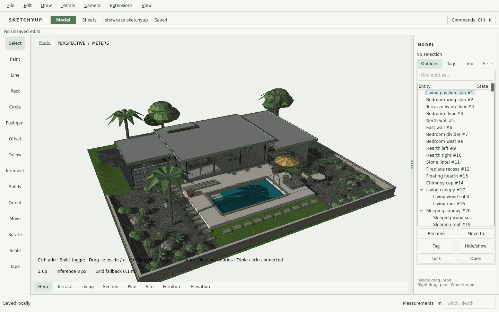
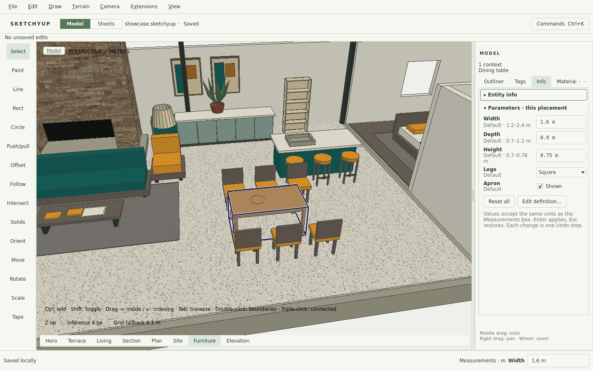
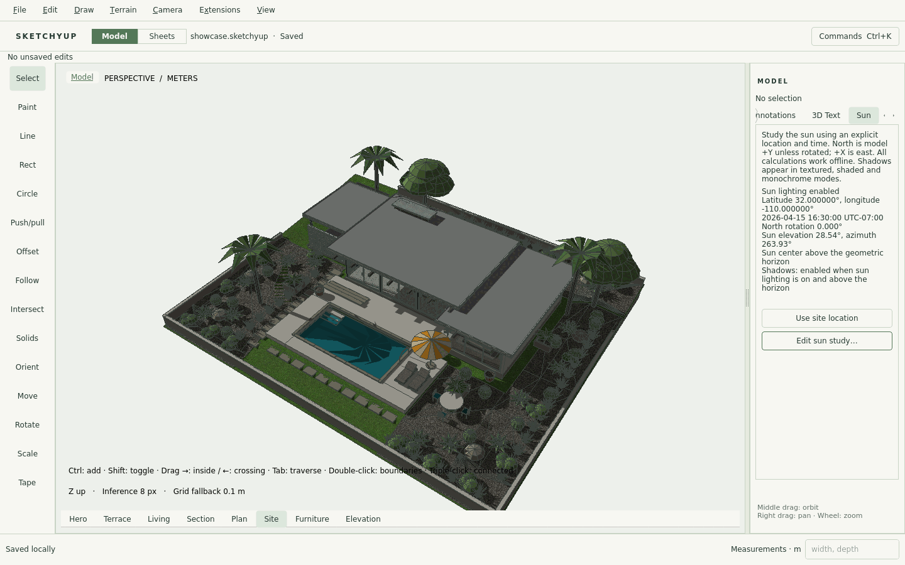
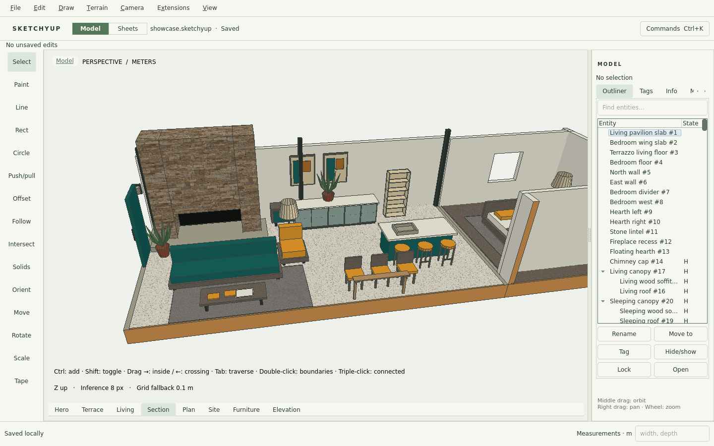
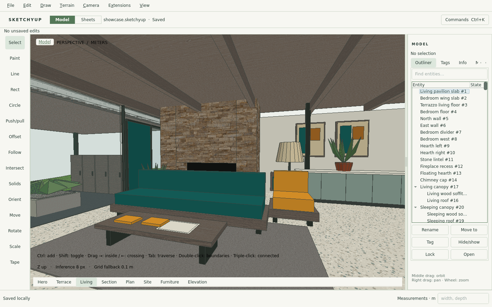

<p align="center">
  
</p>

<h1 align="center">SketchyUp</h1>

<p align="center">
  A native 3D modeler for Linux. Draw, push/pull, document and exchange models,<br>
  with no account, browser or network needed.
  <br><br>
  <a href="https://github.com/zygote55/sketchyup/releases/latest">Download</a> ·
  <a href="docs/USER_GUIDE.md">User guide</a> ·
  <a href="docs/RELEASE_NOTES.md">Release notes</a> ·
  <a href="docs/SUPPORT_MATRIX.md">Support matrix</a> ·
  <a href="CONTRIBUTING.md">Contributing</a>
</p>

<p align="center">
  <a href="https://github.com/zygote55/sketchyup/actions/workflows/native.yml?query=branch%3Amain+event%3Apush"></a>
  <a href="https://github.com/zygote55/sketchyup/releases/latest"></a>
  <a href="LICENSE"></a>
</p>

<picture>
  <source media="(prefers-color-scheme: dark)" srcset="docs/images/hero-dark.png">
  
</picture>

## What it does

- **Direct modeling.** Draw lines, rectangles, circles, arcs, polygons and freehand strokes on any face or plane, then push/pull, offset, sweep, intersect, move, rotate and scale, typing exact values as you go. Inference snaps to endpoints, midpoints, edges and axes. Faces keep their holes, curves keep their parameters, and every edit can be undone.
- **Groups and components.** Nest groups and share components, so that editing one copy edits them all. Configurable components carry parameters and formulas. The library includes a cabinet, bookshelf, window, table, door and stair.
- **Documentation sheets.** Lay out plan, section and perspective views on pages with dimensions and labels, then print or export them to PDF.
- **Terrain and site.** Build terrain from edges or a downloaded GeoTIFF elevation file. Sculpt it, stamp level pads into it and drape edges onto it. Place a georeferenced orthophoto, set geographic coordinates, and study sun and shadow.
- **Exchange.** Native `.sketchyup` files are checksummed and keep a backup of the previous save, and automatic recovery copies protect unsaved work. SketchyUp imports and exports GLB/glTF, OBJ, STL and 2D DXF, and imports `.skp` files. IFC and STEP come with the optional `sketchyup-ifc` package. The `.skp`, IFC and STEP importers run in sandboxed helper processes.
- **Presentation.** Saved scenes, section planes, model styles, quantities and schedules, batch presentations, and optional rendering through Blender 5.2.
- **Automation.** `sketchyup-cli` runs the same modeling commands without a display: scripts, persistent sessions and a local MCP server. An optional assistant, using OpenAI or an experimental local model, proposes edits that you preview before applying them.

| | |
| :---: | :---: |
| <br>**Configurable components** | <br>**Documentation sheets** |
| <br>**Terrain, sun and shadow** | <br>**Section perspective** |
| <br>**Interior modeling** | <br>**Optional rendering with Blender** |

## Install

SketchyUp is packaged for Arch Linux on x86_64. Download the package and its checksums from the [latest release](https://github.com/zygote55/sketchyup/releases/latest), check them, and install:

```sh
v=1.8.0
gh release download "v$v" -R zygote55/sketchyup -p "sketchyup-$v-1-x86_64.pkg.tar.zst" -p SHA256SUMS
sha256sum -c SHA256SUMS --ignore-missing
sudo pacman -U "sketchyup-$v-1-x86_64.pkg.tar.zst"
```

For IFC and STEP exchange, also install `sketchyup-ifc-$v-1-x86_64.pkg.tar.zst` from the same release. Start SketchyUp from your launcher or run `sketchyup`; `sketchyup --demo` opens an example courtyard. The [release notes](docs/RELEASE_NOTES.md) cover upgrading and rolling back.

SketchyUp needs Qt 6.8 or later, OpenGL 3.3, and a Wayland or X11 session. On other distributions, build it from source.

## Build from source

```sh
cmake --preset dev
cmake --build --preset dev --parallel 2
./build/dev/sketchyup --demo
```

This needs CMake 3.25+, Ninja, a C++20 compiler, Qt 6.8+ (base and Wayland), OpenSSL 3 and Python 3. On Arch: `cmake ninja gcc pkgconf python qt6-base qt6-wayland wayland openssl`. [CONTRIBUTING.md](CONTRIBUTING.md) covers the tests, the core-only headless build and the package.

## Documentation

| | |
| --- | --- |
| [User guide](docs/USER_GUIDE.md) | Task-by-task instructions. The app also opens it in its built-in guide viewer. |
| [Feature reference](docs/FEATURES.md) | Tools and shortcuts, saving and recovery, the assistant and rendering. |
| [Command-line reference](docs/COMMAND_LINE.md) | `sketchyup-cli`: scripts, sessions, MCP and file exchange. |
| [Tool reference](docs/TOOL_REFERENCE.md) and [modeling agent guide](docs/AI_MODELING.md) | The scripting and MCP API. |
| [Support matrix](docs/SUPPORT_MATRIX.md) | What is supported and tested, and the limits. |
| [Release notes](docs/RELEASE_NOTES.md) and [changelog](CHANGELOG.md) | What changed in each release. |
| [All documentation](docs/README.md) | Every document, including design records and verification. |

## Status

**[SketchyUp 1.8.0](https://github.com/zygote55/sketchyup/releases/tag/v1.8.0) is the current release.** It covers the 1.0 core scope plus documentation sheets, configurable components, terrain and site tools, IFC and STEP exchange, `.skp` import and geographic data. It is not a full replacement for SketchUp; the [support matrix](docs/SUPPORT_MATRIX.md) says what is and is not covered. Work follows the [roadmap](docs/PR_ROADMAP.md), and every release has a verification record in [`docs/verification`](docs/verification/).

## License

SketchyUp's own code is MIT licensed; see [LICENSE](LICENSE). Bundled third-party code keeps its own license, and the `THIRD_PARTY_NOTICES` file in each release lists them all.

SketchyUp is an independent project. It is not affiliated with SketchUp or Trimble.
