# SketchyUp UX design

Status: proposed design, not an implemented interface. Updated: 2026-10-22.

This document designs the user experience for the native editor described in
the [build plan](BUILD_PLAN.md). It covers the window, tools, numeric entry,
inference feedback, organization panels, the AI assistant, Blender rendering,
document safety and accessibility. Scope IDs refer to the
[scope matrix](SCOPE.md); AI behavior follows the
[AI modeling contract](AI_MODELING.md). Shortcut letters, panel names and visual
tokens here are defaults to validate in the M0/M1 spikes, not frozen decisions.
The [PR roadmap](PR_ROADMAP.md) sequences implementation and records clarifications
C1–C6 for recovery, commit reconciliation, component scope, numeric re-entry,
responsive layouts and command discovery. The supplied screenshots remain
original design references, not evidence of implemented behavior; their simplified
status copy must follow the verified states specified below.

## 1. Design principles

1. **The viewport is the product.** Chrome stays thin and docked. Nothing floats
   over the model except feedback about the operation in progress.
2. **Draw first, type to be exact.** Every tool works by click–move–click, and
   every tool accepts typed values at any moment without clicking a field.
3. **One model, two hands.** A human and the assistant edit the same document
   through the same commands. An AI edit looks, undoes and saves like any other
   edit; it is never a separate mode with separate rules.
4. **Nothing happens silently.** Rejected geometry, lossy imports, stale AI
   plans, failed saves and failed renders all say what happened and what was
   preserved. Preview geometry never looks like committed geometry.
5. **Optional things fail alone.** With no provider, no network and no Blender,
   the interface has no dead ends, nag screens or broken panels.
6. **Keyboard-complete, tiling-friendly.** The primary desktop is Hyprland:
   the window can be any size or shape, has no title bar, and its user expects
   to reach everything from the keyboard.

## 2. Platform constraints that shape the design

| Constraint (Omarchy / Hyprland / Wayland) | Design consequence |
| --- | --- |
| Tiled windows of arbitrary size, often half a screen | Single window with docked, collapsible regions and defined breakpoints (section 3.3); no floating palettes or satellite windows |
| No server-side title bar | Document name, save state and edit context are shown inside the window |
| `Super` belongs to the compositor | No default shortcut uses `Super`; app shortcuts use plain keys, `Ctrl`, `Shift`, `Alt` |
| No global menu | In-window menu bar; collapses to one menu button when narrow |
| Trackpads without a middle button | Orbit/pan available as tools (`O`, `H`) and as modifier drags, not only middle-drag |
| Fractional and mixed-DPI scaling (N04) | Vector icons, overlay markers sized in logical pixels, hit targets independent of zoom |
| File access through portals | Native Open/Save dialogs only; no custom file browser |
| User-controlled theme | Follow the system light/dark preference; never edit Omarchy or compositor configuration |

## 3. Window anatomy

### 3.1 Regions

```text
┌────────────────────────────────────────────────────────────────────────────┐
│ File Edit View Camera Draw Tools Window Help      room ● Edited   ⌕ Ctrl+K │ 1
├────┬───────────────────────────────────────────────────┬───────────────────┤
│ ▸  │ Model › House › Window #2          3D Top Front ⛶ │ Tray │ Assistant  │
│ ╱  │                                                   ├───────────────────┤
│ ▭  │                                                   │ ▾ Entity info     │
│ ◯  │                                                   │   Window #2       │
│ ⌒  │                                                   │   Component (2)   │
│ ── │                    VIEWPORT                       │ ▾ Outliner        │
│ ⇕  │                                                   │   ▸ House         │
│ ✥  │                                                   │     ▸ Walls       │
│ ⟳  │                                                   │ ▸ Materials       │
│ ⤢  │                                                   │ ▸ Tags            │
│ ── │                                                   │ ▸ History         │
│ ✎  │ ┌ Scene 1 ┬ Scene 2 ┬ + ┐                         │                   │
├────┴───────────────────────────────────────────────────┴───────────────────┤
│ Line │ Click next point · Shift locks · Esc cancels  │ ⟳ Render 42% │ Length [ 3.5 m ] │ 5
└────────────────────────────────────────────────────────────────────────────┘
  2                         3                                    4
```

1. **Top bar.** Menu bar, document name with save state, command palette entry.
   Every command lives in the menus with its shortcut shown; the menu bar is
   the discoverable, screen-reader-friendly index of the application.
2. **Tool rail.** One column of tools grouped Select / Draw / Modify / Measure /
   Camera. Tooltips show name, shortcut and a one-line description. Related
   tools (arc variants, rectangle variants) share a slot with a flyout.
3. **Viewport.** Overlays are limited to: edit-context breadcrumb (top left),
   view controls (top right), scene tabs (bottom left, from M7), and transient
   operation feedback. A removable scale figure stands at the origin in new
   documents so the first shape has a sense of size.
4. **Side panel.** Two tabs. **Tray** stacks collapsible sections: Entity info,
   Outliner, Materials, Tags, History, and later Styles, Scenes, Shadows,
   Components and Diagnostics. **Assistant** holds the AI conversation
   (section 8). On wide windows the Assistant can split into its own column
   so Entity info stays visible during AI edits.
5. **Status bar.** Active tool, a context-sensitive instruction with the
   modifier keys that currently apply, background job chips, and the
   Measurements box. The Measurements box is the last thing ever hidden.

### 3.2 Command palette

`Ctrl+K` opens a palette over the viewport that searches user-facing actions in
the shared command registry (A01), recent documents, scenes and named entities.
The registry marks user-facing actions with labels, enabled contexts and input
forms, so modeling operations share handlers across UI, CLI and assistant.
Internal queries and transaction plumbing need not appear as raw menu entries.
Each action result shows its shortcut, so the palette also teaches the keyboard.

### 3.3 Responsive behavior

| Window width (logical pixels) | Layout |
| --- | --- |
| ≥ 1500 px | Tool rail, viewport, Tray and Assistant as separate columns |
| 1100 ≤ width < 1500 px | Tray and Assistant share one tabbed side panel |
| 800 ≤ width < 1100 px | Side panel collapses to an icon strip and opens as an overlay sheet; menu bar becomes one menu button |
| < 800 px | As 800–1100 px (icon strip, overlay sheet, Menu button); status instruction truncates; Measurements box and job chips remain. The Model tool rail shows one group of tools behind a group button (see Tool rail groups) |

**Resizable sidebar (R094.a).** The side panel and, in the ≥ 1500 px layout,
the Assistant column sit in one splitter with the workspace. Drag the handle on
the sidebar's left edge to resize it; in the column layout a second handle
between Tray and Assistant trades width between them. Double-click a handle, or
use View → Reset sidebar width, to return to the defaults (248 px panel,
340 px tabbed panel with the Assistant, 340 px Assistant column, as before;
capped at 320 / 420 px at large text). View → Widen sidebar (`Ctrl+Alt+]`) and
Narrow sidebar (`Ctrl+Alt+[`) step the edge column by 40 px; both are rebindable.
The handles are named "Resize sidebar" and "Resize between Tray and Assistant"
and reach AT-SPI as vertical split panes. Each handle is 6 px wide (scaled by
text size), filled with the theme's panel hover tone, a step darker than the
Tray, with a centred grip of two 1 px dotted lines about 28 px tall in the muted
text colour (at least 3:1 against the fill in both themes). Hovering or dragging
tints the fill with the accent (25 % over the surface); keyboard focus in the
sidebar does not change it. The pointer is the horizontal split cursor.

- **Bounds:** each column is at least 240 px and at most 720 px, both scaled by
  interface text size. The workspace (viewport or sheet canvas) always keeps
  400 px, unscaled because it is drawing area; that leaves the panel about
  240 px at 800 px with 200 % text. When the window shrinks, the rightmost
  column narrows first, then the panel, and only when the window cannot hold
  the minimum do the columns go below it. The sidebar never overlaps the workspace.
- **Persistence:** widths are per layout (panel alone, tabbed panel with the
  Assistant, Assistant column) in QSettings keys `sidebarTrayWidth`,
  `sidebarTabbedWidth` and `sidebarAssistantWidth`, saved when the user drags or
  steps a width and removed on reset. A missing, corrupt or out-of-range value
  (outside 240–720) uses the default. Window-size clamping never rewrites them, so
  a wider window restores the chosen width. Model and Sheets share the widths.
- **Text size:** widths are stored in logical pixels at 100 % text and scaled by
  the current interface text size, so a text-size change keeps the user's width
  in proportion (then clamps to the bounds).

**Narrow layout (below 1100 px).** The side panel collapses to an icon strip at
the window's right edge and opens as an overlay sheet; the menu bar becomes one
Menu button. Below 800 px the same strip, sheet and button apply.

- **Icon strip:** 46 px wide (the Sheets rail's width) with 36 px square buttons,
  top to bottom Info, Outliner, Materials, Tags, History, Assistant and More panels
  (three dots), as in the narrow mockup. The first five open the Model panel on
  that tab; Assistant opens the Assistant; More panels opens the whole Model panel
  (in Sheets, the Sheets panel) with all its tabs. The icons are original 1.5 px
  line glyphs drawn like the Sheets rail's (an 18 px glyph in a 24 px box, scaled
  with text size): an information circle, an indented three-row list, a 2×2 grid,
  a tag with its hole, a clock at three, a four-point sparkle and three dots. They
  use the muted text colour; the button of the panel open in the sheet is checked,
  with the selected fill and an accent glyph. Hover, checked and focus follow the
  Sheets rail. Each button's accessible name is its tab's name and its tooltip is
  the name plus the bound shortcut when one exists (Ctrl+J for Assistant,
  Ctrl+Shift+T for More panels, and any binding the user gives View → Outliner and
  the other panel commands). No new default shortcuts. The strip is one Tab stop
  with arrow keys (the rail pattern) and an F6 region.
- **Overlay sheet:** a strip button, or its View command or shortcut, opens the
  panel in a sheet over the workspace, anchored to its right edge beside the strip,
  and moves keyboard focus into it. The sheet's width is the remembered tabbed
  side-panel width (`sidebarTabbedWidth`, 340 px by default), clamped to the
  window; its left edge is the R094.a resize handle, and dragging it (or
  Ctrl+Alt+] / Ctrl+Alt+[) updates that setting. Esc, the open panel's button
  again (Ctrl+J and Ctrl+Shift+T toggle the same way), or a click in the workspace
  closes it and returns focus to where it was; the dismissing click does not select
  or draw. The side panel's own tab bar hides in the sheet; the strip chooses the
  page. A sheet opened for one of the six strip panels has that panel's name as its
  heading (in the Tray heading's style, in place of "MODEL") and no Tray tab row;
  only More panels shows the tab row (Ctrl+Tab and Ctrl+Shift+Tab switch tabs), headed
  "Panels". The sheet's edge is named "Resize sidebar" only while the sheet shows,
  so assistive technology finds exactly one such handle at any width. While the sheet is closed it takes no keys, so Measurements typing is
  unaffected. The Assistant opens in this sheet below 1100 px (there is no
  separate Assistant dialog). In Sheets, the Model view tool does not open the
  sheet; More panels shows its New model view panel.
- **Menu button:** one Menu button at the left of the header lists the menu bar's
  menus in order (Page, Insert and Arrange in Sheets). The hidden menu bar's
  mnemonics (Alt+F and so on) open the same menus from the button; every action
  shortcut is unchanged.
- **Breakpoints:** crossing 1100 px moves the side panel between the splitter and
  the sheet without changing its open tab, the selection or the dirty state.
  Widening docks it at the remembered widths; narrowing with focus in the panel
  keeps it open, as the More panels sheet, with focus where it was.

**Tool rail groups (below 800 px, Model workspace).** The rail's actions belong to
five groups: Select (Select, Paint), Draw (Line, Rectangle, Circle), Modify (Push/pull
with its "Create new face when pushing/pulling" toggle, Offset, Follow Me, Intersect,
Solids, Orient, Move, Rotate, Scale), Measure (Tape measure) and Camera (Orbit, Pan);
the group of each is set in one table where the rail is built. Below 800 px the rail's
first item is a group button (the shown group's name, then a 1.5 px down-chevron; a
single control as wide as the rail's buttons) and only the shown group's tools show, in
rail order, with no separators. The button opens a menu of the five groups with a check
mark on the shown one; choosing a group shows its tools and does not change the active
tool. When the active tool changes to a tool on the rail in another group (shortcut,
menu or command search), the rail switches to that group; tools off the rail (Zoom, Look
around, Walk) leave it. The shown group starts as the active tool's group, also each
time the window narrows below 800 px. Add driver, inside a component definition, stays
below the shown group with its separator. The button is the rail's first item in its one
Tab stop and arrow navigation; Enter, Space or Down opens the menu, Esc closes it and
returns focus to the button. Its accessible name is "Tool group", its description the
shown group, and its tooltip "Tool group: Draw"; the menu items are named for the groups.
It uses the rail's text, hover, checked and focus tokens in both themes. From 800 px the
rail is as before (all tools, one separator before Camera, no group button). Crossing
800 px either way keeps the active tool and keyboard focus (focus on a tool that hides
moves to the group button; focus on the group button moves to the active tool).

Validate at 640, 900, 1200 and 1600 logical pixels, including fractional scale.
On the smallest tile collapse job detail before reducing Measurements access.
The supplied narrow illustration is 900 px; add 640 px and split-column wide
references during M0.

`F6` cycles focus between regions. `Ctrl+\` hides all chrome for a
viewport-only view; the Measurements box stays.

### 3.4 Mockup screens

Static illustrations of this design, using the M5 demonstration room. They
are HTML drawings, not application code; regenerate them by opening
`mockups/index.html?screen=<name>` (`draw`, `context`, `assistant`, `render`,
`narrow`).

| Screen | Shows | Sections |
| --- | --- | --- |
|  | Rectangle tool drawing the second window opening: on-face inference, a tape guide at sill height, live dimensions and the Measurements box | 3.1, 4.1–4.4 |
|  | Editing a shared component: breadcrumb, dimmed surroundings and the definition banner with Make unique | 4.6, 5 |
|  | A staged assistant change: hatched preview in the viewport, the change card, context chip and provider line | 8.1–8.4 |
|  | Dark theme. Render result tab with its provenance line, plus the Jobs list with a second render running | 7, 9 |
|  | A 900 px tile: single menu button, side panel collapsed to an icon strip, and the persistent save-failure banner | 3.3, 6.1 |

## 4. Tools and direct manipulation

### 4.1 One interaction grammar for every tool

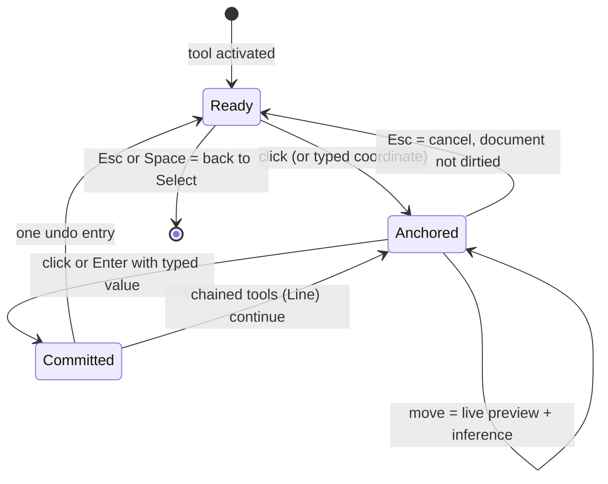

- Click–move–click and press–drag–release are equivalent everywhere.
- `Esc` backs out one step: cancel the operation, then leave the tool, then
  leave the edit context. A canceled operation never dirties the document or
  adds an undo entry (D03).
- The tool stays active after a commit so shapes can be drawn repeatedly.
- Middle-drag orbits and `Shift`+middle-drag pans **without leaving the active
  tool**; an operation in progress survives camera movement (M3 exit
  criterion: no camera/tool input conflict).
- A rejected operation leaves the previous document intact and explains why at
  the cursor and in the status bar, for example "No face created: the outline
  is not planar" (G02).

### 4.2 Default shortcuts

Defaults follow the muscle memory of the reference workflow; all are
configurable (N05). The prototype's `V` remains an alias for Select. Its `F`
(fit) moves to `Shift+Z` so `F` can be Offset.

| Key | Tool | Key | Tool |
| --- | --- | --- | --- |
| `Space` | Select | `M` | Move |
| `L` | Line | `Q` | Rotate |
| `R` | Rectangle | `S` | Scale |
| `C` | Circle | `F` | Offset |
| `A` | Arc | `T` | Tape measure / guides |
| `P` | Push/pull | `E` | Eraser |
| `B` | Paint | `G` | Make component |
| `O` / `H` / `Z` | Orbit / pan / zoom | `Shift+Z` | Zoom to fit |
| `Shift+D` | Add driver (in a component definition, section 14) | | |

| Modifier during an operation | Effect |
| --- | --- |
| `Shift` | Lock the current inference (axis, plane, direction) |
| `→` `←` `↑` | Lock to the red, green, blue axis; press again to release |
| `↓` | Lock parallel/perpendicular to the hovered edge |
| `Ctrl` | Toggle copy in Move/Rotate; toggle "create new face" in Push/pull |
| `Tab` | Cycle between overlapping pick or inference candidates |

The status bar always lists the modifiers that apply to the current step, so
none of this has to be memorized.

Shortcuts have a workspace scope ([ADR 0164](decisions/0164-sheet-layout-interface.md)
§4): **model** keys work only in the Model workspace, **sheets** keys only in
the Sheets workspace (section 13), and **global** keys in both. The same key can
mean one tool in Model and another in Sheets; a global key conflicts with every
scope. The shortcut editor shows each action's workspace.

| Key | Sheets tool or command (scope: sheets) | Key | Sheets tool or command (scope: sheets) |
| --- | --- | --- | --- |
| `Space` | Select | `M` | Move |
| `W` | Model view | `H` | Pan |
| `L` | Line | `Z` | Zoom |
| `R` | Rectangle | `Shift+Z` | Fit page |
| `X` | Text | `U` | Accept view |
| `K` | Label | `Ctrl+Shift+N` | Add page |
| `D` | Dimension | `Ctrl+PgUp` / `Ctrl+PgDn` | Previous / next page |
| `Ctrl+]` | Bring forward | `Ctrl+[` | Send backward |
| `Delete` / `Backspace` | Delete the selected view or item | `Ctrl+Alt+S` | Switch Model and Sheets (global) |

**Keyboard ownership rule:** the viewport owns the keyboard by default. Plain
keys are tool shortcuts and digits go to the Measurements box. Text fields
(entity name, assistant composer) take keys only while focused, and `Esc`
returns focus to the viewport.

### 4.3 Measurements box (G10)

Typing never requires clicking the box. Its label follows the active step:
Length, Dimensions, Radius, Distance, Angle, Sides, Copies.

| Input | Meaning |
| --- | --- |
| `3.5` | Value in document units |
| `350cm`, `12'6"`, `3/4"` | Explicit unit overrides document units for this entry |
| `6,4` | Two dimensions (rectangle); `;` is the separator in comma-decimal locales |
| `[1,2,0]` / `<1,2,0>` | Absolute / relative coordinate for the next point |
| `x5`, `/5` | After a copy: five copies / divide the span into five |
| `24s` | Segment count for the circle or arc being drawn |

- `Enter` applies. Until the next operation starts, typing a new value
  **revises the operation just completed** rather than starting another, only
  while its amend token matches the current content revision and context. Keep
  one undo entry but increment the revision for each successful replacement.
  An intervening human or AI content edit invalidates re-entry; never roll it
  back to revise an earlier operation. A replacement also makes existing AI
  previews stale. Pure camera movement does not change content revision.
- Before `Enter`, the box shows the live measured value of the preview.
- An entry that cannot be parsed or applied keeps the operation active, marks
  the box and states the reason ("Height must be greater than 0").
- Typed coordinates make every drawing tool usable with no pointer at all,
  which is also the keyboard-accessible modeling path (N05).

### 4.4 Inference feedback (G06, G07)

Inference is the feel of the product. Each inference has a marker shape, a
color and a text label near the cursor; shape and label carry the meaning so
color is never the only signal.

| Inference | Marker | Label |
| --- | --- | --- |
| Endpoint | Filled circle | Endpoint |
| Midpoint | Filled triangle | Midpoint |
| Center | Ring with dot | Center |
| On edge | Square on the edge | On edge |
| On face | Diamond on the face | On face |
| Intersection | Cross | Intersection |
| Along axis | Rubber band takes the axis color, drawn thicker | On red / green / blue axis |
| Parallel / perpendicular | Band in the reference color; reference edge highlights | Parallel / Perpendicular to edge |
| From point | Dotted line back to the reference point | From point |
| Locked | Band drawn bold with a lock glyph | Locked: blue axis |

Snapping distance is a fixed number of logical pixels at every zoom and scale
factor. It selects a constraint; it is never used as geometric tolerance.
Hovering a point for a moment "arms" it as a reference for from-point
inference, shown by a small persistent marker.

### 4.5 Selection (G08)

- Hover pre-highlights exactly what a click would select.
- Click selects one entity; double-click a face adds its bounding edges;
  triple-click selects all connected geometry. `Ctrl` adds, `Shift` toggles.
- Drag left-to-right draws a solid box and selects what is fully inside; drag
  right-to-left draws a dashed box and selects anything touched.
- Selected faces get a dot pattern plus outline; selected edges a heavier
  stroke; selected groups and components a bounding box.
- Entity info always summarizes the selection ("3 faces, 5 edges"), and the
  Outliner mirrors it in both directions.

### 4.6 Editing contexts (O01, O02)

Groups and components are the main defense against sticky geometry and the
main source of confusion, so the current context is always visible.

- Double-click or `Enter` opens a group or component; `Esc` or a click outside
  closes one level. The breadcrumb `Model › House › Window #2` is clickable.
- Everything outside the active context dims and cannot be picked or merged.
- Editing a shared component shows a persistent banner in the viewport:
  "Editing a definition used by 2 instances" with a **Make unique** action.
  The same instance-versus-definition question is put explicitly by the
  assistant (section 8.4), in the same words.

## 5. Tray panels

| Panel | Purpose | Notes | Gate |
| --- | --- | --- | --- |
| Entity info | Name, type, tag, material, dimensions, position, area/volume | Editable fields accept the same unit syntax as the Measurements box; volume appears only for valid solids, otherwise "Not a solid" with a link to Diagnostics (O06) | M4 |
| Outliner | Nested hierarchy with search | Rename, hide, lock, drag to re-parent; fully keyboard navigable; this is the accessible view of the model (N05) | M4 |
| Tags | Visibility and folders | Toggling visibility never edits geometry (O04) | M4 |
| Materials | In-model and library swatches | Paint tool samples with `Alt`-click; front/back shown separately (P01) | M4 |
| History | Labeled undo stack | AI entries are marked and carry the request text; click to step back; redo branch disappears on a new edit | M4 |
| Diagnostics | Open edges, non-manifold regions, reversed faces | Each finding selects and frames its entities; repairs are explicit, previewed and undoable (E09) | M6 |
| Styles, Scenes, Shadows | Display modes, saved views, sun | Scenes also appear as tabs in the viewport (P02, P03, P06) | M7 |
| Components | Local library with thumbnails; the bundled configurable assemblies (section 14) | Missing assets shown as such, never silently substituted (O05) | M8 |
| Terrain edits | A selected terrain's ordered changes (section 15.6) | Remove, Edit pad…, Restamp and Reset edits… replay with progress; skipped changes stay listed with their reason | R096 |

## 6. Document lifecycle

### 6.1 Save state is always visible

| State | Top bar shows | Behavior |
| --- | --- | --- |
| Saved | `room` | — |
| Edited | `room ● Edited` | Recovery journal is kept current in the background |
| Saving | `room · Saving…` | Editing continues; save is atomic |
| Failed | `room ⚠ Not saved` (persistent) | Banner with the reason and **Retry** / **Save as…**; never just a toast |

A save failure may also prevent recovery writes. Show the last verified recovery
revision/time separately from in-memory edits; do not promise the newest edits
are safe on disk unless the journal write succeeded. The narrow mockup's recovery
assurance is illustrative and must be replaced with the verified state.

Autosave is recovery data and never overwrites the user's file (D04). Closing
a window with unsaved edits, including a compositor close request, asks
**Save / Discard / Cancel**.

### 6.2 Recovery

After an unclean exit the next launch shows one dialog listing each affected
document: its name, when it was last explicitly saved, and how many edits were
recovered. Choices per document: **Open recovered version** (opens as Edited;
the saved file is untouched), **Open last saved**, **Discard recovery data**.
Missing textures or assets are listed rather than hidden.

### 6.3 First run and new documents

No account, sign-in or tour. First run asks one question — default units
(meters, millimeters, feet and inches) — and opens an empty document. A
start view lists recent documents and recovered work. Templates (D05) replace
the units question at M8. Assistant and Blender setup are offered only when
those features are first opened.

### 6.4 Import, export and reports

One **report sheet** component is reused wherever an operation has an outcome
worth reading: imports and exports (per-feature loss report, X02–X04), Formline
migration (X01), recovery, diagnostics and AI changes. It lists what was
converted, approximated and skipped, with counts and clickable entities.

## 7. Visual system

- **Themes.** Light, Dark, and Follow system. The viewport background belongs
  to the model style, not the theme.
- **Identity.** Carry the prototype's calm warm-gray surfaces and single lime
  accent forward as the starting token set, with a dark counterpart. The
  accent marks the primary action and active tool only.
- **Reserved colors.** Red, green and blue mean the X, Y and Z axes everywhere:
  viewport, inference, coordinate fields. Selection has its own blue-violet.
  Amber means warning or stale; red text means failure.
- **Not-yet-real geometry is hatched.** Tool previews are drawn as thin
  outlines; staged AI changes use a diagonal hatch (section 8.3). Hatch, not
  hue, is what says "this is not in your document".
- **Type and density.** System UI font, tabular numerals for all measurements,
  28 px controls on a 4 px grid, original line icons at 1.5 px stroke.
- **Motion.** Camera transitions between standard views and scenes animate
  briefly; everything else is immediate. Respect reduced-motion preferences.

## 8. AI assistant

### 8.1 Panel anatomy

```text
┌ Assistant ──────────────────────────────────┐
│ ◉ Remote · <provider/model>   What is sent ▾│  provider chip
├─────────────────────────────────────────────┤
│ You: Make the selected window 20 cm wider,  │
│      keeping it centered.                   │
│                                             │
│ ▸ Inspected selection · 6 steps             │  collapsible activity
│   Clear opening is 1.20 m wide.             │
│                                             │
│ ┌ Proposed change ────────── rev 42 ──────┐ │
│ │ Widen Window #2 by 0.20 m               │ │
│ │ Clear width      1.20 m → 1.40 m        │ │
│ │ Center, sill, height        unchanged ✓ │ │
│ │ Window #1 (other instance)  unchanged ✓ │ │
│ │ Made unique: Window #2                  │ │
│ │ Modified 4 faces · created 0 · deleted 0│ │
│ │ [ Apply  Ctrl+Enter ] [ Discard ] Refine│ │
│ └─────────────────────────────────────────┘ │
├─────────────────────────────────────────────┤
│ ⌖ Window #2 · in Model › House         ✕    │  context chips
│ [ Ask or describe a change…            ] ➤  │
│ Preview first ▾                    ■ Stop   │
└─────────────────────────────────────────────┘
```

`Ctrl+J` toggles the panel and focuses the composer. The current selection and
edit context are attached automatically as chips the user can remove; "this",
"the selected window" and "here" resolve to them.

### 8.2 Request lifecycle

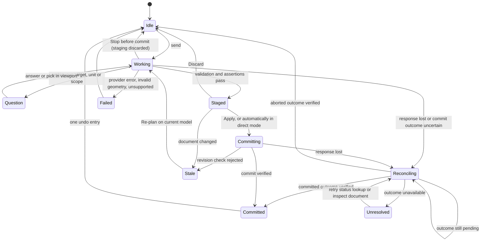

| State | What the user sees |
| --- | --- |
| Working | A plain-language activity list ("Measured clear width: 1.20 m"), not raw tool calls; raw calls are one disclosure away. **Stop** is always available. The model stays fully editable. |
| Question | A card with concrete choices, for example "Width of the clear opening or of the frame?", and **Pick in viewport** when the target is unclear. Never a silent guess on anything that changes the result. |
| Staged | Hatched preview in the viewport plus the change card: before → after measurements, what was verified unchanged, entity counts, warnings. |
| Committed | The card collapses to a summary with **Undo** and the new revision. The History panel gains one labeled entry (A03). |
| Stale | "The model changed while this was prepared. Nothing was applied." with **Re-plan on current model**. Human edits always win; there is no silent rebase. |
| Committing | Applying the validated transaction; the card does not report success until the outcome is verified. |
| Reconciling / unresolved | "Checking whether the change was applied" or "Outcome unknown"; query the request/transaction identity before retrying. Do not claim the document is unchanged. |
| Failed | What failed, the verified transaction outcome, and a supported alternative if one exists. Say this request made no changes only after confirming it did not commit. "Unsupported" is said plainly, never disguised as success. |

### 8.3 Preview in the viewport

Staged changes render in place: added geometry hatched green, removed geometry
hatched red, modified faces outlined amber with before/after dimension labels.
A banner at the top of the viewport reads "Preview — not in your model yet"
with Apply and Discard. The user can orbit, measure and inspect the preview.
Editing the real model during a preview is allowed and turns the card Stale.

### 8.4 Modes and confirmations

The composer has a mode switch: **Preview first** (default) or **Apply
directly**. In direct mode routine requests commit after validation and report
with an Undo button. Regardless of mode the assistant stops to ask before:

- changing a shared definition when the intended scope is ambiguous — "Used 2
  times. Change only this one (make unique) or all 2?". When the user explicitly
  requests only one instance, make it unique and report that without asking again;
- deleting or replacing content beyond what was requested;
- a paid render beyond configured limits, or sending anything outside the
  machine other than the configured provider request.

### 8.5 Trust, privacy and absence

- The provider chip always shows remote versus local and the model in use.
  **What is sent** lists the context of the current request: selection
  summary, hierarchy excerpt, screenshots. The first remote request per
  provider asks once for consent with this list.
- Text inside imported models, names and metadata is displayed as data. If it
  resembles instructions the assistant does not follow it, and says so.
- Keys are entered in Preferences, stored through the OS credential facility
  and never shown in documents, logs or the conversation.
- With no provider configured the panel shows a single setup card and the rest
  of the application is unaffected. A dropped connection triggers transaction
  outcome reconciliation. Say "Nothing was applied" only for a verified
  non-commit; otherwise report the committed result or unresolved outcome.
  Committed work is never rolled back by a timeout.
- A render image is never presented as evidence that a modeling request was
  correct; correctness is reported from measurements.

## 9. Rendering with Blender

- **Start.** `Camera › Render…` or the palette opens a small sheet: camera
  (current view or a scene), preset (Final / Preview from M7), resolution,
  device (Automatic, GPU, CPU). One primary button: **Render**.
- **While running.** The job appears as a chip in the status bar with
  progress. Modeling continues. Clicking the chip opens the Jobs list with
  progress, elapsed time, **Cancel** and logs. Canceling a render never
  touches the document and is not an undo.
- **Result.** Opens in a Render tab beside the model view, with **Save image
  as…**, **Render again** and, from M7, **Open scene in Blender**. Each result
  carries a provenance line: "From revision 42 · model has changed since",
  plus Blender version, preset and device from the manifest (P08).
- **Failure.** The job shows the actual reason and its log. A success state is
  shown only when an image exists.
- **Blender absent.** The Render sheet becomes a setup card: what Blender is
  used for, the detected status, a path chooser and the install hint for the
  platform. No other part of the interface mentions Blender.
- **Handoff (P09).** "Open scene in Blender" states up front that it is one
  way: changes made in Blender do not return to the model.

## 10. Accessibility and preferences (N05)

- Every command is reachable from the menus and the palette; every control
  has a label, a visible focus ring and a tooltip with its shortcut.
  A control filled with the accent colour (a primary button, the checked
  segment of a switch) shows focus as a 2 px inset ring in the surface colour,
  which contrasts with the fill in both themes.
- The viewport cannot be fully screen-reader accessible. The documented
  alternative is the Outliner (structure), Entity info (measurements) and
  typed coordinates (creation), all keyboard operable. The assistant is a
  further non-pointer path to the same commands.
- Color is never the only carrier: inference uses shape and label, previews
  use hatch, states use icon and text. Text contrast meets 4.5:1 in both
  themes; UI text scales independently of display scaling.
- Preferences: units and precision, theme and accent, shortcut editor with
  conflict detection, navigation style (mouse or trackpad), assistant mode and
  provider, Blender path, autosave interval. Preferences persist across
  upgrades.

## 11. Delivery by milestone

The interface grows with the engine; no gate ships controls for capabilities
that do not exist yet.

| Gate | UX delivered |
| --- | --- |
| M0 | Spike validates: overlay markers and hatch rendering in the chosen viewport path, keyboard ownership rule, tiled-window breakpoints, fractional-scale picking |
| M1 | Window shell, menus, command palette from the registry, camera navigation, status bar, save states, themes, native dialogs |
| M2 | Push/pull on real faces with live dimension, rejection messages for invalid geometry |
| M3 | Full tool rail for drawing, inference markers and locks, Measurements box syntax, selection model, standard views, guides |
| M4 | Tray (Entity info, Outliner, Tags, Materials, History), edit-context breadcrumb and definition banner, recovery dialog, Formline import report |
| M5 | Assistant panel with preview/apply and direct modes, provider setup and "What is sent", basic Render sheet, job chip and result tab |
| M6 | Offset, follow-me, intersect and solid tools; Diagnostics panel; placement feedback for hosted components |
| M7 | Styles, Scenes tabs, sections, dimensions and text, shadows, full Jobs list, Blender handoff |
| M8 | Component library, templates, import/export report sheets, extension management |
| M9 | Shortcut editor, accessibility audit against section 10, scaling and multi-display verification, preference migration |
| M10 (R091) | Sheets workspace (section 13): Model \| Sheets switch, page canvas, sheet tool rail, Sheets Tray (Entity info, References, Pages, History), model views with Changed and Broken states, edit-view, lines, rectangles, text, labels, referenced dimensions with Reattach, title blocks, workspace-scoped shortcuts |

## 12. Decisions to confirm

| Decision | Proposed default | Why it matters |
| --- | --- | --- |
| Shortcut scheme | Reference-workflow letters (section 4.2); prototype `F` fit moves to `Shift+Z` | Familiarity is the product objective; the prototype's keys conflict with Offset |
| Assistant default mode | Preview first | Builds trust before speed; one click to switch |
| Assistant placement | Tab beside Tray, own column when wide | Keeps Entity info visible during AI edits without a second window |
| Render result location | In-window tab, not a separate window | Predictable under a tiling compositor |
| Visual identity | Evolve the prototype palette, add dark theme | Continuity; needs an accent check against the reserved axis green |
| Native menu bar versus single menu button | Menu bar when width allows | Discoverability and accessibility versus vertical space |

Validate sections 4 and 8 with the M5 demonstration in the build plan: a
person should be able to complete every step using only what this document
describes, and each failure case in step 8 should land in a state named here.

## 13. Sheets

The Sheets workspace lays out drawing pages from the model's scenes
([ADR 0163](decisions/0163-documentation-sheets.md) records,
[ADR 0164](decisions/0164-sheet-layout-interface.md) interface; R091). Page
editing never changes model geometry: every page operation is one labelled,
undoable sheet-only entry in the model's single history.

### 13.1 Switching workspace

- The header holds a **Model | Sheets** switch: two buttons, also under View
  (Model workspace, Sheets workspace). `Ctrl+Alt+S` switches between them and
  is configurable like any shortcut.
- Switching swaps the tool rail, the central area and the Tray. The model
  viewport is never closed, so returning to Model is instant and keeps the
  camera and selection.
- In Sheets the header's document name reads "house.sketchyup · Sheets •
  Edited", and the Page, Insert and Arrange menus appear.
- F6 regions in Sheets: command search, sheet tool rail, canvas, page tabs,
  Tray (Sheets), Assistant, Measurements.

### 13.2 Layout

```text
┌────────────────────────────────────────────────────────────────────────────┐
│ File Edit View … Page Insert Arrange  [Model|Sheets]  house.sketchyup · Sheets │
├────┬───────────────────────────────────────────────────┬───────────────────┤
│ ▸  │ Sheets › A-101 Ground floor   A3 420×297 · Grid ⛶ │ ▾ Entity info     │
│ ▢  │ ┌─────────────────────────────────────────────┐   │ ▾ References      │
│ ── │ │  ┌ plan ─────────┐  ┌ elevation ── ⟳ Changed│   │   2 views changed │
│ ╱  │ │  │               │  │                 │     │   │   [Accept all]    │
│ ▭  │ │  └───────────────┘  └─────────────────┘     │   │ ▾ Pages           │
│ T  │ │                          ┌ title block ───┐ │   │   A-101 ⟳2        │
│ ↘  │ │                          └────────────────┘ │   │   A-201 ⊗1        │
│ ↔  │ └─────────────────────────────────────────────┘   │ ▸ History         │
│ ── │ ┌ A-101 ┬ A-201 ┬ + Page ┐                         │                   │
├────┴───────────────────────────────────────────────────┴───────────────────┤
│ Dimension │ Click the second point · Esc cancels │ Paper units: mm │ Offset [ 10 ] │
└────────────────────────────────────────────────────────────────────────────┘
```

- **Canvas.** White paper on a pasteboard, the margin frame, an optional
  5 mm grid, and the page's views and items. Wheel and the Zoom and Pan tools
  move the page; `Shift+Z` fits it. Targets and snapping keep their size in
  logical pixels at every zoom and scale factor.
- **Breadcrumb and paper line** above the canvas name the page and its paper,
  with the grid toggle and Fit page.
- **Page tabs** below the canvas switch pages; **+ Page** adds one and copies
  the current page's title block in the same entry.
- **Status bar.** An active-tool label, the instruction, "Paper units: mm" and
  the Measurements box labelled with the current step.

### 13.3 Tools

| Tool | Use |
| --- | --- |
| Select | Click or Tab to select a view or item; drag to move; handles crop a view; arrows nudge 1 mm (`Shift` 10 mm), and consecutive nudges are one "Nudge" entry; Enter opens edit-view on a view or edits text in place |
| Model view (`W`) | The Tray shows **New model view**: this model, its scenes with their projections, the scale (the page's scale by default) and the style. Drag a frame, click–move–click, or type `w,h`; Enter or **Place** uses the natural frame at the pointer. A perspective scene places as "Not to scale" with rendered content |
| Line, Rectangle | Drag or click–move–click; `Shift` gives 45° steps or a square; snaps to the grid, margins and view edges |
| Text | Click (the box fits the words) or drag (the drag sets the wrap width), then type in place; a new item is made only when editing ends with text |
| Label | First click picks the leader's point: a model vertex or edge in a view drawn to scale binds it to that view, anything else is a paper point. Second click places the text |
| Dimension | Pick two model points in one view (vertex preferred within 8 px), then the offset. Values follow the page's dimension format |
| Move, Pan, Zoom | Move picks up and drops; Pan and Zoom move the page view |

Insert › Title block places a title block in the bottom-right corner of the
margin. Its project, drawing title, date and revision are stored; the sheet
number, page "n of N" and scale ("1:50 @ A3", "As indicated", "Not to scale")
fill in automatically. Arrange › Bring forward and Send backward change the
stacking order.

**Snapping.** 8 logical pixels at any zoom, to the paper edges, the margins,
and other views' edges and centres, which draw as alignment guides; the 5 mm
grid applies when shown and nothing nearer does. A hint names the target. `Alt`
held during a drag ignores snapping.

### 13.4 Measurements in Sheets

Bare numbers are paper millimetres; `cm` and `in` suffixes are accepted.
Dimension *values* use the page's dimension format, never the model's units.
Typing right after an operation revises it (amend), as in Model.

| Tool or step | Label | Accepts |
| --- | --- | --- |
| Model view | Size | `w,h` frame size |
| Select, one view | Scale | `1:50` or `50` sets the scale; `w,h` crops |
| Select, items | Move | `<dx,dy>`, `[x,y]` (top-left) or `12pt` (text size) |
| Select, a dimension | Offset | offset in mm |
| Line | Length | a length along the preview, `<dx,dy>` or `[x,y]` |
| Rectangle | Size | `w,h` |
| Move | Distance | `dx,dy` |
| Text, Label | Position | `[x,y]`, or `12pt` for new text |
| Dimension, after two points | Offset | offset in mm |
| Zoom | Zoom | `150%` or a factor |

### 13.5 View states

| State | On the page (screen only, never printed) | Repair |
| --- | --- | --- |
| Current | Nothing | — |
| Changed | Amber "⟳ Changed" chip in the frame corner | **Accept view** (`U`) or **Accept all** (References, Page menu) |
| Broken | Red border, cross-hatch and a card naming the cause, for example "Scene “South elevation” was deleted", with **Choose scene…** | Choose scene… relinks the view, keeping frame and scale |
| Failed | As Broken, with "Could not draw this view" and the detail | — |

"Not to scale" (a perspective scene) is a caption, not a state. Until a view's
evaluation arrives, the page keeps its last drawing and Entity info reads
"Updating…".

**Edit-view.** Enter on a selected orthographic view, or **Edit view** in
Entity info, edits what the frame shows without moving the frame: the wheel
zooms the crop about the pointer, arrows pan 1 mm (`Shift` 10 mm), `+` and `-`
zoom, and a banner offers **Save as new scene…** and **Done**. Each gesture is
one entry; Esc, Done or a click outside leaves. **Show scene in model** applies
the scene's camera in Model without an edit.

### 13.6 Referenced dimensions and Reattach

A dimension measures model geometry through its view: moving geometry, or
changing the view's scale, crop or scene camera, updates the value at once.
Anchors are resolved by entity identity. When an anchored vertex or edge no
longer exists (erasing it, splitting an anchored edge, making a component), the
dimension turns red at its last position, reads "[Missing reference]", and
Entity info offers **Reattach**. Reattach proposes the nearest model vertex or
edge point in the view; Enter accepts it, or a click picks another, and nothing
is committed until then. Labels bound to a view behave the same way.

### 13.7 The Tray in Sheets

| Section | Contents |
| --- | --- |
| Entity info | The selection's editable fields: Model view (title, source, scale, style, crop, status, Edit view, Show scene in model, Choose scene…), each item kind's fields, and Page (dimension unit, decimals, show unit) when nothing is selected |
| References | This model, the count of changed views, and **Accept all** |
| Pages | Pages expanding to their views and items in paint order, with a state glyph (amber ⟳ changed, red ⊗ broken; page rows show counts) |
| History | The shared labelled history |

While Model view is the active tool, the **New model view** panel replaces
these sections.

### 13.8 Accessibility

The canvas is one accessible object named for the page. Its description
announces the selected view or item ("View 1 · Ground floor plan · 1:50 ·
Changed since accepted"), and each view and item is an accessible child. The
**Pages** tree is the full keyboard and screen-reader alternative, as the
Outliner is for the model: arrows choose a row and select it on the canvas, F2
renames a page or view, Alt+Up and Alt+Down move a page or an item's stacking
order, Delete erases, and Enter edits an item's text. State glyphs carry their
words as tooltip and accessible description. Entity info exposes every value as
a labelled field. With typed Measurements, a page can be laid out without a
pointer. Every Sheets control draws the visible focus ring of section 10.

### 13.9 Export and print

**File › Export sheets…** (Sheets, and Model while the model has pages) and
**File › Print…** (Sheets) open one preflight dialog, from the approved R091
design ([ADR 0164](decisions/0164-sheet-layout-interface.md) "R092 export").

```text
┌ Export sheets as PDF ───────────────────────────────────────────────┐
│ house · 4 pages · printed at actual size                             │
├──────────────────────────────────────────────────────────────────────┤
│ Pages   (•) All 4  ( ) Current page  ( ) Range [A-101–A-301]          │
│ File    ~/Projects/house-sheets.pdf                       [Choose…]  │
├──────────────────────────────────────────────────────────────────────┤
│ Checked before publishing                                            │
│ ┏ ⊗ 1 broken view blocks export. A-301, view 3 “Section B-B”: …     ┓ │
│ ┃   [Go to view]  [ ] Export it as an empty, labelled frame         ┃ │
│ ┌ ⟳ 2 views changed since accepted. A-101 view 2 …                  ┐ │
│ │   [Review and accept]  [ ] Export them as they are now (…)        │ │
│ ┌ ⚠ 1 font is not installed. “ISOCPEUR” … Choose another font       ┐ │
│   ✓ 7 views at measured scale: 6 at 1:50 and 1 at 1:20. …            │
│   ▦ 1 view will be raster: “Garden view” (perspective) at 300 dpi.   │
├──────────────────────────────────────────────────────────────────────┤
│ Fix the broken view, or choose to export it empty. [Cancel][Export PDF]│
└──────────────────────────────────────────────────────────────────────┘
```

- **Pages** is one Tab stop; the arrows choose All, Current page or Range, and
  typing a range chooses Range. A range names sheet numbers or page positions
  (`A-101–A-301`, `1, 3–4`); an unknown page marks the field and the footer
  says why.
- **File** shows the new PDF's path; **Choose…** opens the platform's save
  dialog (through the portal). An existing file is never replaced: the footer
  asks for a new name. In Print the row is **Printer**: the printer and paper,
  and **Choose…** opens the system print dialog, whose page range comes back to
  Pages.
- **Checked before publishing** groups the preflight's findings by code, with
  a bold count headline and the engine's sentence. A blocking group has the red
  failure border; changed views and warnings are amber; scales and raster views
  are plain rows. The list checks again whenever an option or the document
  changes, keeps the focused control, and scrolls when the screen is small.
  - **Go to view** and **Review and accept** close the dialog and select the
    first broken or changed view on its page; nothing is accepted for the user
    (**U** accepts).
  - The opt-in check boxes turn the blocking finding into a warning: broken
    views export as empty, labelled frames; changed views export as they are now
    and the export report names them.
  - **Choose another font** selects the first text that uses the missing font
    and focuses its Font field.
  - In Print, a page larger than the paper adds an amber "pages are larger than
    the paper" row: it prints at 100% and is cut off; nothing scales to fit.
- **Footer.** The hint names what to fix; **Export PDF** (or **Print**) is the
  default, accent-filled with the R091.h focus ring, and disabled while
  anything blocks or the check is running. Cancel and Esc close without writing.
- **Export** runs off the UI thread behind the file-operation progress surface
  ("Exporting sheets…"), then shows the **report sheet** (§6.4): the file, the
  page count, the views exported as they are now or as empty frames, raster
  views and font substitutions, and **Show the reconciliation report (JSON)**.
  A failure says what happened; no file is written.
- **Print** paints each page at actual size from the paper's top-left corner,
  one printer page per sheet.
- Focus returns to the page canvas (or, from Model, the viewport) when the
  dialog, the report or a failure message closes.

## 14. Configurable components

Component definitions can carry typed parameters and drivers, and each
placement can keep its own values ([ADR 0165](decisions/0165-constrained-component-parameters.md)
records; [ADR 0166](decisions/0166-configurable-component-interface.md)
interface and its implementation notes; R093, R094). This section describes
what was built. Every change is one labelled, undoable History entry, and
every refusal leaves the model unchanged.

### 14.1 The Info tab's sections

Entity info is a stack of collapsible sections in one scroll area with no
horizontal scroll bar: **Entity info**, then **Parameters · this placement**
when a configurable placement is selected, then **Parameters · definition**
and **Drivers** while a component definition is open. A header shows a muted
count when it has one ("2 overridden") and elides its title in a narrow Tray.

- **Parameters · this placement.** One row per parameter in the definition's
  order: the label and a caption ("Override · default 900 mm", "Default",
  "Derived · *formula*", "From *parent*", and the bounds), then the control: a
  line edit for quantities, a spin box for counts, a check box ("Shown" or
  "Hidden") for booleans, a list for choices. A row is laid out beside its
  label while the label fits next to 16 characters of value, else under it.
  Values accept the Measurements box's syntax in the document's units
  (`1200`, `1.2 m`, `3'11"`). The value is checked as you type; Enter or
  leaving the field commits, Esc restores. An override row has a reset button,
  and Ctrl+Backspace on an unchanged field resets it (while editing it deletes
  a word). **Reset all** and **Edit definition…** close the section. Entries
  read "Change *Label*", "Reset *Label*" and "Reset all parameters".
- **Measurements box.** With the Select tool and one configurable placement
  selected, the box is labelled with the parameter last focused in the section
  (else the first quantity) and shows its value; Enter sets it, and typing
  again amends the same entry. Digits typed in the canvas stay view
  shortcuts: reach the box with F6, Tab or a click.
- **Parameters · definition.** A tree (Name, Type with its bounds, Default or
  "= *formula*") with an inline editor below it and **+ Parameter** in the
  header. The editor has no button: Enter commits and Esc cancels. F2 edits,
  Alt+Up and Alt+Down reorder and Delete removes; a parameter still in use is
  refused with the names of its users. Entries read "Add parameter *Label*",
  "Edit parameter *Label*", "Rename parameter *name*".
- **Drivers.** A tree (Kind, Target, Formula, State) with **+ Driver**. A
  driver whose part was edited by hand reads "⚠ Changed" in the warning
  colour with an in-row Rebind; **Rebind** and **Rebind all** act on Changed
  drivers ("Rebind driver", "Rebind *n* drivers").
- **Formula fields** are checked as you type. An error is a sentence under
  the field, with a caret under the character it names, and a missing unit
  offers a one-click fix ("Use 120 mm").

### 14.2 Definition authoring

- Opening a parametric placement shows the breadcrumb "*Definition*
  (definition)" and the banner in the information colour with **Close
  definition**. A **Preview** strip under the banner holds one field per
  input; changing one draws a dashed, hatched ghost of the regenerated shape
  from a dry run, without changing the model. Esc in the strip is **Back to
  defaults**.
- **Add driver** (`Shift+D`, the Component menu, the palette, **+ Driver**
  and a rail button in a definition) opens the driver form on the selected
  part with focus on Kind. Only the kinds the part accepts are offered. With
  nothing suitable selected, the status bar says what to select.
- **Stretch plane.** A Stretch driver shows its plane as a dashed quad with
  arrows on the points that move. Drag it (it snaps within 8 px to the part's
  vertex coordinates and the midpoints between them; Alt turns snapping off),
  or type its position in the form's Plane at field or the Measurements box.
- Regeneration keeps the open context, the selection and the parts'
  materials.

### 14.3 A placement with its own values

Opening a placement that has values of its own (Enter, double-click, Edit
definition… or Enter in the Outliner) asks first. The dialog "*Placement* has
its own values" names the differing values and offers **Cancel**, **Make
unique and edit** and **Edit definition at defaults** (the focused,
accent-filled default).

- **Edit definition at defaults** suspends the placement's values ("Edit
  *Definition* at defaults") and the banner says they return on close.
  Closing by any route restores them ("Restore *placement* values"); values
  the definition no longer accepts are left out and the status bar names
  them. When nothing was edited, the suspension is undone and no entry
  remains.
- **Make unique and edit** gives the placement its own definition whose
  defaults are its values ("Make *placement* unique"). A nested placement,
  whose values come from its parent, offers only this choice.
- **Refusals** are shown at the control that caused them, in words, with the
  §5 table of ADR 0166 and its actions (**Use 120 mm**, **Show the driver**,
  **Select *placement*** for a locked one). A hand edit that changes a part a
  driver acts on shows an amber strip under the banner naming the drivers,
  with **Rebind** and **Undo**.

### 14.4 The Components tab and assemblies

The Tray's **Components** tab (View → Components) lists the six bundled
assemblies (interior door, casement window, dining table, bookshelf, base
cabinet, straight stair) as cards in two columns. **Show** chooses
Configurable assemblies or All components (adding the user library). The
cards are one Tab stop; arrows move between them and Enter or a click starts
placing. A card reads "Interior door, cuts opening, 4 parameters", and adds
"In this model" once the model has that assembly.

- A **values form** lists the assembly's inputs with their bounds in the
  model's units, checks each value, and stores only values that differ from
  the defaults. **Use defaults** resets it; Esc or **Cancel** ends placement.
- **Placing** is a mode over the Select tool. The status bar says what to
  click ("Placing Interior door · Click a wall face to place · the opening is
  cut in the same step · Esc cancels"). The ghost follows the pointer; a door
  or window snaps upright to the hovered wall face, moving in whole
  millimetres, and draws its opening outline and width. A click places it, or
  Enter on a selected face places it at the face's centre; the Measurements
  box takes `[x,y,z]`, a wall anchor or an inset, and typing again amends the
  placement. Placing is one entry, "Place *Name*", which also cuts the
  opening; a later width change re-cuts it in one entry. An assembly already
  in the model is reused, so all its placements share one definition. After
  placing, the Tray shows Entity info.
- Dynamic Components: attributes read as read-only properties; formulas and
  behaviour are not run. The tab says so.

### 14.5 Accessibility

Every section header, field, reset button, tree, form, strip, dialog button
and card is a Tab stop with an accessible name; a field's description carries
its caption and, first, "Invalid: …" or "Warning: …" while it has a message.
Override, information and warning states have text as well as colour, and the
default button and focused controls draw the focus ring of section 10. The
interface is checked on X11 and Wayland at 1× and 2× and at 200 % text.

## 15. Terrain editing

This section designs the desktop tools for editing a terrain: sculpt, smooth,
contour edit, pad stamp and drape ([ADR 0169](decisions/0169-terrain-editing-drape-stamp.md)
§8 lists the questions it answers; R096.f builds it). Status: approved by the
owner on 2026-10-20. Every change is one labelled, undoable History
entry with a preview first, and every refusal leaves the model unchanged.
The mockups are `mockups/terrain.html` (all screens, with notes) or
`mockups/terrain.html?screen=<name>` (`menu`, `sculpt`, `contours`, `stamp`,
`drape`, `edits`), drawn in the light theme of `src/app/theme.hpp`.

### 15.1 Where the tools live

- **Terrain menu.** A new top-level menu between Draw and Camera. *Tools:*
  Sculpt, Smooth, Edit contours, Stamp pad, Drape. Then, for the selected
  terrain (its name as the heading): Terrain settings…, Regenerate, Reset
  edits…, Explode terrain…. Last, Create terrain from selection. File →
  Import terrain… and Site settings… stay where they are. All of them are in
  command search (Ctrl+K).
- **Rail.** One **Terrain** slot after Tape, in its own group. It shows the
  last terrain tool used ("Sculpt ▸" at first) and starts it. The rail stays
  one slot longer instead of five, and it follows the rail's existing
  responsive rule. Rail buttons are 1 px shorter so the full rail fits a
  1000 px window (R096.f1).
- **Tool options strip.** While a terrain tool is active, a strip across the
  top of the viewport holds a five-way switcher (Sculpt · Smooth · Contours ·
  Pad · Drape) and that tool's options. It is one row where it fits and wraps
  to a second row where it does not. Its fields take the Measurements box's
  syntax and units, and F6 moves focus between the strip and the box.
- **Context menu.** Right-clicking a terrain offers the five tools, Terrain
  settings… and Explode terrain…. With edges or faces selected it also offers
  **Drape onto terrain**.
- **Shortcuts.** Only Sculpt has a default, Shift+S, which is unused in the
  model scope today. The others start with no shortcut and can be assigned in
  the shortcut editor. Inside a terrain tool, `[` and `]` change the brush
  radius by 10 %. These keys have no other model-scope meaning.
- **Outside a terrain.** Each tool follows R095.e1's hover pattern: over
  anything but a terrain the cursor is not-allowed and the status bar names
  what to point at. With no terrain in the model, it says "No terrain in this
  model. Import one with File → Import terrain…".

### 15.2 Sculpt and Smooth

- **Brush.** A ring is drawn on the surface at the pointer: a solid outer ring
  at the radius and a dashed inner ring at half strength. Every vertex that
  will move gets a dot whose size and opacity follow its weight, and a label
  gives the amount, the radius, the vertex count and the tiles touched. A
  brush that catches no vertex draws its ring amber and dashed, with "No
  vertices under the brush · ] enlarges it" (ADR 0169 §4.1, sparse meshes).
- **Stroke.** Press and drag paints a stroke at the strip's Amount. The stroke
  is swept, so each vertex moves once, by its distance to the whole path.
  Release commits it as "Sculpt terrain".
- **One spot (Smoove).** A click without a drag anchors the brush. Moving the
  pointer up or down then sets the amount, and a click or a typed value
  commits it. This is the only terrain gesture where press–drag and
  click–move–click differ, because a drag paints. The status bar says so.
- **Modifiers.** Ctrl lowers. Shift smooths while held, so one Sculpt session
  can raise and then soften. The status bar lists both.
- **Options.** *Scope* Brush or Region; *Radius*; *Falloff* Smooth, Linear or
  Constant; *Amount* (Sculpt) or *Strength* 0.05–1 and *Passes* 1–8 (Smooth).
  The Measurements box is labelled Radius before a stroke and Amount (or
  Strength) after one. After a commit, typing a new amount amends the same
  entry, under §4.3's rules.
- **Region scope.** If a face or a closed edge loop is selected when the tool
  starts, that region is used. Otherwise, click points on the surface as with
  the Line tool and close the polygon on its first point. The falloff band is
  a dashed outline offset by *Falloff width*, typed in the strip or the box.
- **Pads** are protected. Their vertices show no dots, and a stroke over a pad
  skips them.

### 15.3 Edit contours

- **What is shown.** While the tool is active, source contours are drawn solid
  at 1.5 px and display contours fade. Breaklines are dash-dot and spot points
  are small crosses. Hovering a source highlights it and names it ("Contour
  105.00 m · source 17").
- **Selecting and handles.** A click selects a source. It turns
  selection-coloured, with square handles on its vertices and round handles
  at segment midpoints; dragging a round handle inserts a vertex. Tab cycles
  overlapping candidates (§4.2).
- **Editing.** A dragged handle previews the re-triangulated cavity on a
  worker, latest wins (ADR 0169 §4.2), with the changed region outlined. A
  typed number sets the selected source's elevation (the box is labelled
  Elevation). Delete removes the selected vertex and Shift+Delete removes the
  source. *Role* in the strip switches Contour and Breakline.
- **Adding.** **Add contour**, **Add breakline** and **Add spot** draw on the
  surface as the Line tool does. Enter finishes a line. A new contour takes
  its first point's elevation unless one is typed. **Promote** turns the
  display contour under the pointer into a source at its level; this is how
  terrains made from points become editable.
- **Refusals at the pointer.** A drag that would cross another source, leave
  the outline or enter a pad draws the moved run red and dashed, with a red ×
  at the first conflict and a failure label ("Crosses contour 106.00 m ·
  Release to cancel, or move back"). The preview is withdrawn and releasing
  changes nothing. The status bar repeats the reason with the location in site
  coordinates.
- **Contours a drape crossed** (R096.e). An imprinted drape shares its crossing
  points with the contours and breaklines it crossed, so typing a new elevation
  for such a contour is refused at the first crossing, naming the change
  ("This contour is crossed by Drape (change #4); remove that change to
  re-elevate it alone"). Moving or deleting the contour is allowed: the
  crossing points stay where the drape put them, at their surface heights, as
  vertices of the drape's lines.

### 15.4 Stamp pad

- **Footprint.** Start the tool with a face, group, component or closed loop
  selected, or hover one and click. A group or component uses its lowest
  horizontal face, which is highlighted before the click. The strip names the
  footprint.
- **Elevation.** The pad starts at the footprint's height less *Pad offset*
  (default 0 m; a slab build-up such as 0.15 m is typed once and remembered).
  Move the pointer up or down, or type the elevation; Enter or a click stamps
  it. After the stamp, typing a new elevation or slope amends the same entry.
- **Grading.** *Daylight* (the default) has *Cut* and *Fill* slopes as rise:run
  (default 1:2; `0.5` and `26.6°` are also accepted) and *Max distance*
  (100 m). *Fixed width* replaces them with *Width*.
- **Preview.** Cut is tinted brown with a diagonal hatch and fill teal with
  dots; the strip has a legend, so colour is never the only signal. The pad
  is drawn flat and light, the slope rays as thin lines, and the daylight line
  is dashed and labelled. A refusal ("Ray at E …, N … leaves the terrain";
  "Overlaps Pad · Building B") marks the ray or overlap in red, and Enter is
  refused until it changes.
- **Restamp.** A pad row in Terrain edits (15.6) offers **Restamp**, which
  re-reads the footprint from its source body as one entry, "Edit terrain
  change". It is unavailable, with the reason as its tooltip, when the source
  body no longer exists.

### 15.5 Drape

- **Input.** Select edges, curves or faces in any context, above or below the
  terrain, then choose Drape (or **Drape onto terrain** from the context menu)
  and point at the terrain.
- **Preview.** The lines are drawn lying on the surface. With *Paint regions
  with their material* on, a face's region is also drawn in its material.
  Parts outside the terrain are red and dashed and are counted in the strip
  ("1 edge clipped"). A click on the terrain or Enter drapes.
- **Mode.** *Imprint* (the default) leaves the terrain's shape unchanged and
  adds the lines as breaklines. Afterwards the terrain is selected and the new
  row appears in Terrain edits. *Overlay* makes ordinary geometry in a new
  group in the active context, lifted by *Lift* (default 0.01 m, enabled only
  for Overlay), and afterwards the new group is selected.
- **Crossed contours.** An imprint's lines keep the points where they cross
  contours and breaklines. Removing a crossed contour leaves those points at
  their heights, and a crossed contour cannot be re-elevated alone while the
  drape exists (§15.3); removing the drape's change lifts both.

### 15.6 Terrain edits

A **Terrain edits** section follows the Terrain section on the Info tab
whenever a terrain is selected. The header shows the count ("5 changes").

- **Rows.** The list is in the order the changes are applied. A row shows a
  kind glyph, the title ("Pad · Building A"), its key values on a second line
  ("106.00 m · daylight, cut 1:2, fill 1:2") and its ID, muted. A caption
  gives the use ("5 of 4,096 changes").
- **Selection.** Selecting a row outlines its region in the viewport in the
  selection colour, with a label. Double-click or Enter frames it.
- **Actions.**
  - **Remove** (or Delete) removes the selected change and replays the ones
    after it.
  - **Edit pad…** opens a small form with the pad's elevation, grading,
    slopes and offset.
  - **Restamp** is described in 15.4.
  - **Reset edits…** asks first ("Reset 5 changes to Riverside site? The
    terrain is rebuilt from its sources."), and Cancel is the default.
  
  Each action is one undoable entry. A replay shows a job chip in the status
  bar ("Replaying 3 changes · 64 %") with **Cancel**; cancelling leaves the
  model as it was.
- **Skipped changes.** A change that no longer applies after a replay stays in
  the list. It is marked "⚠ Skipped" in the warning colour, with the reason on
  its second line, until it is removed or the replay is undone. It is not
  silently deleted.
- **Notices.** The notices of the last change or replay appear under the list
  in the warning style, each with **Show report**, which opens the R095.c2
  report tree. Examples: "Paint removed from 2 rebuilt tiles (use Drape with
  Paint regions to keep paint)", "3 source contours clipped", "1 change
  skipped".

### 15.7 Accessibility and keyboard

- **Keyboard-only path.** With a terrain tool active, typing a coordinate in
  the Measurements box places the brush, footprint or contour point there.
  Both `[x,y]` in model coordinates and `@E,N` in site coordinates (R095.e2)
  work. Then:
  - Sculpt: type the amount, and Enter commits a one-spot brush at that point.
  - Region scope: type successive points.
  - Contours: with a source selected, Tab moves between its handles, and a
    typed coordinate moves the focused handle.
- **Accessible names.** The strip's fields, the switcher, the Terrain edits
  rows and their buttons are Tab stops with accessible names. A row reads, for
  example, "Change 3 of 5, Pad, Building A, 106.00 metres, daylight, cut 1 to
  2, fill 1 to 2". A skipped row's description starts with "Warning: skipped".
- **Not colour alone.** Cut, fill and preview use hatch and labels as well as
  colour. Refusals use the × marker and text.
- **Checks.** The interface is checked on X11 and Wayland at 1×, 2× and a
  fractional scale, and at 200 % text, as in R096.f's input tests.

| Screen | Shows | Sections |
| --- | --- | --- |
|  | The Terrain menu, the rail's Terrain slot, a selected terrain with its Terrain edits | 15.1, 15.6 |
|  | A stroke in progress: brush rings, moving-vertex dots, hatched preview outline, strip and Amount | 15.2 |
|  | Source contours, handles, and a drag refused at the pointer | 15.3 |
|  | Pad preview with cut and fill tint and hatch, rays and daylight line | 15.4 |
|  | An imprint preview with region paint and a clipped part | 15.5 |
|  | A selected change highlighted, the row actions, a skipped change and the last replay's notices | 15.6 |

## 16. IFC exchange

This section designs the desktop side of IFC import and export: the File menu entries, the import
options, the dirty-document prompt, progress and Cancel, the import report, the refusals, the
"not installed" states and the export dialog and report ([ADR 0171](decisions/0171-ifc-exchange-subset.md)
§4 and §5; decision 15 asks for this design before R097.e). Status: **approved by the owner on 2026-10-23**. The import engine, the helper process and the report (version 1) already exist (R097.b);
this section designs what a person sees of them. Everything here is a plain-text, modal-dialog
design in the style of the DXF and terrain import dialogs and the shared report sheet (§6.4), and
adds no tool, no rail slot and no tray panel. The mockups are `mockups/ifc.html` (all screens, with
notes) or `mockups/ifc.html?screen=<name>` (`menu`, `options`, `dirty`, `progress`, `report`,
`after`, `far`, `size`, `unavailable`, `limited`, `export`, `exported`), drawn in the light theme of
`src/app/theme.hpp`. The import report is shaped like the R097.b helper's output on the
buildingSMART IFC4 Architecture sample (371 entities); its counts, the uncut wall, the notices, the
two alignments and the georeferencing result are illustrative (the fixtures `openings-hard` and the
sample's own 60° map conversion). Notice texts are the report's own words
(`src/io/ifc_import.cpp`).

### 16.1 Where the commands live

- **File menu.** Three entries, each next to its siblings and with no other change to the menu:
  *Import IFC…* after Import GLB/glTF…, *Export IFC…* after Export OBJ package…, and *Show IFC import
  report…*, directly under Import IFC…. The last is enabled while the open model is the result of an
  IFC import in this session, until the model is replaced (New, Open, another import) or closed;
  edits and Save as… do not clear it. The report is not stored in the `.sketchyup` file; Save report…
  keeps it (16.5). Command search (Ctrl+K) lists enabled actions only, so the two main commands are
  always in it and the report command is while it is enabled. None has a default shortcut; the
  shortcut editor can assign one. The rest of the menu keeps its order and separators.
- **No dead entries.** The two main commands are never disabled. Without the optional
  `sketchyup-ifc` package they open the information sheet of 16.7, so the menu does not change with
  the install (principle 5: optional things fail alone).
- **Not designed here.** No rail slot, tool or tray panel. No IFC class picker: a user or script
  sets `ifc.Class` and `ifc.PredefinedType` through entity properties, as ADR 0171 §5 says. No
  assistant or MCP surface (decision 13). Partial import by storey or class, and shifting a far model
  (decision 7), are later rows.

### 16.2 Import IFC: the options dialog

File → Import IFC… opens the system file chooser (filters: *IFC files (*.ifc)* and *All files*, so that a zipped or
XML file can be chosen and refused with an explanation), then this modal
dialog (screen `options`). It has a title, a one-line subline ("Opens the file as a new unsaved
model. The IFC file is never changed."), a settings column and a short "What import does" column,
and a footer with a status line, **Cancel** and **Import** (the default).

- **File.** The chosen file (with **Choose…**), its size against the 128 MiB limit, and the facts the
  application reads from the header without starting the helper: the schema (IFC2X3, IFC4 or
  IFC4X3_ADD2, with "✓ supported"), the writing application and the view definition (a small addition to the application's header check, which returns only the schema today). The helper's
  findings (units, georeferencing, counts) are not guessed here; they arrive in the report.
- **Units.** "Read from the file." One setting: *Only if the file declares none*, a menu whose
  default is **Refuse the import** and whose other values are millimetres, centimetres, metres,
  inches and feet. A file that declares a unit ignores it, and the report says so
  (`lengthUnitOverrideIgnored`). Nothing is converted by assumption.
- **Spaces.** Three radios: **Hidden** (default: the bodies are on the tag *IFC Space*, which starts
  hidden), **Shown**, **Skip**. The caption explains why: spaces are volumes that cover the building
  when shown.
- **Georeferencing.** Two radios. **Keep the file's axes** (default) and **Grid-aligned** (opt in).
  The caption states, in this order, what each does: a plain-shift map conversion sets the site origin
  in both modes; a rotated conversion is recorded and the axes kept unless Grid-aligned is chosen;
  Grid-aligned rotates the model so +X points east and sets the origin, which turns the walls off the
  model axes; a conversion with a scale, map-unit or context mismatch is recorded and not applied in
  either mode; and a model with a site origin opens only in SketchyUp 1.3.0 or later (schema 29,
  ADR 0171 §3.6).
- **Curved surfaces.** *Maximum deviation*, default 1.00 mm, in the Measurements box's units and
  syntax, with the cost stated ("Finer curves make more faces. A body keeps at most 100,000.").
- **The helper line.** "✓ IfcOpenShell 0.9.0 · OpenCASCADE kernel", from a probe run when the dialog
  opens (a new use of the helper's `--probe`); the states in 16.7 change it. It also says the helper runs in its own process with limits,
  up to two minutes, and that Cancel ends it.
- **Cheap refusals.** The application checks, as soon as the file is chosen and in under a second, a
  regular readable file, at most 128 MiB, a STEP header and trailer, one accepted `FILE_SCHEMA`, and
  not `.ifczip`, ifcXML or ifcJSON. A failure appears as a red banner **inside this dialog**
  (screen `size`) that names the file's problem and the limit, greys the settings (they stay visible),
  disables Import and puts focus on **Choose another file…**. The right-hand column becomes "What to
  do next" and lists the limits that are only known after reading.

### 16.3 The dirty-document prompt

An import opens a new unsaved model and replaces the open one (decision 10), so a model with unsaved
edits needs the question the other importers ask: **Save / Discard / Cancel** (screen `dirty`, the
button set of §6.1). It differs from them in when it is asked and in what the text promises.

- **When.** When **Import** is pressed, before the helper starts. The existing importers convert first
  and ask afterwards ("validate before asking to discard"); an IFC import can take minutes, so asking
  afterwards would make people wait and then answer. The file chooser and the options are not held up
  by the prompt.
- **What it says.** "Save "house" before importing? Importing <file> opens it as a new unsaved model
  in this window and replaces "house", which has unsaved changes. "house" stays open and unchanged
  until the import finishes. If the import is refused or cancelled, you keep it as it is."
- **What the buttons do.** **Save** saves first (Save as… for a model with no file), then imports.
  **Discard** means "replace it when the import succeeds". **Cancel** returns to the options.
  Save is the default, as in §6.1.
- **Two phases.** The promise is real only if nothing irreversible happens at the prompt. Today
  `Window::canReplace()` asks and, on success, also clears the recovery journal, closes the assistant
  session and cancels a terrain replay. R097.e splits it into a **confirm** phase (the question, and
  Save) that runs when Import is pressed, and a **commit** phase (those three effects) that runs
  only when the new model is ready. A refusal, a failure or Cancel therefore leaves the old model
  open, still unsaved, with its recovery data and assistant session intact.
- **While the helper runs.** If the assistant has an unreconciled outcome, Import is refused at the
  confirm phase with the existing message ("Reconcile the assistant outcome…"), shown in the options
  dialog. If the old model changes while the helper runs (an assistant edit lands), the commit phase
  asks again before replacing it.
- **No prompt.** A model with no unsaved edits is replaced without one. So is a model that is an
  unedited import (nothing has changed since the import finished: its history revision is the one
  recorded at the end of the import), because its source file still holds everything. This is what
  **Import again…** (16.5) relies on.

### 16.4 Progress and Cancel

A new modal sheet (screen `progress`) replaces the options dialog while the helper works. It is not
the tooltip-style file-operation progress of the other importers, which cannot be cancelled. The
window behind it is inert and the status bar says "Importing <file>…" (the existing "wait for the
current file operation" rule).

- **Steps.** Seven, in plain words: *Check the file*, *Read the file*, *Read units and structure*,
  *Convert geometry*, *Build the model*, *Check that nothing was dropped*, *Create the new model*.
  Each shows a glyph **and** a word: ✓ Done, ● Working, ○ Waiting. They follow the helper's phases
  (`parse`, `units`, `model`, `geometry`, `assemble`, `account`, `write`) and the application's own
  conversion.
- **One bar.** Only the step that has a count draws a determinate bar: *Convert geometry*, with
  "192 of 640 elements". The helper reports the task count (`tasks`) and then its progress in blocks
  of 64 elements, so a small model moves in one jump; R097.e may ask the helper for finer reports.
  There is no estimated time and no animation. Converting a host again after an untrusted cut starts a
  second count, which the sheet shows as a new "Convert geometry" count, not a bar that goes back.
- **Time.** "Elapsed 0:41 · each attempt stops after 2:00." The deadline, memory and CPU limits are
  per helper run (ADR 0171 §6.4), and a restart starts a new run, so a bad file can take up to four
  attempts. Hitting a limit is a refusal (16.6).
- **Cancel.** Always enabled. It is a normal button and **not** the default one, so an Enter
  repeating from pressing Import cannot cancel; Esc and Space cancel. It ends the helper process,
  returns control within 100 ms and leaves the current model untouched; the status bar says "IFC
  import cancelled · Your model is unchanged". No sheet follows a cancel.
- **Restarts.** If the helper stops (a crash, a timeout, memory), it is restarted, and the first runs
  cannot yet know which element is to blame (the application finds it by running again on one thread
  and then diagnosing). An amber line appears when a restart begins: "Restarting. The helper stopped
  and was restarted (restart 1 of 3). The element it stopped on is left out and will be listed in the
  report." It is shown only after a restart. It needs a new callback from the worker run
  (`IfcWorkerOptions` has none today); the report's `restarted` notice and `excluded` list name the
  element afterwards.

### 16.5 The import report

When the import finishes, the **report sheet** opens over the new model (screen `report`): the §6.4
component, laid out like the terrain import dialog, as a left summary column and a right grouped
list. It does not block anything the person needs: Close returns to the new model, and the report can
be opened again (below).

- **Banner.** "✓ Imported. Opened as a new unsaved model. The IFC file was not changed. 2 items need
  your attention and 3 elements were not imported. Save report… keeps this report; it is not stored
  in the model." With none, "Nothing needs your attention".
- **What came in.** Elements, spaces (hidden or shown), groups, bodies, faces (and the source
  triangles they came from), materials, component definitions when there are some.
- **Every entity is accounted for.** The accounting identity (ADR 0171 §4) as a sentence, a
  three-part bar, a legend with numbers and the sum: "21 + 339 + 11 = 371 ✓ balanced". The parts are
  *Became model content*, *Supporting data* (points, placements, profiles, units) and *Left out*
  (listed by class). The bar uses solid, hatched and cross-hatched fills, so it needs no colour. If
  the three ever failed to add up, the line would read "✕ not balanced" with the difference, and the
  report would say the import is not trustworthy; this is a safeguard, not an expected state.
- **How it was read.** Schema, length unit (and that it was exact), curve deviation, geometry kernel,
  spaces, georeferencing mode, helper restarts, library version.
- **The grouped list.** Each group has a header with a word label (**Attention**, **Warning**,
  **Notice**, **Info**), a title and a count; rows expand with the arrow keys. Only **Needs your
  attention** counts toward "need your attention" and the status-bar chip; **Not imported** is a
  warning about what is missing, counted in the banner on its own. Groups, in this order:
  - **Needs your attention.** Things the person may want to act on.
    - *Uncut hosts.* "1 wall imported uncut: its opening is hidden". Names the wall, class, STEP
      number and GlobalId, says why in words (the cut was not trusted because the surface is open;
      the library failed; the host has more than 100 openings), says the opening is on the hidden
      tag *IFC Opening*, and offers **Select wall and opening**. This is ADR 0171 decision 5.
    - *Georeferencing.* One row, whose title depends on the result (below), with the map conversion
      in numbers (E, N, height, rotation, scale, CRS), where it was recorded
      (`ifc.mapConversion.*`), and, when the opt-in mode could resolve it, **Import again,
      grid-aligned…**.
  - **Not imported.** The unsupported entities: elements by class and reason ("IfcChimney × 1: no
    representation", "IfcAlignment × 2: infrastructure, not interpreted") with STEP numbers, up to 32
    per kind (the report's bound; the counts are complete). Also elements left out by a restart, and
    by a document limit with the limit named.
  - **Notices.** The report's notices, in the report's own words, with their counts ("Elements that
    no spatial container holds were placed under the project. × 1").
  - **Collapsed details.** *Entities left out, by class* (with the identity's 11), *Geometry library
    messages* (code, severity word, count) and *Settings and limits used*.
- **Georeferencing row.** One of: *site origin set* (a notice: "Site origin set from the file's map
  conversion: E…, N…, height…, CRS EPSG:…. This model opens only in SketchyUp 1.3.0 or later."); *not
  representable* (an attention row: "The file is georeferenced and rotated 60.0°: axes kept, no site
  origin set", or the scale, unit or context reason in words); *grid-aligned* (a notice: "Rotated by
  +60.0° so +X points east; site origin set. Walls are 60.0° off the model axes. Opens only in 1.3.0
  or later."); *IFC2x3* (a notice that `ePset_MapConversion` was read as ordinary properties and
  georeferencing is not claimed for IFC2x3). `IfcSite` latitude and longitude and the context's true
  north are recorded as properties with a notice; solar settings never change. This wording is
  proposed here for R097.c to use.
- **Import again, grid-aligned…** Opens the options with the same file and the Grid-aligned radio
  selected. Because the open model is an unedited import, no dirty prompt appears (16.3). If the
  file has gone, the file chooser opens instead. The row has no such button when grid mode would not
  help (a scale, map-unit or context mismatch, which neither mode applies).
- **Actions.** *Select wall and opening* (and every row that names bodies) closes the sheet and
  selects them in the model, so Entity info and the Outliner show them; the status-bar chip reopens
  the sheet. Rows for elements that were not imported have no model
  entity; they offer **Copy row**, which copies the class, STEP number, GlobalId and reason.
  **Copy report** and **Save report…** follow the terrain dialog: the text form, and a `.txt` or
  `.json` file (the report v1, at most 64 KiB, no host paths) chosen in the system Save dialog with
  its overwrite confirmation.
- **After Close.** The status bar keeps a chip while this model is open (screen `after`): "⚠ IFC
  import · 2 need attention · Show report", or "IFC import report" when nothing needs attention. It
  runs File → Show IFC import report… (lifetime: 16.1). Class tags carry the visibility switches: *IFC Space* and *IFC
  Opening* start hidden and the Tags panel says "Hidden" in words. A body's own story survives the
  report: `ifc.Class`, `ifc.GlobalId`, `ifc.Step` and `ifc.Conversion` are in Info (for the uncut wall,
  "tessellated, voids not subtracted (cut not trusted: converted uncut)").

### 16.6 Refusals

Every refusal has the same shape: say first that **nothing was imported**, that the person's model
and the IFC file are unchanged, then the reason with the measured number against the limit, then
numbered next steps. Refusals use the failure colour (red) **and** the word "Refused", a ✕ and the
sentence, never colour alone.

| Where it appears | Refusal | What the person is told to do |
| --- | --- | --- |
| Options dialog, banner (found by the application) | Over 128 MiB; not a regular or readable file; not STEP; truncated; `.ifczip`, ifcXML or ifcJSON (the format is named; "extract the .ifc inside it" for a zip); no `FILE_SCHEMA`; several schemas; an unsupported schema (named, with the three accepted) | Choose another file; for size, export a smaller file (one building, storey or discipline) |
| Sheet (found by the helper) | **Far from the origin** (screen `far`: "The model lies 2,000,000 m from the origin; coordinates beyond 1,000,000 m are not imported") | Move the model near its origin in the authoring program and export again; keep the real position as the map conversion; the app does not shift the model for you in this version |
| Sheet | More than 2,000,000 instances; a file that cannot be parsed as STEP; no or several `IfcProject`; nothing to import; a non-identity world coordinate system on the model context (the context is named); no length unit and no choice made; an unsupported length, area, volume or angle unit; units that disagree; mixed unit claims; a model that does not fit the model chunk or fails the native checks | Each names its number, limit or unit. For no length unit, **Import again with a length unit…** reopens the options with the unit menu focused. Otherwise: export again, or choose another file |
| Sheet | The helper stopped and could not finish (time, memory, crash, after its restarts) | Says which, with the bounded log tail under *Show details*; try again once, then export a smaller or cleaned file; **Save report…** includes the details |

The helper's sheet is `IFC import refused` with a **Refused** label, the file's name, schema and
size, the banner, a one-sentence headline, a small table of the figure and its limit, **What to do
next**, and the buttons **Copy details**, **Save report…** (the report so far: the file's hash, size
and schema, and the reason), **Choose another file…** and **Close** (the default). Per-element failures are never refusals: they are in the report
(16.5). Cancel is not a refusal and has no sheet.

### 16.7 When IFC is not available

IFC lives in the optional `sketchyup-ifc` package (decision 22), so its absence is an information
state, not a failure: no red, no nag, and the first sentence is that nothing else is affected.

- **Package missing** (screen `unavailable`). The command looks for the helper first, before the
  file chooser or the dialog, so nobody picks a file for nothing. *Import IFC…* and *Export IFC…* open the sheet "IFC import
  is not installed" (or "IFC export…"), labelled **Optional component**. It says what the package is
  and that it was not found next to this installation, **To get IFC** (install `sketchyup-ifc` at the
  same version as SketchyUp, with **Copy package name**, then choose the command again; no restart is
  needed because the helper is looked for at each use), and **Still works** (the other importers and
  exporters, modeling, Sheets, the assistant). A last line covers a damaged or mismatched package:
  reinstall it.
- **Kernel missing** (screen `limited`). If the helper is present but its OpenCASCADE libraries
  cannot load (the helper probes first, because the library aborts instead of failing cleanly), the
  options dialog opens normally with an amber **Limited** banner: files whose shapes are already
  triangulated import; extruded, clipped and other solid shapes will be listed as not imported;
  export is not affected. The helper line changes to "⚠ … kernel: none". The report then carries the
  `kernelUnavailable` notice and lists each shape that could not be read.
- **Helper present but cannot run** (a missing `libifcopenshell`, for example). The probe fails
  where the helper would otherwise start, so the same sheet opens with the title "IFC cannot start",
  the probe's bounded log tail under *Show details*, and "reinstall `sketchyup-ifc`". Without the
  probe this would only surface as "the helper stopped" after a file was chosen.
- **Export** needs the helper but not the kernel, so a missing kernel never affects it.

### 16.8 Export IFC

File → Export IFC… opens the export dialog (screen `export`), then the system Save dialog, then
progress, then the export report (screen `exported`). It does not replace the open model, so it
asks no dirty-document question.

- **Dialog.** A form computed from the open model before anything is written, with no options: IFC4,
  tessellated, the whole model. Left, **Written**, in counts: the structure (one site and one
  building are created and no storeys are invented, unless the model came from IFC), groups as
  assemblies, bodies as triangulated shapes (class from `ifc.Class`, otherwise
  `IfcBuildingElementProxy`), component placements written as separate geometry (no instancing yet),
  materials and per-face colours, properties, hidden bodies (written, on a layer that is switched
  off) and identifiers (kept from an import where valid and unique, otherwise derived from the
  model's identity so two exports give the same ids). Right, **Not written**, one line per kind with
  its count: terrain (omitted in this version), guides, text, dimensions and annotations, sections,
  scenes, sheets, reference images, component parameters, textures, and edges and curves that are
  not part of a face. (Edge appearance and smoothing are not written either, and are not counted.)
  Then **Georeferencing**: whether the site origin and CRS will be written. An amber "Not written"
  says so in advance when the label is not an authority code such as `EPSG:32760`: then **neither
  the coordinate system nor the map conversion is written, so the site origin is lost in the file**,
  and it says where to change the label (File → Site settings…). Last, **What this is**: IFC4 with
  tessellated geometry, not a certified Reference View; re-importing reproduces geometry, names and
  properties and other programs may differ (ADR 0171 §2).
- **Destination.** The footer says "A new file is created. An existing file is never replaced." The
  button is **Export to file…**, which opens the system Save dialog with no overwrite prompt (as
  File → Export 2D DXF…). A name that exists is refused with a message and nothing is written.
- **Progress.** The same sheet as 16.4, titled "Exporting IFC": *Capture the model*, *Build the
  file*, *Check its size*, *Publish the file*. Cancel ends the helper, removes the private temporary
  file and writes nothing.
- **Export report.** The same component as 16.5. The banner says "A new IFC file was written. The
  model is unchanged." The left column balances the model's contents the way the import balances
  entities: every item is written, written as separate copies (components) or counted as not
  written ("37 + 12 + 50 = 99 ✓ balanced"). **Needs your attention** holds the coordinate-system
  row (and its fix) and any GlobalId that had to be replaced (a copy of an imported body carries the
  same id; **Select in model**). **Not written** and **Notices** repeat the dialog's counts, now
  final, plus "numbers are written as plain reals; no unit meaning survives".
- **Keyboard.** Tab order: the scroll region of the form (arrow keys scroll it), Cancel, Export to
  file…. Enter is Export to file…, Esc is Cancel.
- **Refusals.** An empty model ("Nothing to export"), a destination that exists, an output over 256 MiB,
  and the unavailable states of 16.7, each in the 16.6 shape.

### 16.9 Accessibility and keyboard

- **Keyboard-only path.** Alt+F (or Ctrl+K and "ifc") to *Import IFC…*; the file chooser; then the
  dialog. Tab order: Choose…, the unit menu, the spaces radios, the georeferencing radios,
  Maximum deviation, Cancel, Import. Arrow keys move inside a radio group; Enter is Import and Esc is
  Cancel. In the report sheet the list is one Tab stop: Up and Down move between rows, Right and Left
  expand and collapse, Enter toggles a group, Home and End jump. A row's actions (**Select wall and
  opening**, **Import again, grid-aligned…**, **Select in model**) are the Tab stops right after the
  list while that row is current, and the footer buttons follow. The context-menu key on a row offers
  Copy row. Close is the default, Esc closes. No step needs a pointer. The progress sheet's Cancel is focused but not the default
  button.
- **Accessible names.** Every control has one (the dialogs follow the terrain import dialog's
  naming, for example "Spaces: Hidden"). The report list is named "Import report: items that need
  attention, elements not imported, notices and details". A row reads, for example: "Warning: 1 wall
  imported uncut, its opening is hidden. Exterior wall A, IfcWall, step 267. Expanded." The progress
  bar is named "Converting geometry, 7 of 14 elements" with its value; each step reads "Done",
  "Working" or "Waiting". A refusal sheet is announced as an alert, its first line "Nothing was
  imported".
- **Announcements.** At most one per step change, one when a restart begins ("Restarting: the helper
  stopped"), and one when the import finishes ("IFC import finished. 2 items need attention."), not
  one per element. The status bar's chip has the name "IFC
  import, 2 items need attention. Show report".
- **Not colour alone.** Group labels are words (Attention, Notice, Info, Refused); states are glyph
  and word (✓ Done, ⚠ Restarted once, ✕ Refused, ◉ Shown, ◌ Hidden); the accounting bar is solid,
  hatched and cross-hatched with a legend and numbers; the uncut wall's hidden opening is named in its
  report row and the Tags panel says the tag is "Hidden" (a hidden tag draws nothing, and no viewport
  callout is added).
- **Motion and size.** No animation beyond the determinate bar. Text scales with the system's text
  size; at 200 % the report's two columns stack (summary above list), the dialog scrolls and the
  footer stays in view.
- **Checks.** `ifc_import_input_tests` and `ifc_export_input_tests` (ADR 0171 §6.4) drive these paths
  on X11 and Wayland at 1× and 2×, with the keyboard-reachability and accessible-name extensions,
  and the dirty-prompt cases (Save, Discard, Cancel, refusal after Discard, unedited re-import).

### 16.10 Choices for the owner to look at

1. **The dirty prompt comes before the helper starts**, and "Discard" takes effect only when the new
   model exists, which needs `canReplace()` split into confirm and commit (16.3). The other importers
   ask after converting.
2. **The options dialog is header-only.** Units, georeferencing and counts come from the helper, so the
   grid-aligned choice is made before the file's map conversion is known; the report's **Import
   again, grid-aligned…** (no dirty prompt for an unedited import) is the way to change your mind
   (16.2, 16.5).
3. **Georeferencing wording**, and the sentence that a site origin makes the model open only in
   SketchyUp 1.3.0 or later, shown in the dialog and in the report (16.2, 16.5).
4. **The accounting identity is on the first screen of the report**, with a bar, a legend and a
   "balanced" check (16.5), and the export report balances the model's contents the same way (16.8).
5. **Refusals appear in two places:** cheap ones inside the options dialog; the helper's on a sheet. Both
   begin "Nothing was imported", state the number and limit, and end in next steps (16.6).
6. **IFC stays in the menu when it is not installed**, and opens an information sheet; a missing
   kernel is an amber "Limited" banner, not a refusal (16.7).
7. **The report is not stored in the model.** A status-bar chip and a File menu entry reopen it for this
   session; Save report… keeps it (16.5).
8. **Export has no options** and a pre-flight list of what is and is not written, including the
   georeferencing result (16.8).
9. **Menu placement:** three entries beside their siblings, no default shortcuts (16.1).

| Screen | Shows | Sections |
| --- | --- | --- |
| 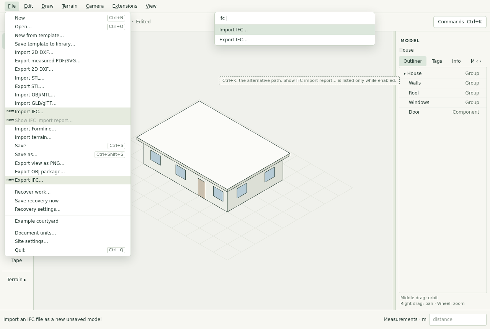 | The File menu with the three IFC entries, and the Ctrl+K path | 16.1 |
| 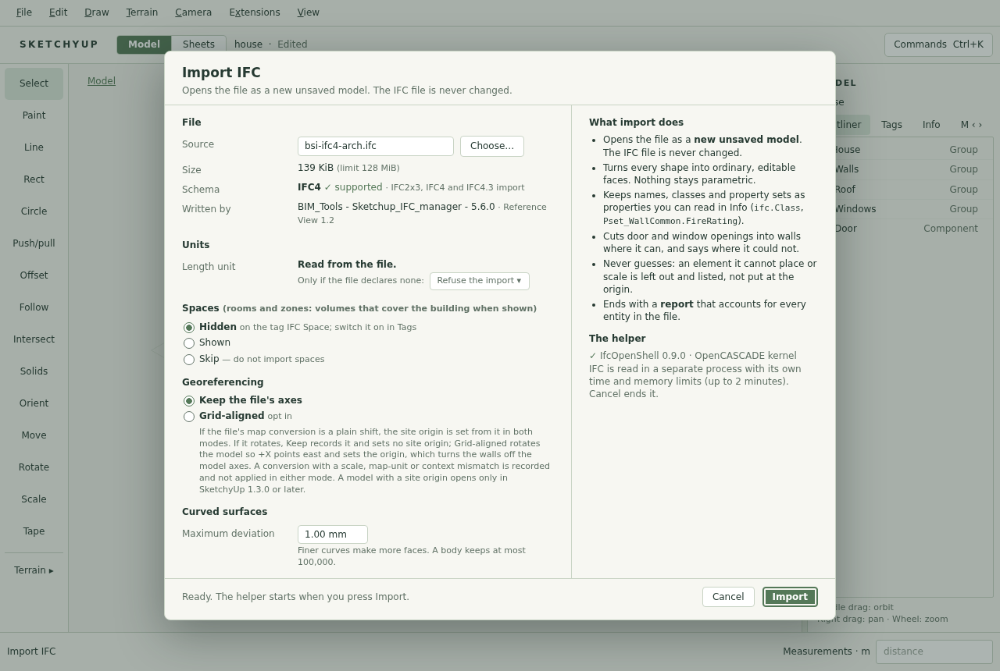 | The import options: file facts, units, spaces, georeferencing, curve deviation | 16.2 |
| 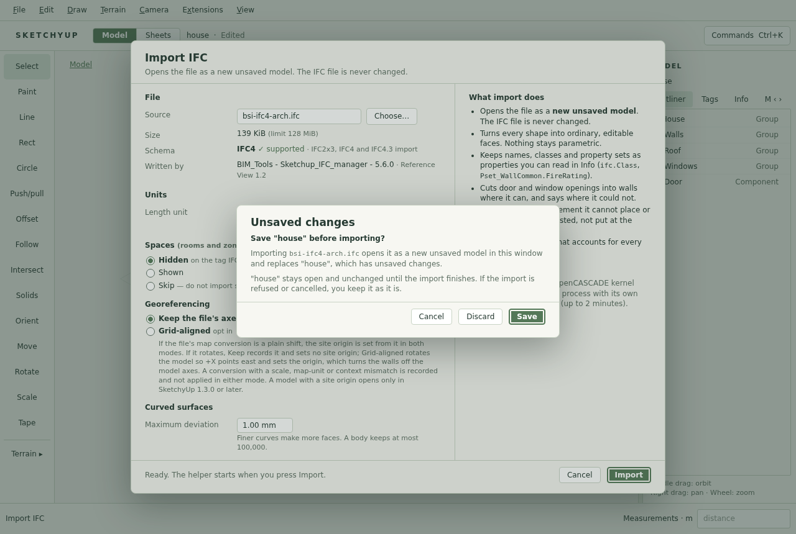 | The unsaved-changes prompt on pressing Import | 16.3 |
| 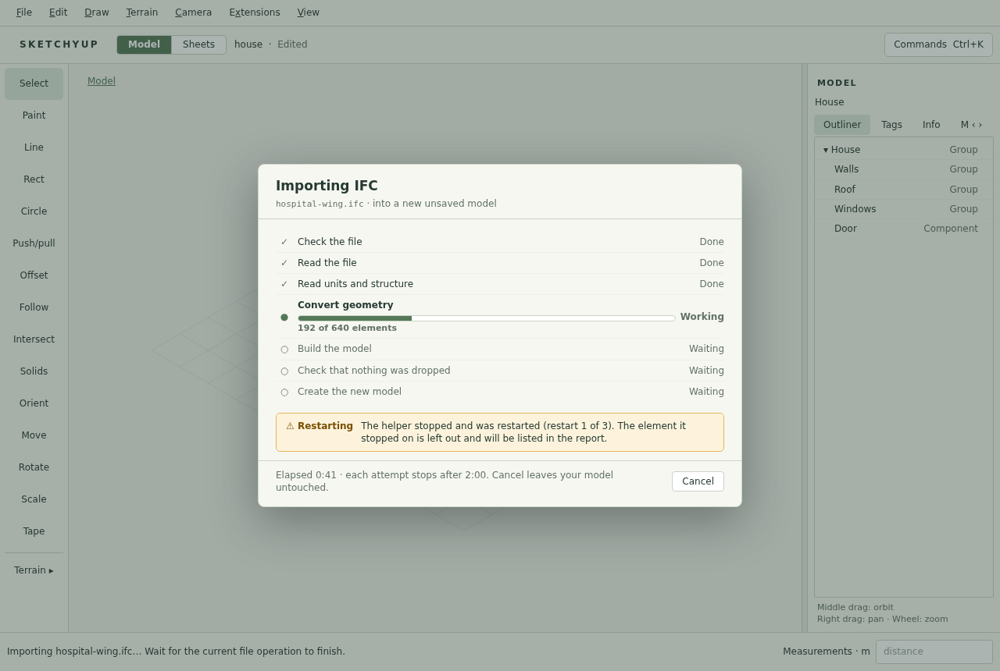 | Seven steps, one bar, Cancel, and the restart line | 16.4 |
| 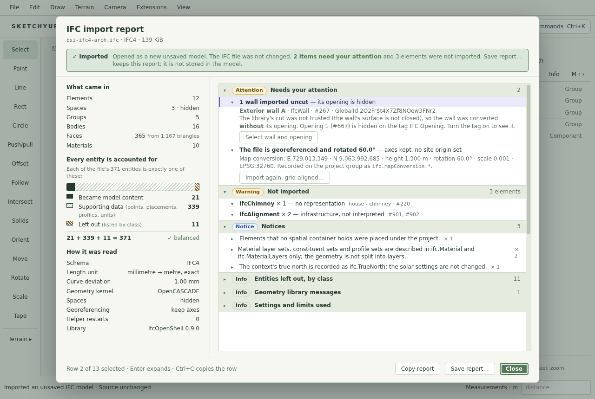 | The import report: counts, the accounting identity, the grouped list | 16.5 |
| 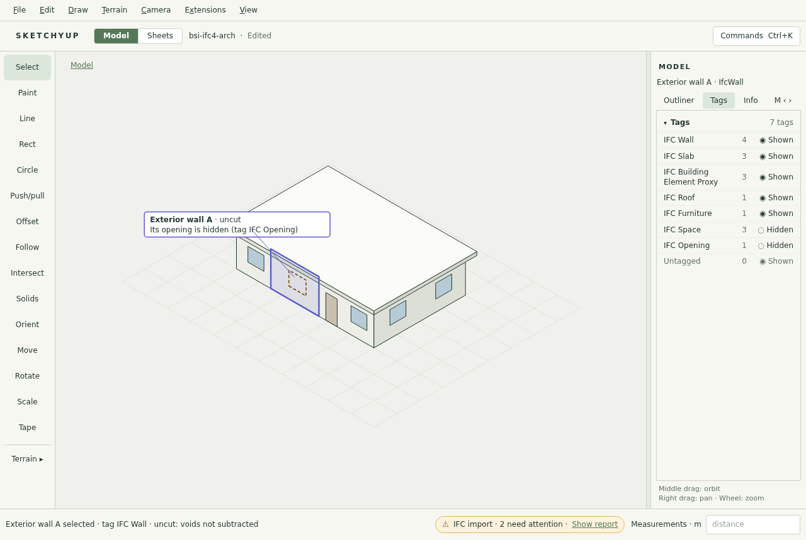 | The new model: class tags, the uncut wall, the report chip | 16.5 |
| 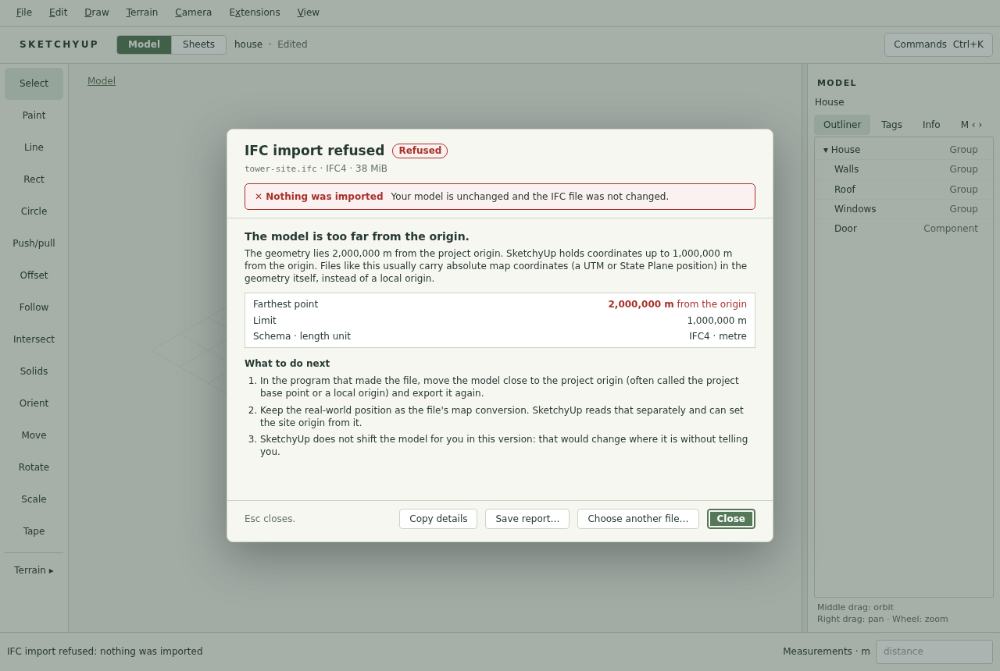 | A refusal found by the helper: far from the origin | 16.6 |
| 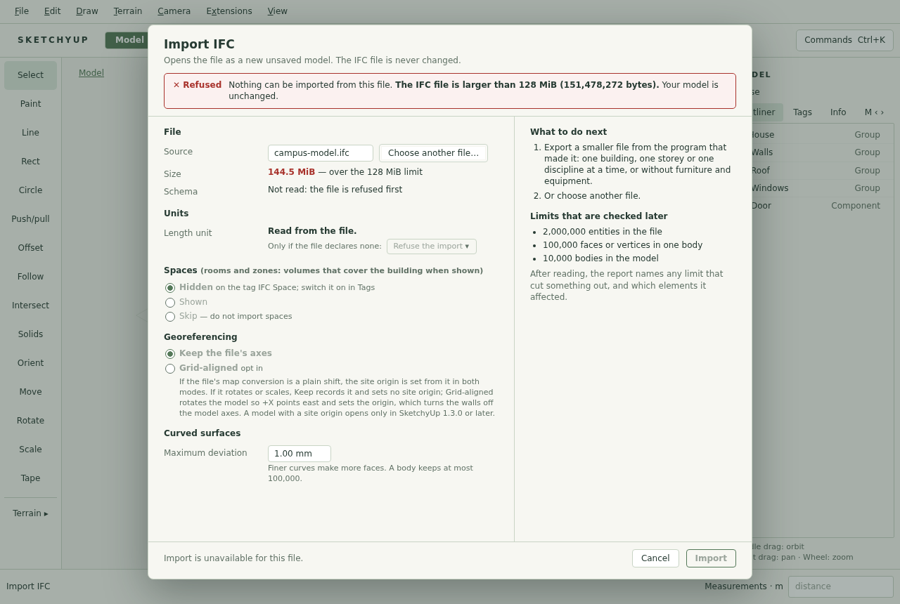 | A refusal inside the options dialog: over 128 MiB | 16.2, 16.6 |
| 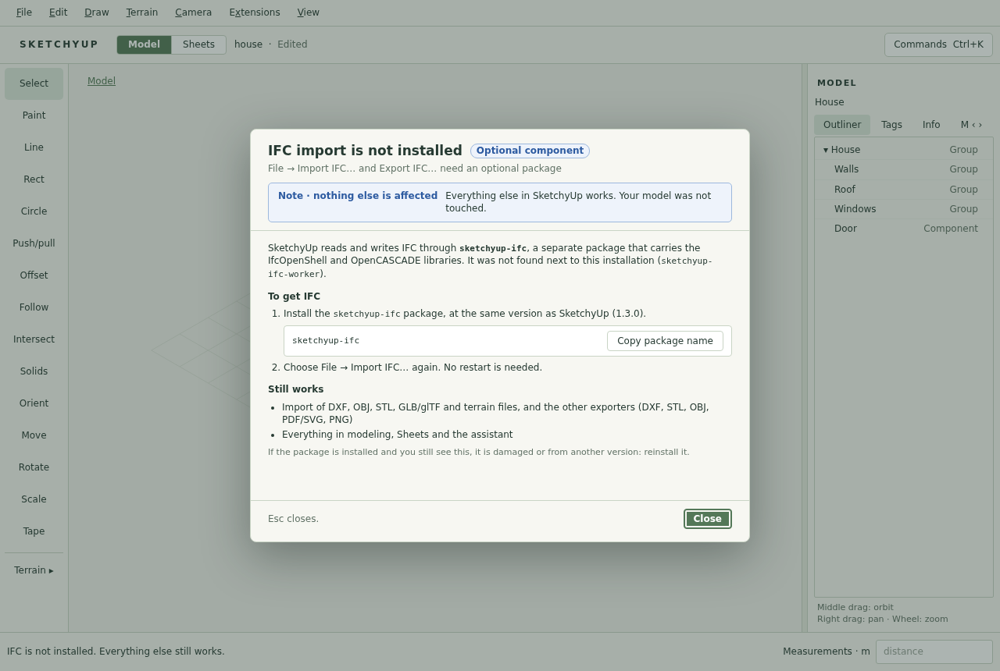 | The optional package is not installed | 16.7 |
| 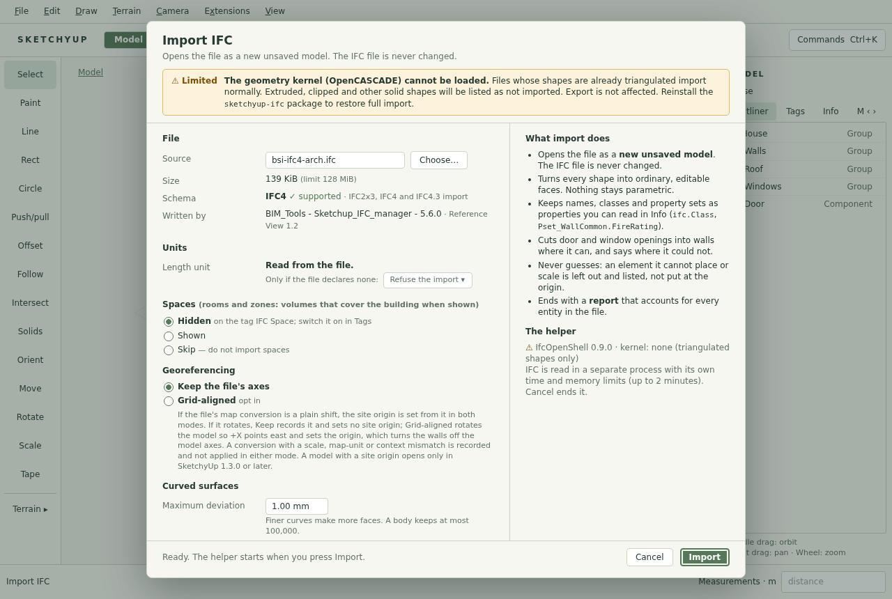 | The helper is present, the geometry kernel is not | 16.7 |
| 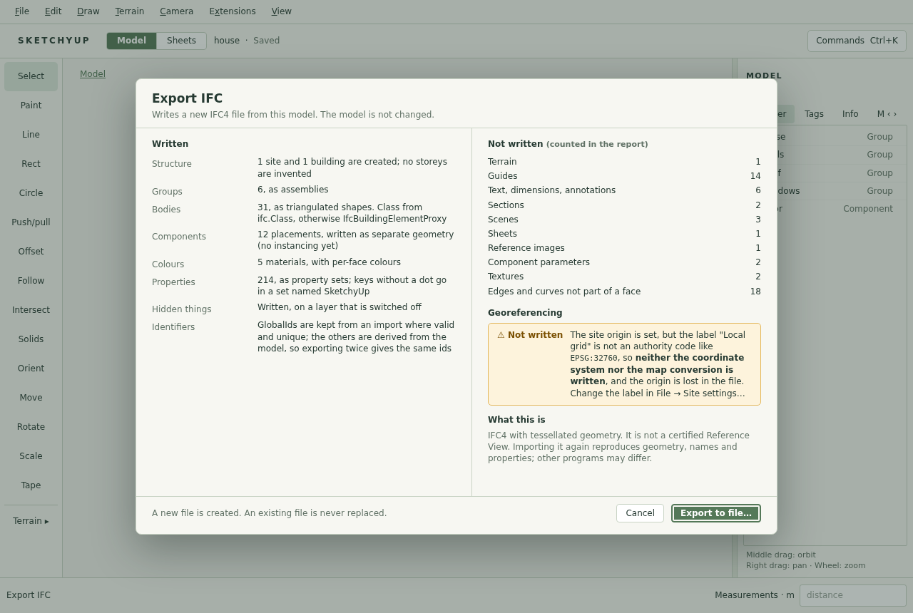 | The export dialog: written, not written, georeferencing | 16.8 |
| 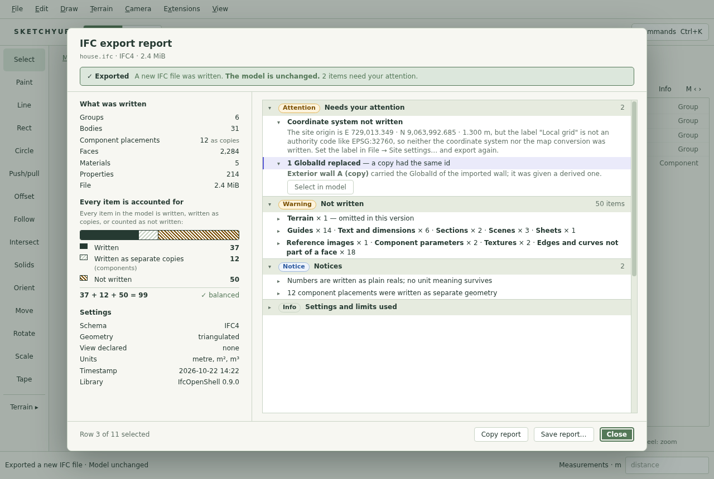 | The export report | 16.8 |

## 17. Presentation batches

Status: **approved by the owner on 2026-10-27**, with every §17.12 choice as recommended. Not implemented.
R099.d builds this; the records, the batch engine, video and the command surface (R099.a to R099.c) are on
main.

This section designs the desktop side of camera paths and batch presentation output: where the path
editor and the presets live, the batch dialog and its live budget, the Jobs row for a batch, results
and video, refusals, coexistence with the one-shot animation sheet, and accessibility. It answers the
eight questions in [ADR 0173](decisions/0173-camera-paths-batch-output.md) §7 (marked Q1 to Q8 below),
as decision 14 asks before R099.d. §17.11 lists where the engine or the commands do not yet give the
design what it needs; §17.12 lists the choices for the owner. The mockups are `mockups/presentation.html`
(all screens, with notes) or `mockups/presentation.html?screen=<name>` (`menu`, `render`, `paths`,
`pick`, `limit`, `presets`, `batch`, `device`, `video`, `unavailable`, `running`, `resume`, `results`,
`broken`), drawn in the light theme of `src/app/theme.hpp`. Add `&text=200` to a screen to double its
text size. The example is invented: a house, a path named Tour with five scenes, and two presets. Its
numbers come from the engine's formulas, not from measurement. Engine wording is quoted from the code
on main or on the R099.c branch.

### 17.1 Where the tools live

- **Camera menu.** One entry, *Presentations…*, after *Render…*. It opens the Presentations dialog (17.2
  and 17.3). Command search (Ctrl+K) lists it, and also *Export presentation batch…*, which opens the
  batch dialog directly. Neither has a default shortcut; the shortcut editor can assign one.
- **Render sheet.** The Render with Blender sheet (§9) gains one button, *Export presentation batch…*,
  beside *Export scene animation…*. The one-shot button and its sheet are unchanged (Q7).
- **Presentations dialog.** A non-modal window with two tabs, *Camera paths* and *Render presets*, and
  an *Export batch…* button in its footer. It is non-modal, like the Jobs list, so every edit is one
  undoable step and the model stays usable behind it.
- **Batch dialog.** Modal, like the one-shot sheet. *Start batch* closes it and opens the Jobs list with
  the new batch selected.
- **Jobs.** The existing Jobs list (§9) gains batch rows. Its title changes from "Render jobs" to
  "Jobs", because it now lists two kinds of job.
- **Not designed here.** No rail slot, tool or tray panel. The Saved scenes panel keeps capturing scenes;
  a path only references them. No viewport preview of the path (ADR decision 17).

A separate dialog, rather than a section of the render sheet, because the sheet is a single-render form
that already scrolls, and a path needs an ordered list with a live count. A tray panel would compete with
Saved scenes and would turn batch inputs into model organization.

### 17.2 Q1: The path editor and its create flow

**Recommendation:** the path editor is the *Camera paths* tab of the Presentations dialog. Its list
holds the paths, and its editor holds the keyframes and the timing. The create flow uses a draft and a
scene picker.

- **List.** Each path shows its name, scene count and planned frames ("Tour · 5 scenes · 157 frames").
  A broken path stays in the list with its reason ("✕ broken: keyframe 2 names a missing scene"). Under
  the list: **New path** and **Delete path**. At 64 paths, **New path** is disabled with the reason.
- **Name.** Unique, up to 1024 bytes, no leading or trailing space, no control characters (the saved-scene
  rule). Engine text: "Camera path names must be unique".
- **Keyframes.** An ordered list. A row shows its position, scene name and a warning if the scene has no
  camera or is missing. A scene may repeat (R099.a allows it). **Add scene…** opens the picker,
  **Move earlier** (Alt+↑) and **Move later** (Alt+↓) reorder, as in Saved scenes, and **Remove**
  (Delete) takes a keyframe out. **Remove** is disabled when only two keyframes are left, with the reason
  "A path needs two to thirty-two scenes".
- **Timing, in seconds.** Frames per second (1 to 60, default 24); *Transition between scenes* (0.05 to
  10 s, default 1.00 s); *Hold each scene* (0 to 5 s, default 0.50 s). These are the one-shot sheet's
  units and its mapping: transition steps are `max(1, round(seconds × fps))` and hold steps are
  `round(seconds × fps)`. Each field shows its steps ("1.00 s = 24 steps"). The seconds are the typed
  value: when fps changes, steps are recomputed from the same seconds, so a one-second transition stays
  one second. The Saved scenes panel's *Camera transition* is in milliseconds and drives viewport playback
  only, so the label here says "between scenes".
- **Live count.** Under the timing, on every change: "157 of 240 frames · 5 scenes · 6.5 s at 24 fps",
  computed with the engine's formula `1 + N × hold + (N − 1) × transition`. It also says how many scenes
  fit at this timing. With the defaults that is **7**, not 32: `1 + 7×12 + 6×24 = 229`, and 8 scenes is
  265. The cap is shown, not hidden (owner question 2).
- **Help, always visible.** "A pan takes the shorter turn. For a longer turn, add a scene between the
  two." And: "A switch between perspective and orthographic is a cut at its keyframe." (ADR §9 asks for
  the yaw note in the path editor's help.)

**Create flow.**

1. **New path** opens a draft named "Path 1", with the name selected so that typing replaces it. Nothing
   is written to the model.
2. The keyframe list is empty, with the line "Add at least two saved scenes. The path plays them in this
   order."
3. **Add scene…** opens the picker. It lists the camera scenes in their saved order. Enter or a double
   click adds one; the picker stays open for more; **Done** (or Esc) returns. A saved scene without a
   camera is listed dimmed, with "no camera: give it a camera in Saved scenes first".
4. **Create path** is enabled when the draft has a unique name, two to thirty-two scenes and no more than
   240 planned frames. Creating it is one undoable edit, "Create camera path". The engine stores only valid
   paths (it refuses fewer than two keyframes), so the draft lives in the dialog until it is valid.
   **Cancel** discards it, and the model does not change.
5. The new path is selected. Each later edit is one undo step.

**Broken paths.** A path whose scene was deleted, or whose scene lost its camera, still loads. Its
editor shows the keyframe as "missing (was keyframe 2)" or "no camera". It can be renamed and retimed.
Its keyframes can be changed only so that every keyframe left is valid (R099.a). A deleted scene cannot
be restored under its old ID, so the repair is to remove the keyframe or to choose another scene.

### 17.3 Q2: Preset management

**Recommendation:** a named list in the *Render presets* tab. Each preset has the setup sheet's own
controls, plus a name and a seed, and the sheet's current values can seed a new preset.

- **List.** Name and summary ("Final · Cycles · 1280 × 720 · 128 samples"). **New preset**, **Duplicate**
  and **Delete**. At 16 presets, **New preset** is disabled with the reason.
- **Fields.** *Name* (unique, the same rule as paths). *Engine* (Cycles or Eevee preview, as radios).
  *Width* and *Height* (64 to 4096 pixels). *Samples* (1 to 1024). *Seed* (default 0; "Cycles only; Eevee
  ignores the seed"). The engine's own text is "Render resolution, samples or seed exceed bounds"; the
  field-level help replaces it.
- **No device, no environment.** A preset carries settings only (ADR decision 3). The batch picks the
  device once, and an HDR panorama is not part of a preset. The caption says "even for video" beside the
  sizes, because a batch that writes video needs even sizes (R099.c refuses odd sizes at validation).
- **New from current settings.** Fills a new preset from the render sheet's width, height, samples and
  engine. This is the only link between the sheet and the presets.
- **How a preset differs from the current settings.** The sheet's values are this computer's preferences
  and have no name. A preset is a named item in the model: it is saved with the file, shared with it, and
  undoable. The footer says so: "Presets are saved with this model. The render sheet's values stay on this
  computer."
- **Later edits.** A batch keeps the settings it started with. Editing or deleting a preset afterwards
  changes no batch that has run, and the Jobs details show the settings the batch used.

### 17.4 Q3: The batch dialog and its live budget

**Recommendation:** one modal dialog. On the left, what to render. On the right, what it will cost and
whether Start is possible. Start is disabled, and its reason is shown beside it.

**Left column.**

- **Camera path.** Valid paths only. A broken path is listed, disabled, with its reason. Under the choice:
  "6.5 s at 24 fps".
- **Presets.** Check up to four. A preset that cannot use the
  chosen device is shown disabled, with the reason on its row (17.8).
- **Device.** *Device backend* and *Device* are the render sheet's own controls, with the same values
  (CPU, CUDA, OPTIX, HIP, ONEAPI, METAL for Cycles; OPENGL for Eevee preview). *Retry once on CPU if a GPU
  fails* applies to each frame. The batch has one device family, because the engine requires it.
- **Output.** *New folder*, a new folder inside an existing parent. It is pre-filled as "parent/Tour" after
  **Choose parent folder…**. The rule is the R072 sheet's and the GLB export's: an existing folder, or a
  link, is refused.
- **Video.** *Write H.264 video for each preset*, off by default (ADR decision 7). Its state is 17.5.

**Right column: the live budget.** Each figure updates as a choice changes.

- **Frames.** "314 frames: 157 frames × 2 presets."
- **Output, at most.** "1.46 GiB. The batch stops when its output reaches 2.0 GiB." With video on, "2.0
  GiB with video: the budget caps it." This is the engine's worst-case bound, the same figure its disk check
  uses: per frame, `min(64 MiB, w × h × 5 bytes + 1 MiB) + 1 MiB` of metadata. The label says "Largest
  possible; real frames are usually smaller", and the budget counts real bytes, so this is a ceiling, not a
  forecast.
- **Free space on this disk.** From `QStorageInfo`. "Enough: the batch needs about 1.7 GiB, with a 256 MiB
  reserve." The need is the ceiling, plus the capture, plus the reserve. With video on, the ceiling is
  doubled before the cap, as R099.c does for the disk check.
- **Time.** "Not estimated. Each frame is a separate Blender render. In R099.b's measurement a 1024 × 768
  frame at 32 samples took about 26 s on CPU." The engine offers no estimate, and this line says so.
- **Blender.** "Blender 5.2.2 · CPU device ready", or the setup card (17.8).

**Start rules.** The first failing rule decides the reason shown beside Start:

| Condition | Start line |
| --- | --- |
| No valid path | "Choose a camera path." |
| No preset | "Check at least one preset." |
| Preset does not match the device | "Preview uses Eevee, which needs the OpenGL device. The batch uses CPU. Uncheck Preview, or choose OPENGL." |
| Odd size with video | "A video needs even width and height in every preset: Draft is 641 × 360." |
| Blender not found or not checked | the setup card (17.8) |
| Video chosen, H.264 unavailable | the probe line (17.5) |
| Another batch running | "Another presentation batch is running; wait for it to finish." |
| Modeling gesture in progress | "Finish the current modeling gesture before starting the batch." |
| Not enough free space | "Not enough free disk space for this batch: about 1,747 MiB needed, 812 MiB free." |

**Start.** Start checks Blender and video again (17.5), freezes the model (the footer shows "Capturing the
model…" for the short capture), and opens the Jobs list. There is no save prompt. The batch works from a
copy of the model as it is now, and the Jobs row records the revision, so later edits show as "model has
changed since". This is the one place where unsaved edits are not a reason to ask.

### 17.5 Video availability before a batch

The engine checks for H.264 only at encode time, after every frame has rendered (R099.c, `codec_unavailable`).
A Blender without the codec would therefore render a whole batch before refusing. R099.d adds a probe.

- **Where it runs.** The batch dialog runs it when it opens, as the render sheet already checks Blender
  when it opens. The probe is the existing one, with one extra report field: the codec list of the chosen
  Blender, read with the worker's `video_codecs()` (on the R099.c branch).
- **Four states.** Each state has a word and an icon, and its checkbox says why it is off.
  1. **Checking:** "Checking the video encoder…". *Write video* is disabled, and Start waits.
  2. **Available:** "✓ H.264 available in Blender 5.2.2. Each video encode stops after 15:00." *Write video*
     is enabled. The 15:00 is R099.c's per-encode limit.
  3. **Unavailable:** "⚠ H.264 is not in this Blender's FFmpeg build. Frames still render; video is off."
     *Write video* is disabled with that reason. A fallback codec is owner question 1.
  4. **Not checked:** "No Blender found, so video cannot be checked", or "The check did not finish", with
     **Check again**.
- **Start checks again.** A Blender that changed after the dialog opened is caught before frame one. If
  *Write video* is on and the fresh check says unavailable, Start refuses before anything is captured:
  "Video is not available in this Blender: its FFmpeg build has no H.264 encoder. No frames were rendered.
  Clear Write video to render the frames only."
- **Fallback.** If an encode still fails at run time, the batch ends Failed with the R099.c message (17.8),
  and the finished frames are kept.
- **Odd sizes** are refused at validation (R099.c: "A video needs even width and height in every preset").
  The dialog shows that on the preset's row, before Start, so it never reaches Start.

### 17.6 Q4: The Jobs row

**Recommendation:** a batch is one parent row in the Jobs list, with one child row per preset. Each child
names its state in words and draws a bar only where there is a count. The parent's state word reads like
the engine's job states.

- **Parent row.** The state and a short progress: "Running · 58 of 157 frames", "Canceling · discarding
  the frame in progress", "Completed · 2 presets · 314 frames", "Canceled · 58 of 157 kept, no video",
  "Failed · frame 12 of 157 failed", "Interrupted · app stopped". The captured-model column carries the
  batch's path name and the render provenance line: "Revision 42 · model has changed since". The other
  two columns are attempts and elapsed time, as for renders.
- **Child rows.** One per preset, in plan order. Presets render one after another, so a child reads
  "Final · frame 58 of 157 · Running" with a determinate bar, "Draft · waiting for Final", and, after the
  frames, "Final · encoding video (15:00 limit)" with no bar. A finished child reads "Final · video written,
  6.5 s".
- **Cancel batch.** Tooltip: "Stops the frame in progress and discards it. Finished frames stay." The
  engine kills the in-flight worker (R099.b), so cancel returns in seconds. ADR §4 says "at frame
  boundaries"; the design describes what the code does. While canceling, the row reads "Canceling ·
  discarding frame 58 of 157". It then ends "Canceled", with "Batch canceled; finished frames are retained"
  and no video.
- **Resume.** Enabled for Failed, Canceled and Interrupted batches, the engine's retry set. Not enabled for
  Completed or running batches. The label is "Resume", not "Retry", because the batch continues at its
  first unfinished frame. Tooltip: "Continues at frame 59 of Final. Frames already kept are not rendered
  again. The same captured model is used." For a failed video: "Resume encodes the missing video. No frame
  is rendered again." For an output-budget stop, Resume stays enabled, and the line states the room left:
  the next frame may or may not fit (the engine checks the real size of that frame).
- **Remove.** Enabled unless the batch is Queued, Running or Canceling. Tooltip: "Removes this job's record
  and log. Your frames and videos stay in the output folder." The store never touches the output folder
  (R099.b).
- **Show folder.** Opens the output folder in the file manager. Enabled once the folder exists.
- **Remove all finished jobs.** The footer button stays, and its tooltip splits the two kinds: "Renders:
  deletes captures, logs and images. Batches: deletes records and logs; output folders stay." The
  current tooltip ("Deletes retained captures, logs and images for finished jobs") is wrong for batches.
- **Details pane.** Provenance, the captured time, the output folder, each preset's settings, the device and
  CPU fallback use, "Frames kept: Final 57, Draft 0", the capture's SHA-256 (as the render's source manifest
  hash), and the bounded log.
- **Provenance.** The same words as the render list: "restored capture", "another model session", "model
  has changed since". A batch restored after a restart says "restored capture".
- **Status-bar chip.** While a batch runs: "Batch Tour · Final 58 of 157 · Show jobs", beside the render
  chip. After it ends, "Presentation ready · Show results" (or "Batch Tour: Draft video not written · Show
  results"), until the model closes, as the IFC report chip does.

### 17.7 Q5: Results and video

**Recommendation:** a results sheet, opened from the chip or from **Show results…** in the Jobs row. A
finished batch does not open its sheet by itself, so the sheet never takes focus from work in progress.
That is a deliberate difference from the render result tab.

- **Banner.** Completed: "✓ Completed. 2 presets, 314 frames, 2 videos. The model is unchanged." Not
  finished: "⚠ Not finished. Final is complete. Draft's video was not written: …. Its frames are kept, and
  Resume encodes that video only."
- **Provenance.** "From revision 42 · model has changed since", then "Blender 5.2.2 · Cycles · CPU · CPU
  fallback on 3 frames". This is the render result's own line.
- **Preset cards.** Name, settings and frame count. Then either the video ("Video: 6.5 s · H.264 MP4 ·
  4.2 MB", with **Play video** and **Show in folder**) or the reason it is missing, with **Resume: encode
  video**.
- **Video surfacing.** A video appears only once it is verified and written. The app has no player, so
  **Play video** opens the system player. The file is `NN-<preset>/video.mp4`, and the card shows its
  duration (frames ÷ fps) and size.
- **Stills grid.** Rows are the keyframes in path order; columns are the presets. Each cell is the frame
  flagged as a keyframe in that preset's sequence (ADR §4), so no still is rendered twice. Each cell is
  labelled in text ("frame 0037"), not by its thumbnail alone. Enter opens the still in the system viewer.
- **Folder layout.** A collapsed tree: `manifest.json`, then `NN-<preset>/frames/frame-NNNN.png` and
  `.json`, and `NN-<preset>/video.mp4` where a video exists.
- **Buttons.** **Copy report**, **Show output folder**, **Close** (the default).

### 17.8 Q6: Errors and refusals

Every refusal follows §16.6. It first says what did not happen (nothing was rendered, no folder was
created, the model is unchanged), then the reason with the number and the limit, then numbered next steps.
A refusal before Start is red with "✕ Refused"; a failure during a run is red with "✕ Failed". The word and
the icon carry the state, never the colour alone. Codes such as `codec_unavailable` go to the log, never to
the main text.

**Before Start (in the dialog or the editor).**

| Moment | Engine text (current) | What the person sees |
| --- | --- | --- |
| Broken path | "Camera path 'X' names saved scenes that no longer exist (17); repair the path before exporting" | Sheet "Batch not started: Courtyard needs repair". "✕ Nothing was rendered." Lists "Keyframe 2 · a saved scene that no longer exists" and "Keyframe 4 · Roof · has no camera". Next: remove or replace the keyframe in Presentations; give the scene a camera in Saved scenes; start again. |
| Broken path, no camera | "Camera path 'X' has a keyframe scene without a camera; give it a camera before exporting" | As above, with "has no camera". |
| Over 240 frames | "Camera path would plan 265 frames (1 + 8 x 12 + 7 x 24); the limit is 240" | "Path 1 would render 265 frames; the limit is 240. At this timing, 7 scenes is the most. Remove a scene, or shorten the transition or the hold." The formula stays in small type. The planner's own text, "Camera path exceeds 240 captured frames", is never shown. |
| Device and preset | "Presets must match the selected device: Eevee needs an OpenGL device, and Cycles needs the CPU or a compute device" | "Preview uses Eevee, which needs the OpenGL device. The batch uses CPU. Uncheck Preview, or choose OPENGL." |
| Odd size with video | "A video needs even width and height in every preset" | "Video needs even sizes: Draft is 641 × 360. Change the size in Presets, or clear Write video." |
| Folder exists | "Choose a new batch folder that does not exist yet" | The same words, with the field focused. |
| Folder not in a parent | "Choose a new batch folder within an existing directory" | The same words. |
| Free space | "Not enough free disk space for this batch: about 1,747 MiB needed, 812 MiB free" | The same words, with "Choose another disk, or fewer frames." |
| Another batch | "Another presentation batch is running; wait for it to finish" | The same words, and Start disabled. |
| Blender missing | "Presentation batches need an installed Blender 5.2 LTS; install it or choose its executable" | The setup card (below). |
| Video missing | "H.264 is not in this Blender build's FFmpeg codec list, so no video was written" (R099.c) | The probe's unavailable state (17.5), and at Start: "Video is not available in this Blender: its FFmpeg build has no H.264 encoder. No frames were rendered. Clear Write video to render the frames only." |
| Modeling gesture | "Finish the current modeling gesture before capturing animation" (R072) | "Finish the current modeling gesture before starting the batch." |

**Setup card (Blender missing).** The §9 card, reused: "Presentation batches render each frame with Blender
5.2 LTS and encode video with its FFmpeg. Renders and the one-shot export use the same Blender." Then
"Detected: Not found on PATH", **Choose executable…**, **Check again**, and "On Arch, install the blender
package, then check again." The path and preset controls stay visible, greyed.

**During a run (in the Jobs row and the results sheet).**

| Moment | Engine text (current) | What the person sees |
| --- | --- | --- |
| Frame failed | "Frame 12 of 157 failed: <message>" | "✕ Failed · frame 12 of 157 failed: <message>. 11 frames kept. Resume retries frame 12." |
| Output budget | "Batch output would exceed its 2048 MiB budget; 12 MiB remain" | "✕ Failed · Frame 59 of 121 would pass the 2 GiB output budget (12 MiB remain). Finished frames are kept. Resume adds frames only while they fit." Then the other way out: a new folder, with fewer frames or a smaller size. |
| Video not written | "Video not written (codec_unavailable): …. The finished frames are kept." (R099.c) | "✕ Failed · Video not written for Draft: <reason>. Frames are kept. Resume encodes the video." The raw code is dropped from the sentence. |
| Frame changed after verification | "Frame N changed after it was verified; no video was written" (R099.c) | "✕ Failed · Frame 40 changed on disk after it was verified, so no video was written. Resume renders that frame again." |
| Interrupted | "Application stopped before this batch finished. Retry to resume from the first unverified frame." (R099.b store) | "⚠ Interrupted · SketchyUp stopped before this batch finished. Resume continues at frame 81 of 157." The engine says "Retry"; the UI says "Resume". |
| Canceled | "Batch canceled; finished frames are retained" | "■ Canceled · finished frames are kept. No video was written." |
| Output folder gone | "The batch folder is missing; the batch cannot resume" | "The output folder was moved or deleted, so this batch cannot resume. Remove the job, or start a new batch." |
| Foreign manifest | "The batch manifest does not belong to this job; the finished frames are kept" | "The folder's manifest is not this batch's, so nothing was changed. Choose a new folder for a new batch." |
| Storage full | "Presentation storage is full; remove finished batches before queuing more" | "Batch storage is full. Remove a finished job, then start again." |

### 17.9 Q7: Coexistence with the one-shot sheet

**Recommendation:** leave the R072 sheet alone and add the batch beside it. The two outputs do not merge.

- **Unchanged.** *Export scene animation…* keeps its scene checklist, the render sheet's settings, one
  preset, PNG frames, no video and no resume (ADR 0107). It keeps its name.
- **New.** *Export presentation batch…* sits beside it. The one-shot export is for one set of frames from
  the current settings. The batch is for several named presets, an optional video and resume. The batch
  dialog's subline says so: "For one set of frames from the current settings, use Export scene animation…".
- **Concurrency.** Both can run. The render queue already coexists with the one-shot export, and the batch
  adds at most one worker (ADR §9). Each writes its own new folder, and neither touches the other's output.
  The Jobs list shows both.
- **Known gap, unchanged here.** The one-shot sheet has no live frame count. At its default timing, eight
  or more scenes fail only after **Export frames** is pressed, with "Camera path exceeds 240 captured frames"
  (§17.11). This design does not change the sheet (ADR decision 14); the owner may want the count there too.

### 17.10 Q8: Accessibility and keyboard

- **Keyboard path.** Alt+C (Camera), then the *Presentations…* entry; or Ctrl+K and "present". In the
  Presentations dialog the tab order is: the two tabs; the path list; New path; Delete path; Name; the
  keyframe list (Up and Down move the current row, Alt+Up and Alt+Down move the scene, Delete removes it);
  Add scene…; the three timing fields; Export batch…; Close. Esc closes.
- **Batch dialog.** Tab order: the path choice; the presets (Space toggles, arrows move); Device backend;
  Device; Retry on CPU; the folder field; Choose parent folder…; Write video; Cancel; Start batch (the
  default when enabled). Esc cancels. Enter starts only when Start is enabled.
- **Picker.** Type-ahead on names; Enter adds; Esc is Done.
- **Jobs list.** One Tab stop for the tree. Up and Down move between rows; Right and Left expand and collapse
  a batch; the row's actions (Cancel batch, Resume, Show folder, Remove) follow the list. Cancel batch is not
  the default button, so Enter cannot cancel by accident. Esc closes.
- **Results.** Arrow keys move in the stills grid; Enter opens a still; Tab reaches Play video and Show in
  folder for each preset.
- **Accessible names.** A keyframe row reads "Keyframe 3 of 5, Side, has a camera", or "Keyframe 2 of 5,
  scene missing; remove or replace it". A path row reads "Tour, 5 scenes, 157 frames". The budget reads
  "Frames 314. Largest output 1.46 GiB. Free space 812 GiB, enough." A child progress bar reads "Final, frame
  58 of 157". The video step reads "Encoding video, Final". The probe reads "Video encoder: unavailable, H.264
  not in this Blender".
- **Announcements.** One at Start ("Batch started: Tour, 2 presets, 314 frames"), one when each preset's frames
  finish, one when each video is written, and one for each final state (Completed, Canceled, Failed,
  Interrupted). Never one per frame. The status chip is named "Batch Tour, Final 58 of 157. Show jobs".
- **Not colour alone.** States are a word and a glyph: ● Running, ✓ Completed, ■ Canceled, ⚠ Interrupted,
  ✕ Failed or Refused. Bars carry their numbers. The stills grid labels every cell in text.
- **Text size.** At 200% the batch dialog's columns stack, the budget cards come below the form, the
  Presentations list stacks above the editor, the stills grid wraps to two columns, and the footers stay
  in view. The mockup shows this with `&text=200`.
- **Focus and motion.** A filled primary button shows focus as a 2 px inset ring in the surface colour (§10).
  The only motion is the determinate bar.
- **Checks.** A `presentation_input_tests` suite (proposed) drives the keyboard path, the names, the Start
  reasons, the device conflict and the four probe states, on X11 and Wayland at 1× and 2× and at 200% text,
  as R096.f and §16.9 do.

### 17.11 Gaps in the engine and the commands

These are the points where the design needs something the engine or the commands do not give today. Each
is a note for R099.d or the owner, not a change made here.

1. **No codec probe before a run.** H.264 is checked only at encode time (R099.c). The probe in 17.5 needs a
   worker report field.
2. **Default timing allows seven scenes.** Under `1 + N × hold + (N − 1) × transition ≤ 240`, the defaults
   (24 fps, 24 transition steps, 12 hold steps) give at most 7 keyframes. The record's own documented range
   (2 to 32) is not reachable at the defaults. The one-shot sheet has the same defaults and no live count.
3. **Two refusals for one rule.** The record says "Camera path would plan 265 frames (1 + 8 x 12 + 7 x 24);
   the limit is 240". The planner says "Camera path exceeds 240 captured frames". The UI shows the first,
   reworded; the planner's text should not reach a person.
4. **A deleted scene has no name.** The engine reports the scene's ID only, so the UI shows the keyframe's
   position and the old ID. Keeping the last name on delete, or warning when a used scene is deleted, would
   help the Saved scenes panel (its Delete has no confirmation).
5. **No environment in a batch.** ADR §4 says the batch request names an environment when one is given. The
   R099.b request has no such field, and the design shows none (owner question 3).
6. **The budget is a ceiling.** The engine's worst-case bound is 5.75 MiB per 1024 × 768 frame (R099.b). The
   measured frames were about 0.47 MB PNG and 0.21 MB metadata at that size. The ceiling is honest and matches
   the disk check, but it is roughly ten times the typical output.
7. **Metadata is most of the real output.** Each per-frame JSON is about 207 KB, because its diagnostics repeat
   the worker's log three times (R099.b). Trimming it would shrink real output more than any budget change.
8. **Codes in user text.** R099.c's message carries "(codec_unavailable)", and the store writes "Retry to
   resume". The UI wording above replaces both; the engine text should follow.
9. **"Cancel at frame boundaries" versus the code.** ADR §4 says cancel stops at the next frame boundary; R099.b
   kills the in-flight worker and discards its frame. The UI describes the code. The ADR text needs a
   correction, which this design does not make, because R099.c has appended its own notes to ADR 0173.
10. **The Jobs list reads one source.** `RenderJobsDialog` reads `RenderQueue` only. R099.d needs a second source
    (`PresentationJobStore`) and a two-level row, and the title and the tooltip change.
11. **No time estimate.** The engine gives none. The design says "Not estimated" and shows elapsed time.
12. **Resume after a budget stop is not pre-checked.** The per-frame check uses the real size of the next frame,
    so Resume can fail at once. The UI warns; no engine change is needed.
13. **Quitting during a batch.** R099.b's SIGTERM leaves a job Running until the store reopens (its contradiction
    4). A rule for quitting is needed (owner question 5).

### 17.12 Choices for the owner

Each choice has a recommended default. **The owner decided all five on 2026-10-27, each as recommended:**
MPEG-4 Part 2 in MP4 as the explicit fallback when H.264 is missing; the 24 fps, 1.00 s and 0.50 s defaults with
the cap shown live; no HDR panoramas in v1; the worst-case ceiling as the live budget; and ask before quitting
with a batch running. R099.d builds these.

1. **A fallback codec when H.264 is missing.** Options: none; MPEG-4 Part 2 in MP4 (lossy, plays everywhere);
   FFV1 in MKV (lossless). *Recommended: MPEG-4 Part 2 in MP4, offered only as an explicit choice when H.264 is
   missing.* It is the R099.b recommendation, and it gives people on such builds a video without changing the
   default.
2. **Default timing.** Keep 24 fps, a 1.00 s transition and a 0.50 s hold (seven scenes at most), or lower
   defaults (a 0.50 s transition and a 0.25 s hold allow 13). *Recommended: keep the defaults, and show the
   cap live.* They match the one-shot sheet and ADR 0173, and the cap is visible, not hidden.
3. **HDR panoramas in batches.** Keep them out of v1, or add a per-batch picker later. *Recommended: out of v1.*
   ADR decision 3 and the R099.b request both leave them out, and the batch dialog says so.
4. **The live budget.** Show the worst-case ceiling, or wait for a measured estimate. *Recommended: the ceiling,
   labelled "largest possible; real frames are usually smaller".* A measured estimate needs a sample render per
   preset, and a wrong estimate is worse than an honest large ceiling. R099.e can revisit it with measured
   batches.
5. **Quitting with a batch running.** Ask first, or stop quietly and leave the batch Interrupted. *Recommended: ask*
   ("Closing stops the batch. Finished frames are kept, and you can resume it later."), because a batch can run for
   hours and the person should decide.

| Screen | Shows | Sections |
| --- | --- | --- |
| 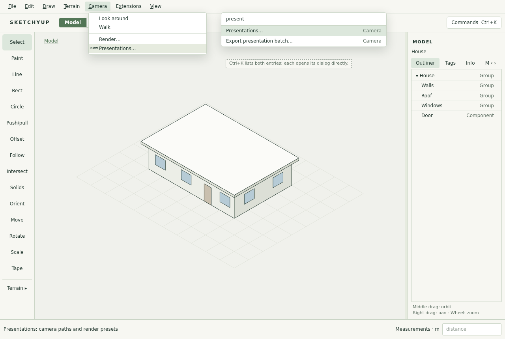 | The Camera menu with Presentations…, and command search | 17.1 |
| 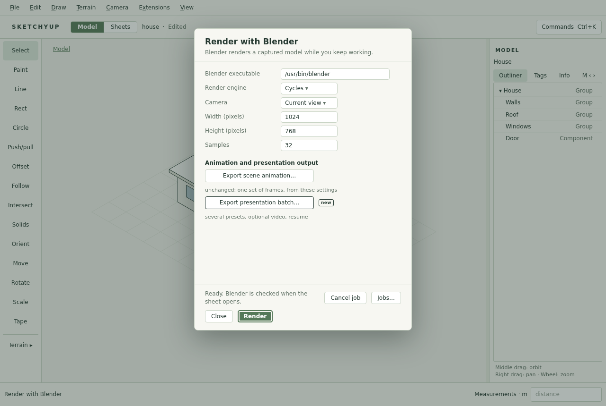 | The render sheet: the unchanged one-shot button beside the new batch button | 17.1, 17.9 |
| 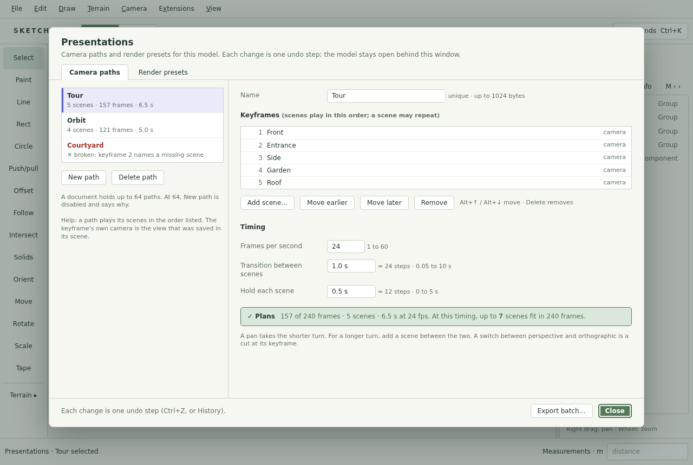 | The path editor: paths, keyframes in order, seconds and steps, the live count | 17.2 |
| 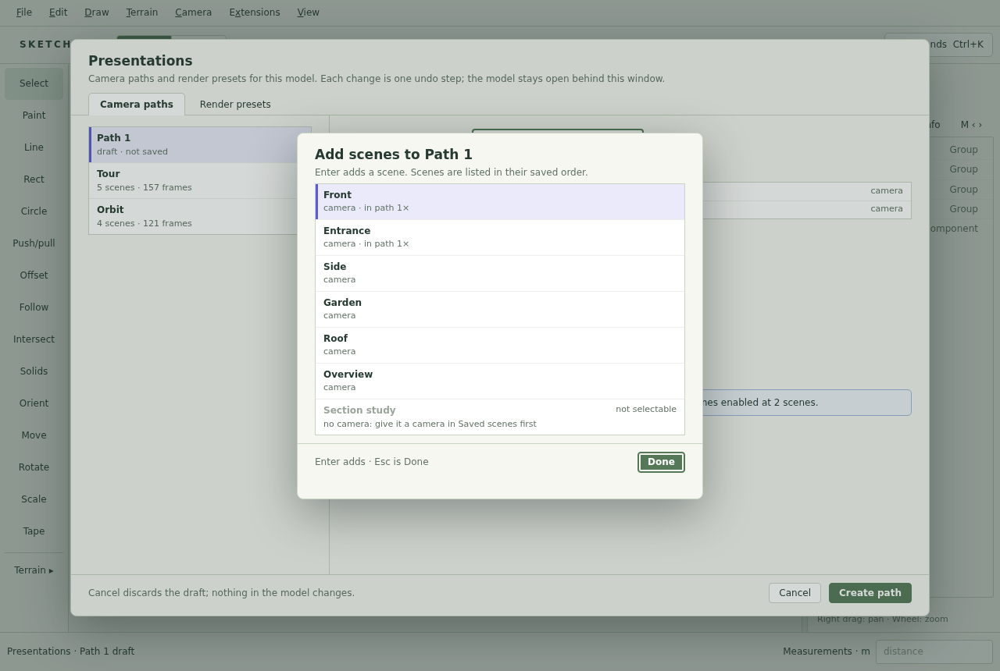 | The create flow: a draft, and the scene picker | 17.2 |
| 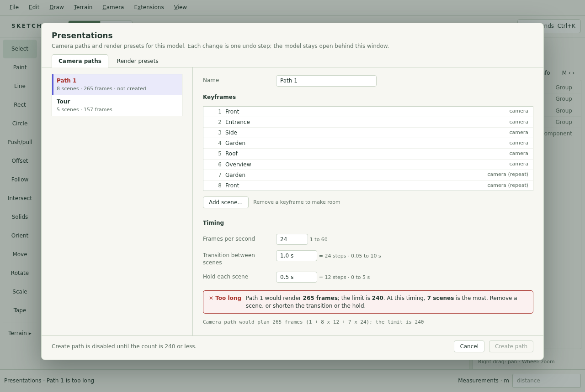 | Over the frame limit: the refusal in words, and the formula | 17.2, 17.8 |
| 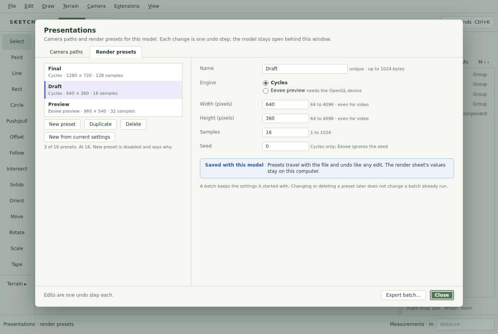 | The render presets: name, settings, seed, and what is saved with the model | 17.3 |
| 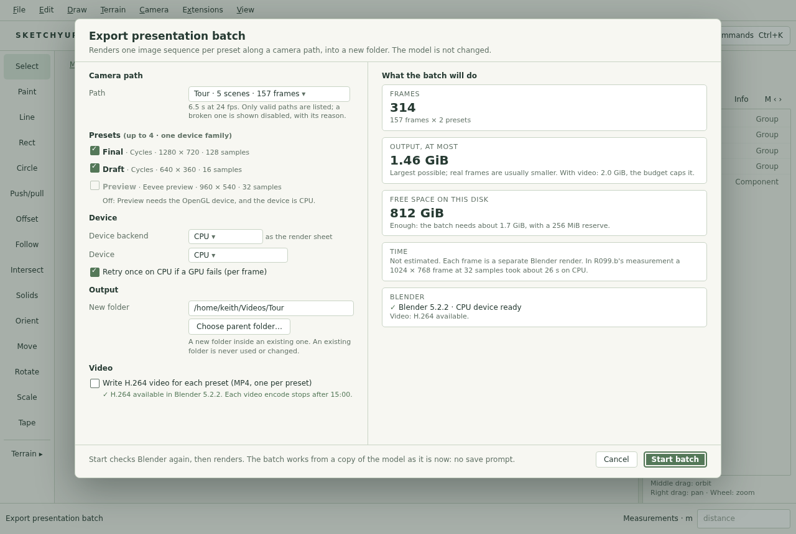 | The batch dialog: the choices, and the live budget | 17.4 |
| 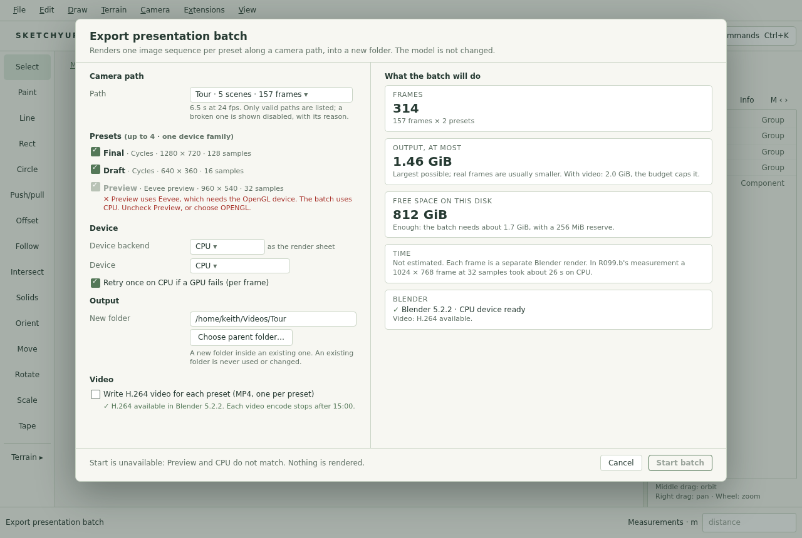 | A preset that cannot use the device: refused before Start | 17.4, 17.8 |
| 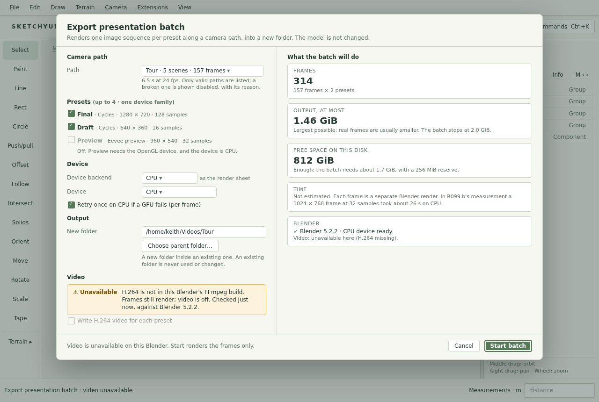 | The video probe: H.264 unavailable, and the frames still render | 17.5 |
| 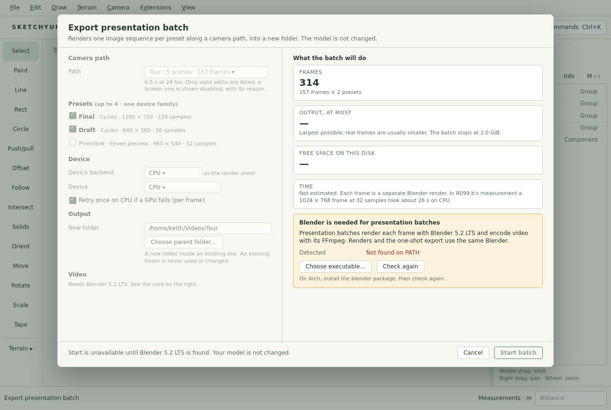 | Blender absent: the setup card, Start unavailable | 17.4, 17.8 |
| 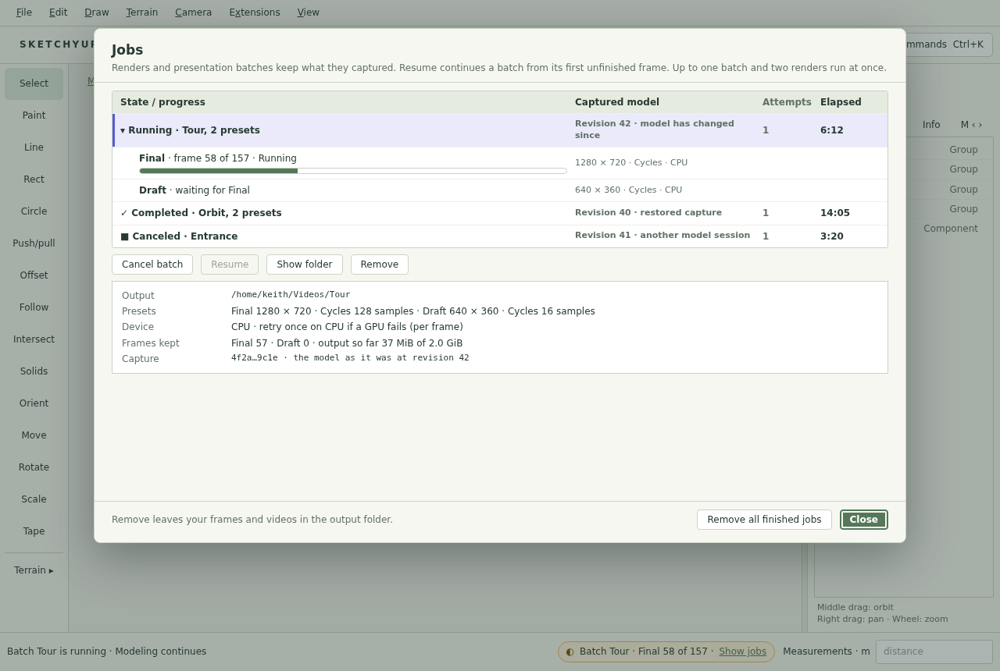 | The Jobs list: a running batch with per-preset progress and the chip | 17.6 |
| 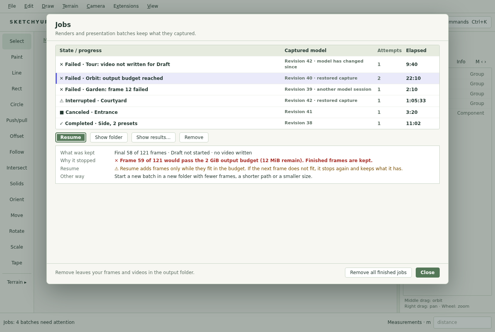 | Failed, interrupted and canceled batches: the Resume wording | 17.6, 17.8 |
| 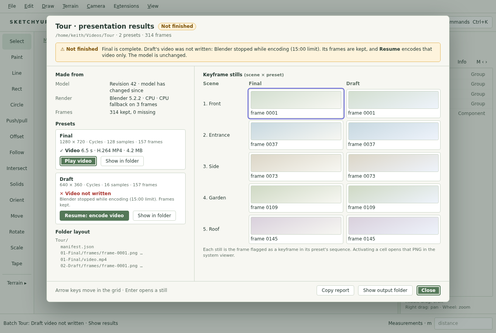 | Results: the presets, a video not written, and the stills grid | 17.7 |
| 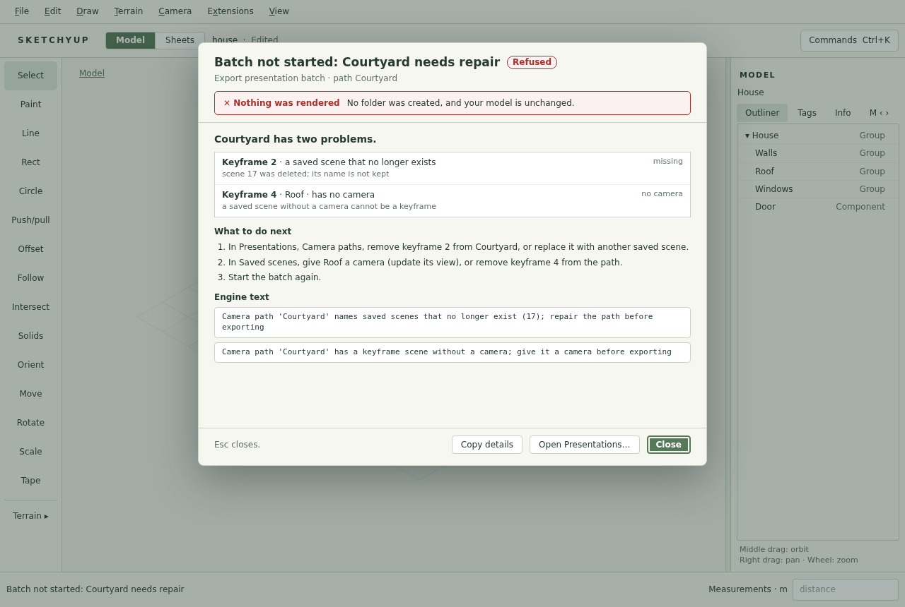 | Refused: a path with a missing scene and a scene without a camera | 17.8 |

## 18. Styles, edge strokes and asset catalogs

Status: **approved by the owner on 2026-10-27**, with every 18.9 choice as recommended. This section designs the desktop side of the R100 styles and catalogs: the style library, the import and export of `.sketchystyle` files, the edge stroke controls, the textured presets in the Materials library, the asset catalog dialog and its missing-dependency report ([ADR 0174](decisions/0174-custom-styles-asset-authoring.md) §8, decision 8; owner decision 11 asks for it before R100.f). The engine slices R100.a, R100.c, R100.d and R100.e are merged. R100.b, the textured preset data, is not, so 18.4 designs how the presets are shown without naming them. This section designs what a person sees of the merged engine work, and it adds no C++.

Each part answers one bullet of ADR §8: 18.1 the library location, names and shortcuts; 18.2 the style import and export flow; 18.3 the edge stroke controls and the missing texture at the pointer; 18.4 the textured presets in the Materials library; 18.5 the asset catalog dialog and its report tree; 18.6 the refusals; 18.7 keyboard, accessibility and text size. 18.8 lists the engine and command gaps the design found, and 18.9 the open questions for the owner.

The mockups are `mockups/styles.html` (all screens, with notes) or `mockups/styles.html?screen=<name>` (`menu`, `styles`, `texture`, `import`, `refused`, `export`, `save`, `materials`, `catalog`, `report`, `viewport`), drawn in the light theme of `src/app/theme.hpp`. Add `&text=200` for 200 % text. Every name in them is a placeholder. The textured preset list, its textures and their licences are open question Q1 of ADR 0174, so no preset or texture is named here. The numbers are illustrative.

The existing surfaces this builds on are the R062 Styles tab (`styles_panel.cpp`), the Materials tab and its **New material** dialog (`materials_panel.cpp`), and the component library's **Insert library component** dialog (`window_library.cpp`), whose folder, refresh and search controls this section reuses.

### 18.1 Where the libraries live

- **Styles tab, not a new panel.** View → Model styles opens the R062 Styles tab in the Tray. It keeps its display controls and gains two sections under them: **Edge stroke** (18.3) and **Style library**. In the narrow layouts it is reached through More panels, as now.
- **File menu, four entries, next to their siblings.** **Import style…** and **Asset catalogs…** after Import terrain…; **Export style…** and **Export asset catalog…** after Export STEP…. Nothing else in the menu moves. There is no Styles menu.
- **Nothing is reachable only by the mouse.** A library row's context menu offers the same commands as its buttons, and Ctrl+K lists the four File entries by name.
- **Names.** Styles tab: "Style library", "Edge stroke", "Apply to model", "Save to library…", "Choose folder…", "Refresh". Dialogs: "Import style", "Export style", "Save style to library", "Asset catalogs", "Export asset catalog". Catalog entries are inserted with "Insert component", "Insert material", "Insert N entries" or "Apply style".
- **No default shortcuts.** Every plain letter in 4.2 is a tool, and the Ctrl keys near these commands are in use (Ctrl+J is the Assistant and Ctrl+K the command search). The shortcut editor can assign one (N05), and no conflict is introduced.
- **The Components tab does not change.** Catalog entries are inserted from the Asset catalogs dialog, so the R079 component library and the catalogs never mix.
- **Folders.** Each library has one folder, shown in its dialog. The desktop default for styles is `styles` under the application data folder, and for catalogs it is `catalogs` (the R100.d folder, which `catalog.library` also lists). **Choose folder…** changes it and the choice is remembered in preferences, as the component library's is (owner question 1).

### 18.2 Style import and export

- **Import style… (File).** The system chooser comes first (filters: `*.sketchystyle` and All files). Then the **Import style** dialog (screen `import`). The left column shows the file's facts, read from the file: name, description, the display settings (14), the edge stroke in words ("2.0 px · 60 % · dashed"), and the texture with its state ("stored in the file"). A preview draws the stroke's own settings, not a render. The right column offers two outcomes as radio buttons: **Apply to this model** (the default) and **Save to the style library**. The one primary button names the chosen outcome. Nothing changes until it is pressed, and Esc cancels.
- **Apply.** One labelled undo step, "Apply style “Name”", as ADR 0068 requires. A style equal to the model's current style is not an error. The dialog closes, and the status bar says "This model already has this style. Nothing changed." (the engine's no-op refusal, shown as a neutral result).
- **Save to the library.** The dialog asks for a file name, pre-filled and checked against the library folder before anything is written. The name rule is the R100.d catalog rule (1 to 64 characters; letters, digits, spaces, dots, underscores and hyphens; starting and ending with a letter, digit, underscore or hyphen). A name that is taken is refused in the dialog (screen `save`), with a free suggestion. The file is then written as a new file, never over an existing one.
- **Apply from the library.** The Styles tab's **Apply to model** button applies the selected library style at once, as one undo step. The status line says what changed: "Applied “Style A”: edge stroke on, 3 settings changed. Undo: Apply style “Style A”." Applying is one step from undo, so it needs no second confirmation (owner question 4).
- **Export style… (File).** The **Export style** dialog (screen `export`) lists what the file will hold: the display settings, the edge stroke, and the texture with its stored state. It also lists what a style never carries (materials, tags, components, scenes), with counts and the way to carry them (an asset catalog). **Export to file…** opens the system Save dialog (`*.sketchystyle`) with no overwrite prompt. A name that exists is refused with the message of 18.6 and nothing is written. The same save dialog serves **Save to library…** in the Styles tab.
- **Library list.** Each row has a sample of the stroke (drawn from the stored width, opacity and dash; a textured style shows its texture tile when the texture decodes), the name, the settings in words, and one state: **✓ Stored**, **⚠ Texture missing from file** (listed, cannot be applied) or **✕ Cannot read** with the reason (not selectable). Search matches names and descriptions. **Refresh** re-scans the folder within the bounded scan limits of ADR 0132 (4,096 entries, 128 candidates, 256 MiB) and reports how many files it skipped and why.

### 18.3 The edge stroke controls, and what the viewport shows

The **Edge stroke** section of the Styles tab (screen `styles`):

- **Use an edge stroke** (a check box, off by default). Off: profiles draw as they do now, at Profile width. On: the stroke applies. Turning it on is one labelled edit, "Turn on edge stroke", which copies the current profile width into the stroke width. Turning it off, or **Reset model style**, removes the stroke in one labelled edit, so the record returns to its 14 fields.
- **Width**, 1 to 8 px, in the unit and step of Profile width. Edit: "Set edge width 2.5 px".
- **Opacity**, 1 to 100 % (stored as 0.01 to 1). Edit: "Set edge opacity 60 %".
- **Dash**, a list of the four named patterns (Solid, Dashed, Dotted, Dash-dot). Edit: "Set edge dash Dashed". The proposed dash lengths are 8 px on and 4 off (dashed), 2 and 3 (dotted), and 8, 3, 2, 3 (dash-dot), in logical pixels and scaled with the display; R100.f checks them at 1× and 2×.
- **Texture**, a list of None and the model's PNG and JPEG assets. A missing asset is listed with a warning word and cannot be chosen. Edit: "Set edge texture “Name”".
- **Saved in schema 31** appears as a caption whenever the stroke is on: "Saved in schema 31. SketchyUp 1.3.0 cannot open it." This is the consequence in ADR decision 2, and it is stated where the person turns the stroke on.
- **Colors and details…** keeps colours, ground height and X-ray opacity. Its **Profile width (px)** is dimmed, with "Set by the edge stroke", while the stroke is on.

**A missing texture at the pointer.** The Texture row always states its state in words: an amber field reading "⚠ Edge texture 2 · Missing", and a caption saying how the edges draw. Hovering the field, or hovering its row in the list, shows a tooltip beside the pointer: "Edge texture 2 is missing from this model (asset 4). Edges that use it draw hatched until it is restored. No other texture is used." Keyboard focus on the row shows the same text, and it is the accessible description. The tooltip adds the reason. It never carries the only state (screen `texture`).

**What the viewport draws (R100.f; nothing draws the stroke yet, screen `viewport`).**

- Profiles keep their screen-space width in logical pixels and the edge colour, now with the stroke's **opacity**, blended over the faces, and its **dash**. Soft and hidden edges are not drawn, as now.
- **Dash** needs segment geometry along each profile. The current profile triangles cannot dash, so this is R100.f work (18.8).
- **Texture** is tiled along each visible edge at the texture's own size in logical pixels and clipped to the stroke width. The texture carries its colour, so the edge colour is not multiplied into it, and the opacity applies to its alpha.
- **Missing texture.** The edge draws **hatched** in the warning colour, which is the §7 rule "hatch, not hue" for things that are not what they say. While the model has one, the status bar shows the chip "⚠ Edge texture missing · Show in Styles". No plain colour, default texture or other substitute is drawn, which is ADR decision 3 applied to the viewport.
- **No label floats over the model.** Principle 1 allows only feedback about the operation in progress, so the report is the Styles row, the status chip and the hatch itself.

### 18.4 Materials: the textured presets

The **New material** dialog's **Local library** keeps "Custom" and the six colour presets unchanged, under a **Colour** heading. The textured presets sit under a **Textured** heading (screen `materials`). The list is data-driven, so the design holds for any size of the Q1 list.

- Choosing a textured preset fills **Name**, sets **Color** as the tint, and shows the texture as a tinted tile at 96 px, captioned "Adds 1 texture, embedded in this model."
- **Asset** reads "Preset texture (added on Create)". The texture is not a choice in the Asset list, which keeps "No attached file" and the model's own assets as they are.
- **Binding.** **Create material** makes the texture a managed asset of the model (its state "Stored") and the material's asset, in one labelled undo step, "New material “Name”". An identical texture already in the model (same media type and equal bytes) is reused and not copied (ADR 0131). The caption then says so.
- **Source and licence** are shown for each preset before it ships. This is the gate of Q1 (ADR decision 3): a preset with no recorded licence is not listed.
- **Materials tab.** Unchanged. A textured material's swatch shows its tint, and Entity info shows its texture as "Stored" or "Missing", the words the Asset list already uses.
- **Refusal.** A preset whose texture fails its check adds nothing (18.6).

### 18.5 Asset catalogs

File → **Asset catalogs…** opens the **Asset catalogs** dialog (screen `catalog`), built from the component library's Insert dialog. It has **Library folder** with **Choose folder…** and **Refresh library**, a **Search** over names, descriptions and labels, and a **Kind** filter (All, Component, Material, Style, Template). **Open catalog file…** reads one `.sketchycat` outside the folder through the same bounded loader (130 MiB at most).

- **Entry list.** Grouped by catalog, each group headed by the catalog's name, version and entry count. A row has a glyph and word, the name, the kind, and one state: **✓ Insertable**; **✕ Not insertable**, with the reason on the line below; or, for a catalog that cannot be read, **✕ Refused** with the file-level reason.
- **Details** for the selected entry: kind, description, author, licence identifier, version, labels, each dependency with its id and state, and the placement ("Inserted at the model's origin").
- **Insert.** One entry: **Insert component**, **Insert material** or **Apply style**. Several: **Insert N entries**. The button is **off** whenever a selected entry is not insertable, and a line says which one and why: "Insert is off: “Chair” cannot be inserted. Deselect it to insert the other two." The engine refuses a request as a whole (R100.d), so the dialog checks the same thing first with the shared dry run and never waits for a refusal.
- **Templates** are listed and marked not insertable, with the reason: templates open as a new model, and no command does that yet.
- **One undo step per insert**, named "Insert 3 entries from “Office fittings”" or "Insert component “Desk”". The status bar names the count.
- **Missing-dependency report.** A refused insert opens the report (screen `report`). It is the §6.4 sheet laid out as §16.5: a summary with the accounting identity, "0 + 2 + 1 = 3 ✓ balanced" (every requested entry is inserted, refused with a reason, or not inserted because the request was refused), and a tree:

```text
✕ Nothing was inserted. Your model and the catalog file are unchanged.

▾ [Attention] Needs your attention                                  2
    ▾ Chair · component · entry 3 — missing texture
        Asset 7 “Chair fabric” is not in this catalog. A component needs every
        texture it names, so the request is refused as a whole.
        [Select the other entries]  [Remove Chair from selection]
    ▾ Desk top · material · entry 2 — tampered texture
        Asset 6 does not match its recorded SHA-256. A matching name or size
        never substitutes an asset, so the material is refused.
▸ [Notice] Not inserted                                             1
    Desk · component · entry 1 — refused with the request
▸ [Notice] Notices                                                  1
    Components are placed at the model's origin. Templates are not inserted.
```

  Each dependency row names its kind (asset or entry), its id and its name, and the reason in words: **missing** (not in the catalog), **tampered** (the bytes do not match the recorded hash), **not importable** (the entry it needs is refused, which is named), or **not earlier** (a layout fault, which the reader refuses). Rows expand with the arrow keys, as in §16.5.

### 18.6 Refusals

Every refusal has the §16.6 shape. It says first what did not happen ("Nothing was applied", "Nothing was saved", "Nothing was inserted"), then the reason with the measured number, then the next steps. Refusals use red, the word "Refused", ✕ and a sentence, never colour alone.

| Where it appears | Refusal | What the person is told |
| --- | --- | --- |
| Import style, sheet (`refused`) | The texture is listed in the file but its bytes are not | "The edge texture is not in the file." Export the style again from the model that has it, or choose another file |
| Import style, banner | The file is a catalog or a model, not a style | "This file is a catalog, not a style. Use File → Asset catalogs…" (the kind is named) |
| Import style | Checksum mismatch; a texture that is not PNG or JPEG; a texture over 16 MiB | The bytes do not match the recorded checksum (the file may be damaged); the texture is not an image SketchyUp can read; the texture is 17.2 MiB, and the limit is 16 MiB. Each with a next step |
| Import style | A field out of range | "Width 9 px is outside 1 to 8 px." The field is named, and nothing is applied |
| Apply (style and library) | The texture is missing from the model | "Edge texture 2 (asset 4) is missing from this model. Restore it or choose another texture." Nothing changed |
| Save to library | The name is taken | "A style named “Style B” is already in the library. An existing file is never replaced; choose a new name." |
| Export style, export asset catalog | A destination that exists | "That file already exists. An existing file is never replaced; choose a new name." (the wording of the IFC export) |
| Export style | The model's texture is missing | "Export refused: edge texture 2 (asset 4) is missing from this model. Nothing was written." |
| New material | The preset's texture fails its check | "The preset's texture failed its check. Nothing was added." |
| New material, insert | A document limit (1,024 assets; 64 MiB of payloads) | The measured number and the limit, for example "This would make the model's payloads 66.2 MiB; the limit is 64 MiB. Nothing was inserted." |
| Asset catalogs, insert | A selected entry is not insertable | "Nothing was inserted. “Chair” needs asset 7, which is missing from the catalog. Deselect it to insert the others." |
| Asset catalogs, insert | A tampered dependency | "Asset 6 does not match its recorded SHA-256. A matching name never substitutes an asset." |
| Asset catalogs, open | The file is over 130 MiB, not a catalog, or fails its file-level checks | "This file is not a catalog SketchyUp can read: <reason>. Nothing is listed." |

A style equal to the current one is not in this table. It is a neutral result, shown in the information colour: "This model already has this style. Nothing changed."

### 18.7 Keyboard, accessibility and text size

| Area | Rule |
| --- | --- |
| Styles tab | Tab order: display mode, the check boxes, Colors and details…, Reset model style, Use an edge stroke, Width, Opacity, Dash, Texture, the library list, Choose folder…, Refresh, Apply to model, Save to library…. Arrow keys move in the list; Enter applies the selected style; the context-menu key opens the row menu. |
| Edge stroke fields | Each control's name carries its unit and range ("Edge width, 1 to 8 pixels"). Enter commits and Esc restores. An invalid value is a sentence under the field that begins "Invalid:". |
| Texture state | "Missing" is in the field, the caption and the row. The tooltip text is the accessible description. |
| Import style, Export style, library save | Tab order: the radio buttons, Name, Description, then the footer buttons. Enter is the primary button and Esc cancels. A refusal is announced as an alert, its first line "Nothing was applied" or "Nothing was saved". |
| New material | Group labels in the Local library are disabled items that the arrow keys skip. The tile is named "Texture preview, tinted with the colour". |
| Asset catalogs | The entry list is one Tab stop. Arrows move, Space toggles selection, and Ctrl+A selects every insertable entry. The Insert button is off, not hidden, and its reason is its description. |
| Report | As §16.9: one Tab stop for the tree, Up and Down move between rows, Right and Left expand and collapse, Home and End jump. Close is the default and Esc closes. |
| Colour | Never the only carrier. States are a glyph and a word (✓ Stored, ⚠ Missing, ✕ Refused). Stroke styles differ by dash, width and hatch. The accounting bar is solid, hatched and cross-hatched, with a legend. |
| Text size (200 %) | The Tray keeps its widths as UX §3.3 sets them (capped at 420 px at large text). Dialogs stack their columns, summary above list, and scroll, and the footer stays in view. Status text wraps. Buttons wrap rather than truncate. |
| Scale (1×, 2×, fractional) | The stroke width is in logical pixels, so it keeps its size on screen at every scale. The sample and tile are drawn at 1:1 logical pixels. |
| Motion | None. The sample and the tile do not animate. |
| Checks | `style_catalog_input_tests` drives these paths on X11 and Wayland at 1× and 2×, with the keyboard-reachability, accessible-name and 200 % extensions of ADR 0174 §10. |

### 18.8 Engine and command gaps the design found

These are gaps to close in R100.f or before it. The design does not depend on any of them being decided differently, but the R100.f slice cannot be built without them.

1. **No command sets the edge stroke.** `document.style` has no `edgeStroke` field (R100.a left the choice to the owner), and `style.apply` replaces the whole style. Each control needs its own labelled undo step, so R100.f needs either a field on `document.style` or a dedicated command (owner question 3).
2. **Two width fields.** `profileWidth` and `edgeStroke.width` both exist. The design shows one **Width**, which is the stroke's while the stroke is on. R100.f must state the precedence in the renderer and keep the Colors and details field dimmed.
3. **A style library has no name.** It has no fixed folder, so MCP and the CLI cannot name a library style, and R100.e has no `--list-style`. The desktop scans its folder directly.
4. **Two folders for catalogs.** The dialog may choose a folder, but `catalog.library` and `--to-library` see only the default `catalogs` folder (owner question 1).
5. **The edge texture is not reported.** `document.describe` does not report the edge texture's `assetStatus`, and `missingAssets` does not name the entry (ADR 0174 R100.a and R100.d notes). The desktop reads the model directly, so the Styles tab is right, but MCP cannot show the same state.
6. **Insert placement.** Catalog components insert at the identity transform, with no position field, and at the root (R100.d and R100.e). The dialog says where they went. A position field needs the engine to take a transform (owner question 5).
7. **Templates from a catalog cannot be opened** as a new model, since no command does it (R100.d).
8. **A nested component definition shared by two entries is stored in each entry** (R100.d), so the size in the details pane counts it twice.
9. **Rendering is new work.** `Viewport::drawStyleProfiles` draws screen-space triangles. Dashes need segment geometry, texture tiling needs UVs along each edge, and the hatch needs a pattern. This is the main cost of R100.f, and the §9 budgets are unmeasured.
10. **Wording.** The Asset list says "Stored" where the engine says `present`, and the design keeps "Stored". ADR 0174 §2 expects a newer-format error from 1.3.x, but the released CLI says "Unsupported container field" (R100.a). The design's warning does not quote the released reader's text.

**Status after R100.f2.** Gap 1 is closed by R100.f1 (`document.style` takes the stroke, one labelled edit per control). Gap 2 is closed: Profile width is dimmed while the stroke is on, and the stroke's width is the one drawn. Gap 3 stands: the desktop scans its own folder, and MCP and the CLI cannot name a library style. Gap 5 stands: `document.describe` does not report the edge texture's status, so MCP cannot show it. Gap 9 is measured: a dash run costs 456 bytes of upload, and the dotted cost is recorded in ADR 0174 (R100.f2 implementation notes), on software GL and not against the reference-hardware budget. Gaps 4, 6, 7 and 8 are the R100.d and R100.f3 slices' concern.

### 18.9 Open questions for the owner

**The owner decided all five on 2026-10-27, each as recommended:** Choose folder is allowed; a missing edge texture draws hatched; `document.style` sets the edge stroke now (with the decision 9 re-pin if the assistant's bytes change); apply from the library without a confirmation step; and a catalog component is inserted at the origin until the engine takes a position. R100.f builds these.

1. **Library folders.** Each library has one folder: the desktop default (`styles` and `catalogs` under the application data folder), with **Choose folder…** remembered in preferences, as the component library does. *Recommended: allow Choose folder. Reason: users keep shared catalogs on other drives, as R079 already allows. MCP and the CLI see only the default folder, and the docs say so.*
2. **A missing edge texture on screen.** *Recommended: draw the edge hatched in the warning colour, with the status chip. Alternative: draw no edges until the texture is restored. Reason: the hatch says "not what the style says" with no substitute colour (ADR decision 3), and the model stays readable while it is fixed.*
3. **Let `document.style` set the edge stroke now.** *Recommended: yes, one labelled field edit per control, so the Styles tab and MCP make the same edits. Reason: the UI needs one undo step per control. If the assistant's pinned tool bytes change, the re-pin under ADR decision 9 is part of the same change.*
4. **Apply from the library without a confirmation step.** *Recommended: yes, apply at once, with one undo step and a status line that names the change. Alternative: a preview before every apply. Reason: applying is one undo away, and a dialog on every apply adds a click to the common case.*
5. **Where a catalog component goes until the engine takes a position.** *Recommended: insert at the origin and let the person move it. Alternative: hold catalog insert until a position field exists. Reason: the components are usable at once, and the report says where they went.*

Open question Q1 of ADR 0174 (the textured preset list, its textures and their licences) was answered on 2026-10-27: only procedural or CC0 textures (Poly Haven, ambientCG), with a drafted list the owner signs off. This section needs only that the Q1 list has a group heading and a per-preset licence line.

| Screen | Shows | Sections |
| --- | --- | --- |
| 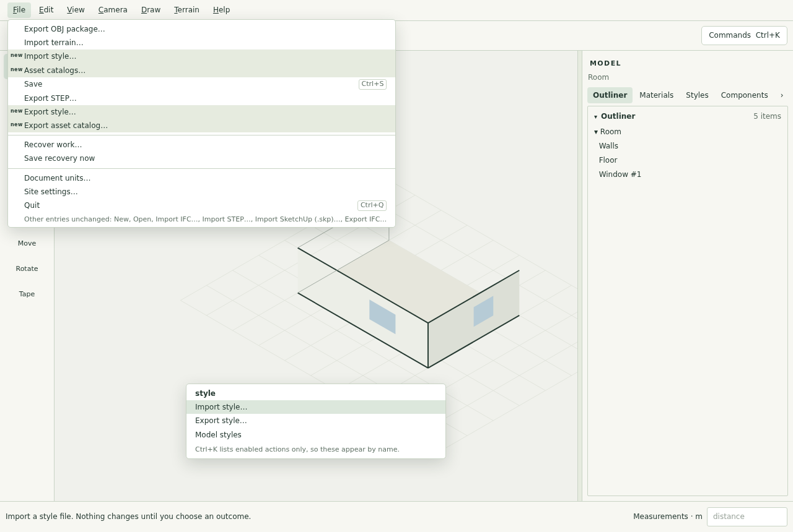 | The File menu with the four new entries, and command search | 18.1 |
| 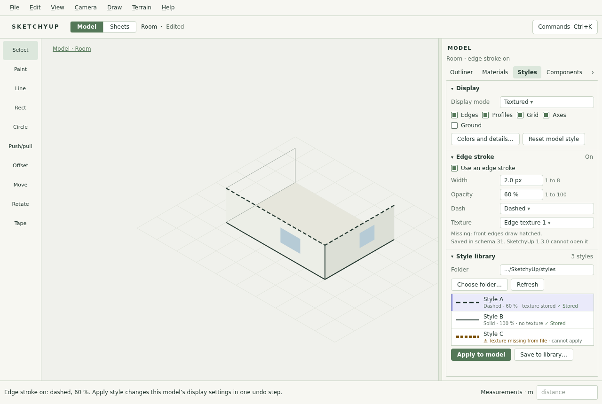 | The Styles tab: the display controls, the edge stroke and the style library | 18.1–18.3 |
| 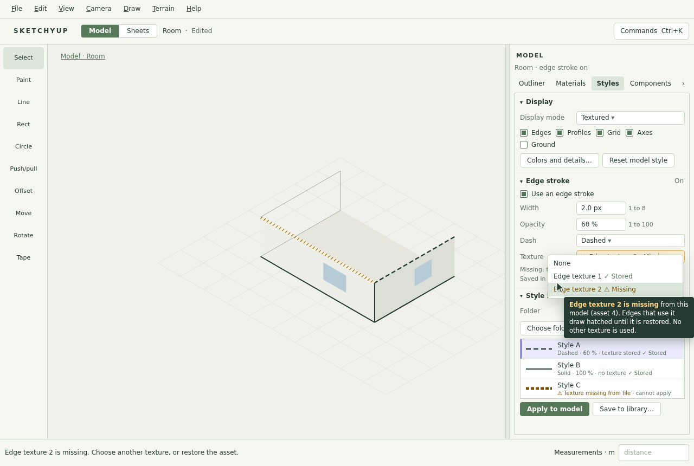 | A missing texture: the field's state, the list, and the tooltip at the pointer | 18.3 |
| 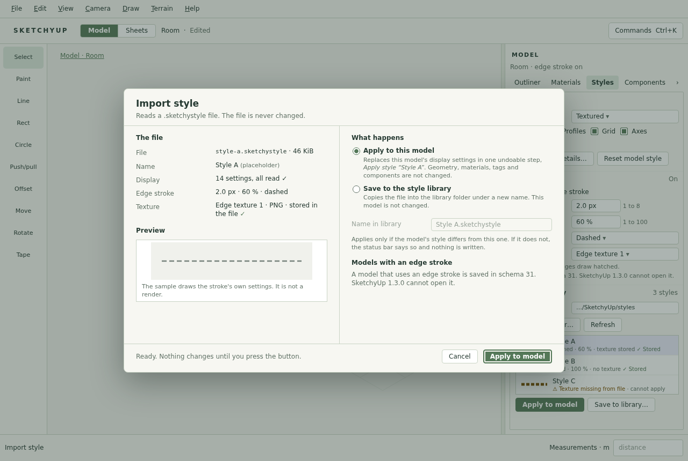 | Import style: the file's facts and the two outcomes | 18.2 |
| 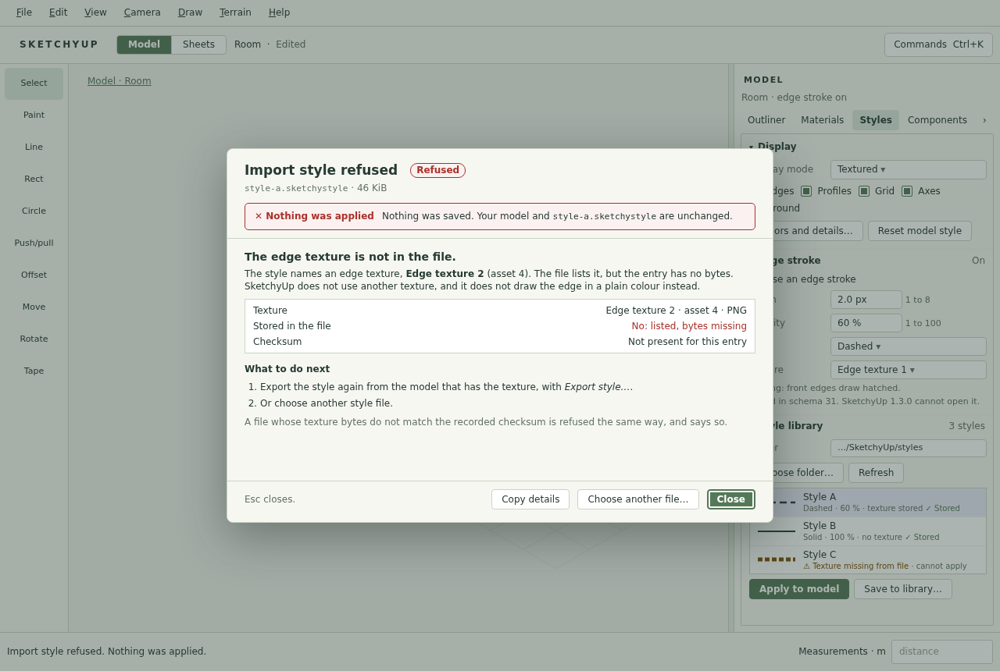 | Refused: the texture is not in the file | 18.2, 18.6 |
| 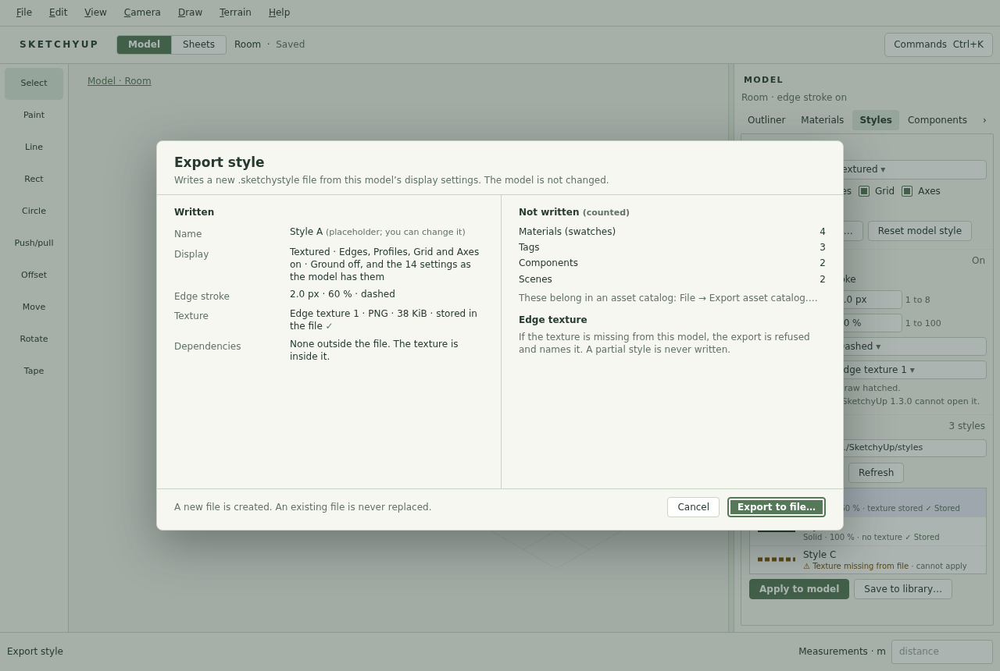 | Export style: what is written and what is not | 18.2 |
| 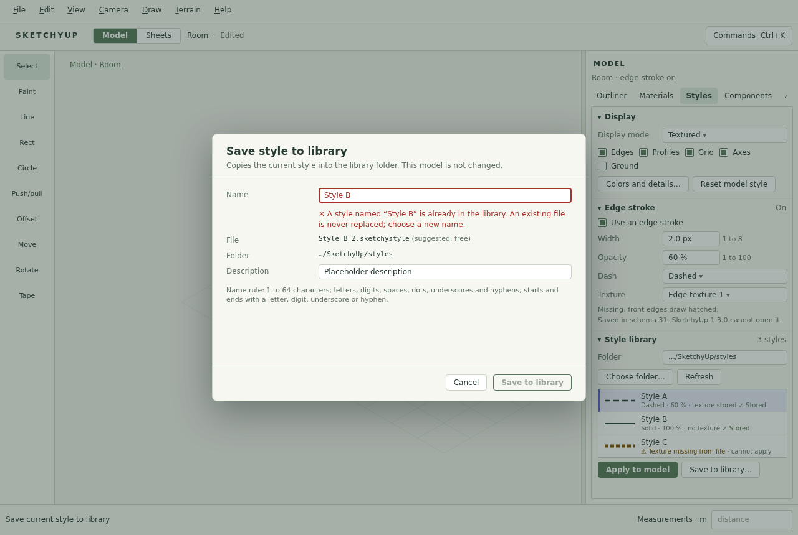 | Save to the library, with a taken name refused in the dialog | 18.2 |
| 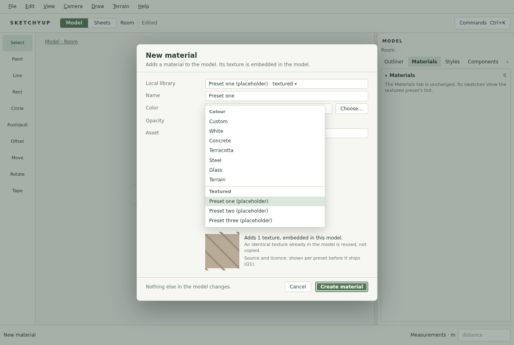 | New material: the textured presets, the tinted tile and what will be added | 18.4 |
| 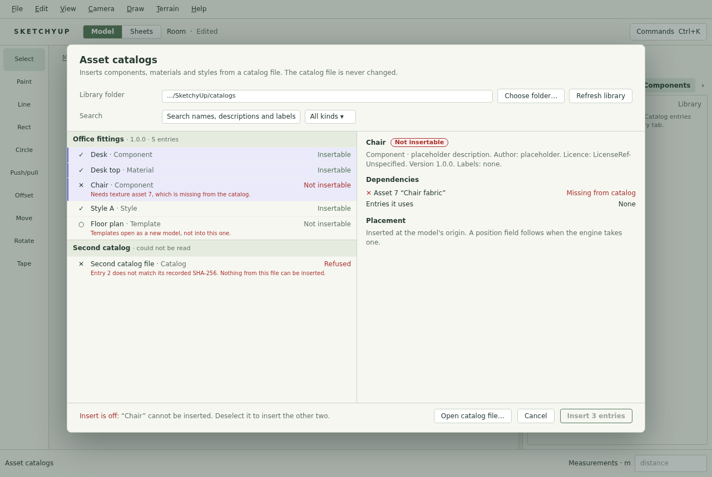 | Asset catalogs: folder, search, entries and an insert that is off | 18.5 |
| 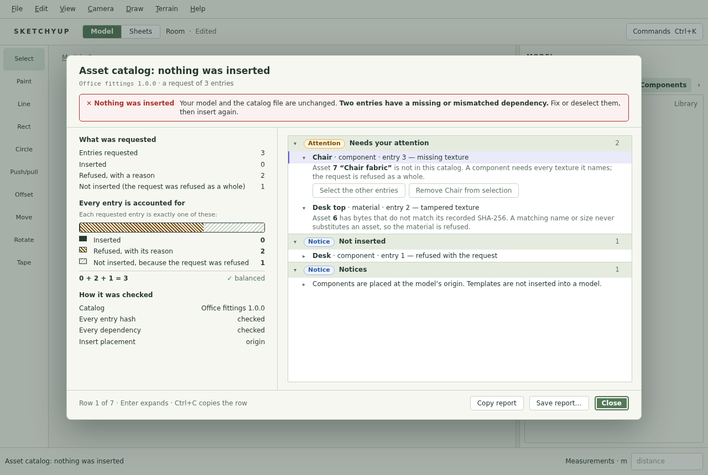 | The missing-dependency report and its accounting | 18.5 |
| 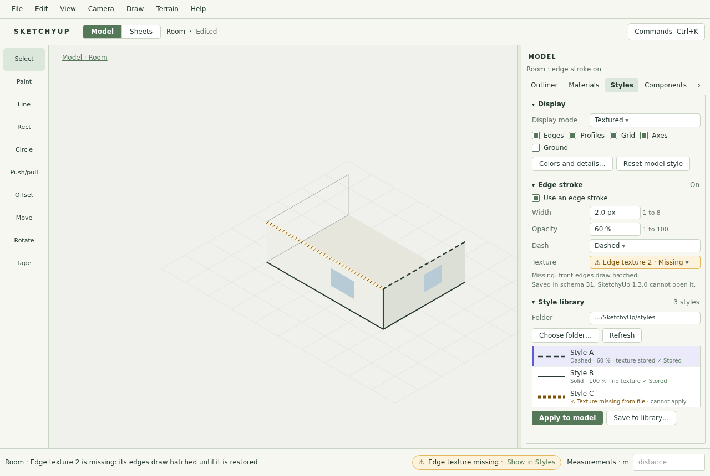 | What the viewport draws with a stroke and a missing texture | 18.3 |

The 200 % versions are `mockups/styles/<name>-200.png` for each of the eleven screens.


## 19. Quantities and schedules

**Status: approved by the owner on 2026-10-27**, with every 19.12 choice as recommended. Not implemented. R101.e builds this on the merged engine, outputs, saved schedules and MCP surface (R101.a to R101.d).

This section designs the desktop side of the report engine ([ADR 0175](decisions/0175-quantities-reports-schedules.md)): where the Quantities section lives, grouping and filters, the live totals, the invalid list, saved schedules, the export files, units and precision, refusals, and keyboard and accessibility. ADR 0175 §10 asks for it before R101.e, and each of its bullets is answered here:

| ADR 0175 §10 bullet | Decided in |
| --- | --- |
| Entry point and default view | 19.1 |
| Grouping and filters, the selection toggle, the file-only hint | 19.2 |
| Live state: "Computed at revision N", computing and Cancel, the invalid list | 19.3, 19.4 |
| Schedules: create, rename, delete, Run, Export CSV…, Export JSON… | 19.6, 19.7, 19.8 |
| Units and precision in labels | 19.5 |
| Keyboard and accessibility | 19.10 |

The figures are the ADR 0175 §11 fixture `quantities-a` with its corrected totals: 40,259.20 m² at precision 2, where the earlier text said 40,174.20. Section 19.11 lists where the engine, the CLI or the schedule store does not yet give the design what it needs, and 19.12 lists the choices for the owner. The mockups are `mockups/quantities.html` (all screens, with notes) or `mockups/quantities.html?screen=<name>` (`menu`, `totals`, `groups`, `filters`, `computing`, `save`, `schedules`, `run`, `stale`, `delete`, `store`, `exported`, `exists`), drawn in the light theme of `src/app/theme.hpp`. Add `&text=200` to any of them to double the text size. The drawing is illustrative. The terrain's name, the folder and the tags other than Boxes and Off are invented, and each screen says which figures it derives.

### 19.1 Where it lives and the default view

- **The section.** Quantities is a section of the Tray, between Tags and History, like Entity info, Outliner, Materials and Tags (sections 3.1 and 5). It is not on the Info tab, which describes the selected entity. A quantity describes the whole model and must show with nothing selected. It is not a rail slot, a window or a floating palette (sections 2 and 3.1).
- **Ways in.** View → Quantities shows the Tray, opens the section and puts focus on Group by. It has no default shortcut; the shortcut editor can assign one. Ctrl+K lists "Quantities" while it is enabled. In a narrow window the Tray is the overlay sheet of section 3.3, and the same entries open it. Version 1 adds no File menu entry; export lives in the section.
- **Default view.** Group by None, the **All** row, hidden content included (ADR 0175 owner decision 1), the document's display units and precision. The All row shows area, volume, contexts, instances, definitions and "Not counted in volume". Below it come "Computed at revision N", the Not solids list when there is one, the terrain line and the export buttons (screen `totals`).
- **Metrics are not a choice.** Every run computes all four tables. Each run computes the face areas anyway, because the terrain table is always emitted (R101.a notes), so a metrics switch would save no time. Version 1 has none.
- **When it computes.** The section computes only while it is open. Collapsed, it does nothing. Open, it runs when opened and again whenever the revision changes (ADR 0175 §5), so the totals follow edits and undo.
- **Empty model.** The All row shows zeros, as the engine always emits it, with the line "No bodies in this model. Draw something, or import a model."

### 19.2 Grouping and filters

- **Group by.** A combo box: None (the default), Kind, Tag, Material or Definition (ADR 0175 §1). The panel names each group: "Untagged", "No material", "No definition", and for kinds "Geometry", "Group", "Component", "Terrain" and "Reference image". An em dash marks a group with no ID only in the CSV. The panel uses the words.
- **Hidden content.** Two radio buttons: **Include hidden** (the default) and **Visible only**. Visible only drops hidden groups, hidden bodies and content on hidden tags, as ADR 0175 §2.2 defines. It does not drop geometry hidden for this session only, because the file alone must reproduce the report. The caption under Visible only says so: "Hidden tags, groups and bodies are left out. Geometry hidden for this session only is still counted."
- **Pickers.** Tags, Materials and Definitions are rows that show their value ("none", "Boxes", "2 selected") and open a popover of check rows. This is the pattern of the Tags and Materials sections: each row carries its name and a muted count, and the choice is by ID. A folder includes every tag under it, and its row says so ("includes its tags"). The Definitions picker lists all four definitions with their placement counts, nested ones included, so Post can be filtered on its own (ADR 0175 V2).
- **Missing IDs in a filter.** A filter that names a tag, material or definition that no longer exists shows "Missing tag 7" in amber, with **Remove**. Save and Run are disabled until it is removed, so nothing runs with fewer filters (ADR 0175 §7).
- **Materials apply to areas only.** The Materials row says "areas only", and its popover says "Counts and volumes ignore this filter." The CSV cannot say so (19.11, item 6), so the panel does.
- **Selection only.** A check row. It is enabled when the editor has a selection, and it names the count ("3 bodies selected"). With nothing selected it is greyed, with the words "select bodies in the model to use this". A selection is the selected bodies and their descendants. A hidden body cannot be selected, so a selection never brings hidden content in (ADR 0175 §1 and the R101.a notes).
- **The file-only hint.** A saved schedule and the command line have no editor, so they cannot use a selection. The save dialog therefore never offers the selection row, and says why: "Not stored: the selection. A schedule runs without it, from the file and the command line alike." A saved schedule never keeps a selection (ADR 0175 §7 and §8).
- **Per model.** The filter state belongs to the open model. Opening another model resets it to the defaults, because the IDs belong to one document.

### 19.3 Live state: revision, computing and Cancel

- **Revision line.** "Computed at revision 214" sits under the totals. It is the revision the numbers came from (ADR 0175 §4 and §5), so any total can be traced to a model state. The document identity is in the export report, not in the panel.
- **Quick runs.** A run that finishes within about a second shows no progress. The previous totals stay readable until the new ones replace them, so the panel never goes blank while it updates.
- **Computing.** After about a second, the totals dim and a line reads "● Computing revision 215 · elapsed 0:03", with a bar and a **Cancel** button, which is not the default. The status bar shows a job chip, "Quantities 0:03 · Cancel", as it does for other background work (section 3.1).
- **Progress.** The engine reports no progress yet (19.11, item 1), so the bar is indeterminate and the elapsed time is what the person reads. The design shows no percentage. When the engine reports the contexts it has done, the bar becomes determinate.
- **Cancel.** Returns control in 100 ms or less (ADR 0175 §12). The panel then shows the last complete result with its own revision, and the line "Not updated: cancelled. Showing revision 214." A total is never shown with a revision other than the one it was computed at.
- **A newer revision.** If the model changes while a run is in progress, the run is superseded. Its result is dropped and a run starts for the newest revision.
- **A failed run.** The section says "The totals could not be computed: <the engine's message>." and keeps the last result, labelled with its revision.
- **Announcements.** One per run the person waited for (a group change, Run or Cancel), not one per edit (19.10).

### 19.4 The invalid list

- **Where.** Under the totals, as "Not solids", with one row for each status that has bodies, in the order of the CSV's invalid table (ADR 0175 §6.1). A status with no bodies has no row. The header reads "area counted, volume not".
- **Words.** A row uses the wording of the Entity info panel, from `unavailable()` in `src/app/entity_info_panel.cpp`: "Not a solid: open boundary", "Not a solid: non-manifold boundary", "Not a solid: inconsistent face winding", "Not a solid: loose geometry", "Not a solid: intersecting faces", "Not a solid: degenerate shell". The statuses the panel already names as unavailable keep its words ("Unavailable: multiple shells", "Unavailable: ambiguous shell containment", "Unavailable: analysis limit"), and an empty record reads "No closed surface". One table serves both (19.11, item 8).
- **Row shape.** A ⚠ glyph in the warning colour, the words, the count ("1"), and a second line: "1 body · area counted, no volume". The glyph, the word and the count carry the state, so no row depends on colour. The glyph is amber because it is a warning about the model, not a refusal.
- **Terrain is not in this list.** Terrain has its own line, as a terrain, with no volume and the words "not a solid" (ADR 0175 §2.5).
- **The volume line.** The All row shows "Not counted in volume" beside the volume, so a reader can see that the volume leaves out N bodies.
- **Selecting them.** The engine returns counts, not bodies (19.11, item 4), so version 1 rows cannot select their bodies. Owner question 3 proposes adding up to 64 body IDs per status to the query. Each row would then offer **Select in model**.

### 19.5 Units and precision in labels

- **Units.** Every measure carries its unit, in the document's display units (ADR 0175 §3): m² and m³ for metres, mm² and mm³ for millimetres, ft² and ft³ for feet. A feet-and-inches document reports in feet; the compound form never appears in a total. Counts have no unit. Accessible names say the unit in words ("square metres").
- **Precision.** The document's display precision by default, set in File → Document units…. The panel header shows it ("precision 2"). Version 1 has no precision control in the panel. A saved schedule pins the precision it was saved with (owner question 4).
- **The corrected totals.** Quantities-a at precision 2, the All row: **40,259.20 m²** and **82.40 m³**. Under Visible only: **40,241.20 m²** and **79.40 m³** (ADR 0175 §11, corrected in the R101.a review). The earlier 40,174.20 m² is withdrawn.
- **Separators.** The panel groups digits as the locale does, as the Entity info panel does ("40,259.20"). The CSV and JSON never group (ADR 0175 §6.1), so a file and the screen agree once the separators are removed.
- **Feet.** A feet document reports in ft², ft³, and at most three decimals, the largest precision `maxDisplayPrecision` allows for feet (`src/core/units.hpp`). ADR 0175 §11 gives ft-in values to four decimals ("141.2587 ft³", "172.2226 ft²"), which no allowed precision produces. The design shows "141.259 ft³" at precision 3 and asks for the ADR example to be corrected (19.11, item 14).
- **Millimetres.** In mm, the same totals are a million times the m² figures: 40,259,200,000.00 mm² at precision 2. ADR 0175 §3 requires the document's units, so the design keeps them (19.11, item 13).

### 19.6 Schedules: create, rename, delete and Run

- **The list.** A **Saved schedules** block sits below the export buttons and holds this model's schedules in name order. Each row shows the name, a summary ("Definition · Included · all metrics · precision 2"), the date saved, a **Run** button and a **⋯ Actions** menu (screen `schedules`). The list is per model (ADR 0175 §7), so other models' schedules are not in it (19.7).
- **Create.** **Save as schedule…** sits under the list and in the export row. It opens a small modal dialog (screen `save`) with a **Name** field, a "Stored with the name" list (grouping, hidden content, metrics, precision pinned) and the "Not stored" line for the selection. Save is the default. Enter saves and Esc cancels. The name rules are the store's: 1 to 64 characters, letters, digits, spaces and . _ ( ) -, starting and ending with a letter or a digit. The field counts characters as you type and says the rule in words when it is broken.
- **Name in use.** "A schedule named "Boxes only" already exists for this model. Choose another name." The engine's own text says "delete it first", which the panel does not show (19.11, item 3).
- **Disabled, with the reason on screen.** Save is disabled when the model has no file yet ("Save the model first. A schedule belongs to a saved model.") or when the model has 32 schedules ("This model has 32 schedules. Delete one to save another."). The first matters because a schedule keyed to a model that is never saved could not be found again (19.11, item 10).
- **Run.** Runs the schedule's own request and makes it the active view. The section header reads "Schedule · Boxes only", with **Back to the live view** (screen `run`). The active schedule re-runs when the revision changes (ADR 0175 §5). A schedule never uses the selection.
- **Rename.** **Rename…** opens the same name field, filled in, with the same rules and the same duplicate message. The request and the creation time are kept. The store has no rename yet, so the design assumes one (19.11, item 2).
- **Delete.** **Delete…** asks first (screen `delete`): "Delete the schedule? Its saved filters are removed from this computer. The model is not changed. Reports you exported earlier are not changed." Cancel is the default, and Esc cancels, as Reset edits does (section 15.6). Delete is never the default.
- **Export from a schedule.** Export CSV… and Export JSON… from a row, or from an active schedule, write that schedule's own request. The CSV carries `#schedule=` with the name in place of `#ad-hoc=1`, and the JSON carries `metadata.schedule` (ADR 0175 §6.1 and the R101.c notes).
- **Limits.** The panel builds every request from its controls, so the 16 KiB request limit is never reached. The 1 MiB store file and the 64-model limit can be reached, and 19.9 covers them.

### 19.7 Stale schedules and another model's schedules

- **Stale.** A schedule that names a tag, material or definition that no longer exists is marked when the list opens and whenever the revision changes. The check only looks IDs up and runs nothing. The row shows an amber ⚠ and plain words: "Stale: tag 7 no longer exists", or "Stale: material 3 and tag 7 no longer exist".
- **Run is refused.** Run on a stale schedule is refused in the row, not in a dialog. The row shows a red ✕ "Not run." and the sentence "It refers to tag 7, which no longer exists in this model. Nothing was run, and the totals above are unchanged." The row offers **Delete…** and **Save current filters as…**, which opens the save dialog with the current filters. The engine names the IDs in its refusal details, and the panel names them in words. Nothing runs with fewer filters (ADR 0175 §7).
- **Stale is never silent or automatic.** The panel does not delete or edit a stale schedule, and no stale schedule changes the live totals.
- **Another model's schedules.** A model's list shows only its own schedules, keyed by identity (ADR 0175 §7), so schedules saved for other models do not appear. When there are some, one muted line says: "Other models on this computer have 3 schedules. They are kept with those models and are not listed here." It gives a count and no names, and it offers no action. Those schedules are reached by opening their models.
- **The command line.** A schedule run against the wrong file is refused WRONG_DOCUMENT and names both identities (R101.c). The panel never shows that refusal, because it lists only its own model's schedules.
- **A store that cannot be read.** A damaged or oversized store file puts a red ✕ "Schedules cannot be read" in the schedules block, with the file's location and the place of the fault. The text then says: "Totals, groups and exports still work. SketchyUp never resets this file: move it aside yourself, then reopen this model." The rest of the section keeps working (screen `store`). An optional store must not stop the model's own numbers (principle 5).
- **A busy or changed store.** Two cases, each with its own line: "Another SketchyUp window is changing schedules. Try again." when the store is locked, and "The schedule file changed in another process. Nothing was saved. Try again." when it changed after it was read.

### 19.8 Export CSV… and Export JSON…

- **The dialog.** Export CSV… and Export JSON… open the system Save dialog for a new file, suggesting "<model name>-takeoff.csv" or ".json" with the matching filter. The dialog has no overwrite prompt, as the IFC and DXF exports have (section 16.8). A name that exists is refused after the dialog, on the sheet of screen `exists`. Nothing is replaced.
- **What is written.** The current view: its grouping, filters, precision and all four tables. In a schedule's view, the schedule's own request, with its marker. An export from the live view writes `#ad-hoc=1`.
- **Selection.** If Selection only is on, the file holds the selection's figures and `#filters.selection=1` (ADR 0175 §6.1). The file writer does not take a selection yet (19.11, item 5).
- **Progress.** A write that takes more than a second shows the progress line of 19.3, labelled "Writing the file…", with Cancel. Cancel writes nothing. The budget is 10 s for 100,000 rows (ADR 0175 §12).
- **The export report.** The report sheet of section 6.4, laid out like the IFC export report (section 16.8; screen `exported`). Its banner reads "✓ Written. The model is unchanged." The left column records what was written: grouping, metrics, hidden content, precision, units, revision, and the schedule or "none (ad hoc)". The right column lists **Needs your attention** (each not-solid, with its words and, once 19.11 item 4 is done, **Select in model**) and **Notices** (terrain is not a solid). The buttons are **Copy path** and **Close**, which is the default.
- **JSON.** The same figures as the CSV, in the shape of ADR 0175 §6.2. Both come from one result, so they agree.

### 19.9 Refusals

Every refusal follows section 16.6: it first says that nothing was saved or written and that the model is unchanged, then gives the reason and the number, then the next step. The name rules are the one exception. They show in the field as the person types, before anything is attempted.

| Where | Engine refusal | What the person is told | Next step |
| --- | --- | --- | --- |
| Save or Rename, name | `INVALID_REQUEST` | In the field: "Use 1 to 64 letters, digits, spaces or . _ ( ) -, starting and ending with a letter or a digit." | Edit the name |
| Save or Rename, name in use | `INVALID_REQUEST` | "A schedule named "X" already exists for this model. Choose another name." | Choose another name |
| Save, 32 schedules | `LIMIT_EXCEEDED` | Save is disabled, with "This model has 32 schedules. Delete one to save another." | Delete a schedule |
| Save, 64 models in the store | `LIMIT_EXCEEDED` | "Nothing was saved. This computer's schedule file holds 64 models, its limit. Open each model whose schedules you no longer need and delete them there." | Open those models |
| Save or Run, missing IDs | `NOT_FOUND`, with the IDs | The stale row (19.7) | Delete…, or Save current filters as… |
| Run, a schedule of another model | `WRONG_DOCUMENT` | Not shown: the panel lists only this model's schedules | Use the command line on the right file |
| Any read of the store | `INPUT_ERROR` | The store block (19.7) | Move the file aside |
| Store changed by another process | `FILE_CHANGED` | "The schedule file changed in another process. Nothing was saved. Try again." | Try again |
| Store locked | `OUTPUT_ERROR` | "Another SketchyUp window is changing schedules. Try again." | Try again |
| Export, file exists | `FILE_EXISTS` | "Nothing was written. quantities-a-takeoff.csv already exists in this folder. An existing file is never replaced." (screen `exists`) | Choose a new name |
| Export, over 256 MiB | `LIMIT_EXCEEDED` | "Nothing was written. This report is over the 256 MiB limit. Group less, pick a tag, or choose Visible only." | Narrow the report |
| Run, the engine fails | any | "The totals could not be computed: <message>." | Try again |

### 19.10 Keyboard and accessibility

| Control | Keys | Accessible name (example) |
| --- | --- | --- |
| The section | Ctrl+K "Quantities", or View → Quantities; focus lands on Group by | "Quantities, revision 214" |
| Group by | Enter or Space opens the list; Up and Down choose; Enter confirms | "Group by: Definition" |
| Hidden content | One Tab stop; the arrows choose | "Hidden content: Visible only" |
| Tags, Materials, Definitions | Enter opens the popover; Up and Down move; Space checks; Esc closes | "Tags filter: Boxes selected, 1 of 3" |
| Selection only | Space toggles; disabled while nothing is selected | "Selection only: nothing selected, unavailable" |
| Totals and groups | One Tab stop; Up and Down move between rows; Ctrl+C copies the row | "Area, 40,259.20 square metres" |
| Not solids | One Tab stop; Up and Down move; **Select in model**, when offered, is the next Tab stop | "Warning: Not a solid: open boundary, 1 body, area counted, no volume" |
| Computing | Cancel is a Tab stop and not the default; Esc cancels while focus is in the section | "Computing revision 215, elapsed 0:03. Cancel" |
| Saved schedules | One Tab stop; Up and Down choose; Enter runs; Shift+F10 or the menu key opens Actions; F2 renames; Delete asks first | "Takeoff by definition, saved 24 October 2026, Definition, Included. Run" |
| Stale row | As above; the refusal is read with the row | "Walls, old. Warning: stale, tag 7 no longer exists" |
| Save and Rename dialogs | The name is focused; Enter saves (the default); Esc cancels | "Schedule name, 21 of 64 characters" |
| Delete dialog | Cancel is the default; Esc cancels | "Delete the schedule Walls, old?" |
| Export buttons | Tab stops in the section's footer | "Export CSV…" |
| Export report | Close is the default; Esc closes | "Export report: items that need attention and notices" |

- **Keyboard-only path.** Ctrl+K, then "Quantities", then Group by, the hidden-content radios, the pickers, Selection only, the totals, Not solids, the schedules and the export buttons, in that order. The Tab order follows the section, and no step needs a pointer. Enter runs a schedule, and Esc cancels a run or closes a popover.
- **Not colour alone.** Every state has a glyph and a word: ⚠ Not a solid, ⚠ Stale, ✕ Not run, ✕ Nothing was written, ● Computing, ✓ Written. Amber marks a warning about the model, and red marks a refusal or a failure (section 7). A hidden tag is named "hidden" in the Tags popover as well as shown in its colour.
- **Announcements.** One per run the person waited for ("Computed at revision 214: area 40,259.20 square metres, volume 82.40 cubic metres. 2 not solids."), one per export ("Written: quantities-a-takeoff.csv. The model is unchanged."), and one per refusal, announced as an alert. There is no announcement per edit, per row, or per background change of revision.
- **Text size.** At 200 % the value of each group row moves under its name, the schedule actions go under the summary, dialogs scroll with their footer in view (section 16.9), and the report's two columns stack. The section scrolls, and nothing is cut off without a scroll.
- **Motion.** The bar is the only animation. With reduced motion on, it is static, and the elapsed time still counts up (section 7).
- **Checks.** R101.e's input tests run on X11 and Wayland at 1×, 2× and 200 % text, with the keyboard-reachability and accessible-name checks of the IFC and terrain tests (sections 15.7 and 16.9). They cover the stale row, the unreadable store, the existing-file refusal, Cancel and a newer revision during a run.

### 19.11 Gaps in the engine, the CLI and the schedules

These are the points where the design needs something that the engine, the CLI or the schedule store does not yet give. Each is a note for R101.e or a later row. None is changed here.

1. **No progress and no cancel in the engine.** `runReport` (`src/core/report.hpp`) is one synchronous pass, with no progress callback and no cancel flag. The panel needs a worker that runs it off the UI thread, checks a cancel flag between records, and reports the contexts it has done. The 100 ms cancel budget depends on how often that check runs. The re-run budget for the panel (p95 ≤ 250 ms on a model of up to 100,000 faces, ADR 0175 §12) has not been measured: R101.b timed the engine on its own, and the panel has no run yet.
2. **No rename and no update of a schedule.** The store has add, lookup and remove, and the session action has save, describe and delete (`src/automation/report_schedules.hpp`; R101.c). A rename is a delete and a save, so a failure between them can lose the name or the request. The design assumes one atomic `rename` in the store and the session action that keeps the request and `createdAt`. Fixing a stale schedule's filters needs the same action.
3. **The duplicate-name refusal says "delete it first".** That text suits the command line. The panel says "Choose another name", and a rename would make the engine's text unnecessary.
4. **Invalid rows carry a count, not bodies.** `ReportInvalidRow` holds a status and a count. Selecting the bodies needs bounded body IDs per status (owner question 3).
5. **A file cannot take a selection.** `ReportFileOptions` has no selection field, and `writeReportFile` runs without the session's bodies. A selection file needs either that field and the bodies as an argument, or the panel calling `reportDescription` with the bodies and writing the file through `publishNewFile`, as `writeReportFile` does. The CSV metadata already has `#filters.selection=1` (ADR 0175 §6.1), so the file form is settled.
6. **The CSV cannot say that materials apply to areas only.** The JSON does. The CSV's metadata list is fixed by ADR 0175 §6.1, which allows no other `#` line, so the panel says it instead (owner question 5).
7. **Terrain names are not unique in the CSV.** The terrain rows carry the name only (R101.b notes). The panel tells two same-named terrains apart by their ID, which the CSV does not carry. This is a gap in the file of record.
8. **The "Not a solid" words are private to the Entity info panel.** `unavailable()` sits in an anonymous namespace of `src/app/entity_info_panel.cpp`. The report should use the same words, so the function moves to a shared header.
9. **A schedule does not pin its units.** A request has a precision but no display units, so a schedule run after the owner changes the units reports in the new ones. Precision is pinned (owner question 4). Pinning units would need a request field; the design accepts the gap until then.
10. **A schedule for a model that is never saved is lost.** The store is keyed by identity, and an unsaved model's identity cannot be opened again. The design disables Save until the model has a file (19.6). The engine accepts such a save, and its message "save the document before scheduling reports" applies only to an unusable identity.
11. **A copied file shares schedules.** The identity lives in the file, so a copy made outside SketchyUp lists the same schedules. Save as… keeps the identity (ADR 0175 §4). This is accepted for version 1 and flagged, not solved.
12. **The 64-model refusal cannot be acted on from the panel.** The engine's text says to delete schedules "of another document", and the panel lists only this model's. The design sends the person to open those models instead.
13. **Millimetre totals are very large.** In mm the same totals are a million times the m² figures. ADR 0175 §3 requires the document's units, so the design keeps them. A report unit choice would be a later row.
14. **ADR 0175 text that does not match the code or itself.** (a) §11 gives ft-in values to four decimals, which no allowed precision produces (19.5). (b) §11 and the R101.a notes call the 214 m² "non-terrain non-component" area, but it includes BoxP's 48 m², and BoxP is a component. The total of 40,259.20 m² is right, and only the label is wrong. (c) The R101 roadmap row says R101.b is "awaiting merge" and R101.c to R101.f are planned. R101.b is merged (#452) and R101.c is open (#453). This change sets the row's UX field and nothing else.
15. **The terrain's material is not stated.** §11 gives the unassigned area as 214 m² of the 259.2 m² non-terrain, and does not say which material the terrain's 40,000 m² reports under. It reports under its **Terrain** material, because terrain creation gives every tile that material (ADR 0175, R101.e1 implementation notes, "Terrain's material row"). The terrain container has no faces, so its one context counts under "No material" with no area. The Material view in this design, and its mock in `mockups/quantities.html`, draw the terrain's area under "No material". That is the old wording. The mock is not redrawn here, and R101.e's tests check the row.

### 19.12 Choices for the owner

Each choice has a recommended default. **The owner decided all five on 2026-10-27, each as recommended:** the Tray section with View → Quantities; exporting a selection is allowed; the invalid rows carry up to 64 body IDs so they can select bodies; a schedule pins its precision at save; and the materials caveat stays in the panel, with no new CSV line. R101.e builds these.

1. **Where the section lives.** A Tray section with View → Quantities (recommended), a section on the Info tab beside Terrain edits, or a Reports menu that opens sheets. *Recommended: the Tray section. The totals describe the whole model, and the Info tab describes the selected entity.*
2. **Exporting a selection.** Allow a file of the selection (recommended; needs 19.11 item 5), or whole-model files only in version 1. *Recommended: allow it. The totals on screen should be exportable as they are shown.*
3. **Bodies behind "Not solids".** Add up to 64 body IDs per status to the query, so that each row can select its bodies (recommended; the change is additive), or counts only in version 1. *Recommended: add the IDs. A count without the bodies leaves the person to hunt for them.*
4. **Precision in a schedule.** Pin the precision at save (recommended), or follow the model's setting at each run. *Recommended: pin. A saved takeoff should not change because someone changed a display setting, the same reason the stamp carries the revision.*
5. **The materials caveat.** Say it in the panel only (recommended; the CSV dialect stays as ADR 0175 §6.1 has it), or add a metadata line to the CSV, which amends §6.1. *Recommended: the panel only. The file's metadata list is fixed, and the JSON already states it.*

| Screen | Shows | Sections |
| --- | --- | --- |
| 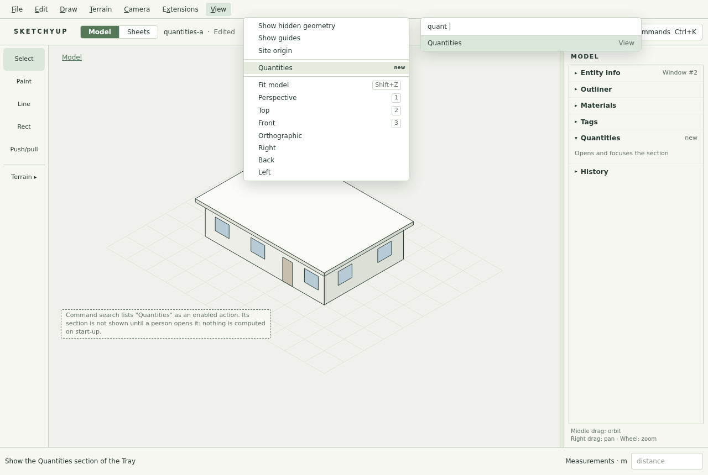 | View → Quantities and the Ctrl+K path; the section not yet open | 19.1 |
| 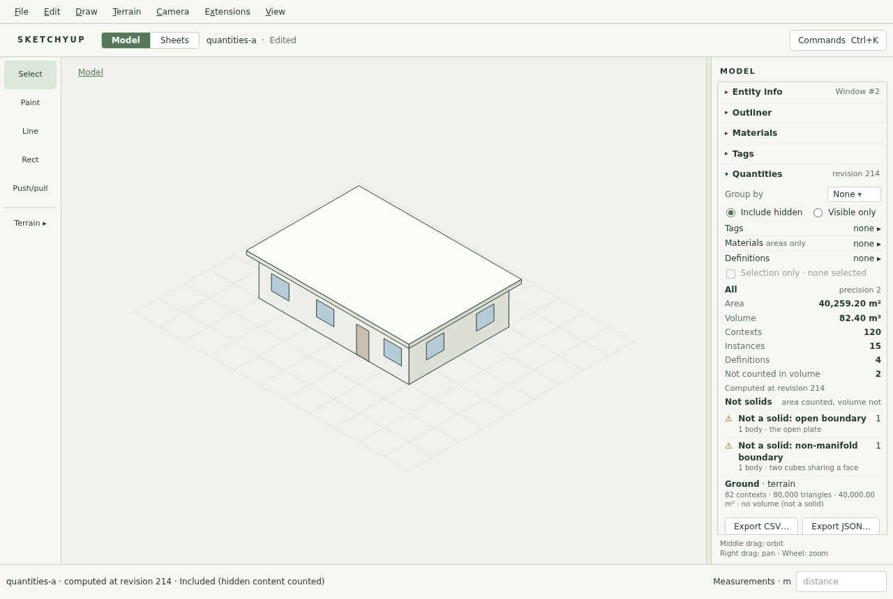 | The default view: the All row, the revision, Not solids, terrain, the exports | 19.1, 19.3, 19.4, 19.5 |
| 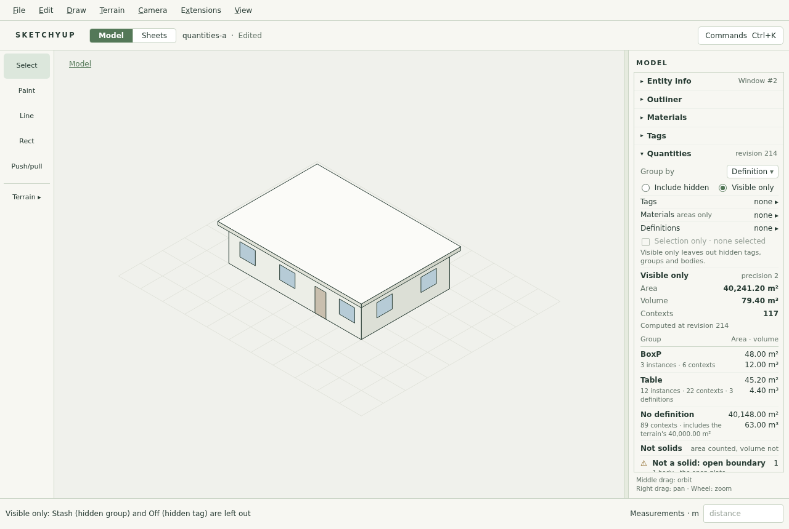 | Group by Definition with Visible only: the three rows and the caption | 19.2, 19.5 |
| 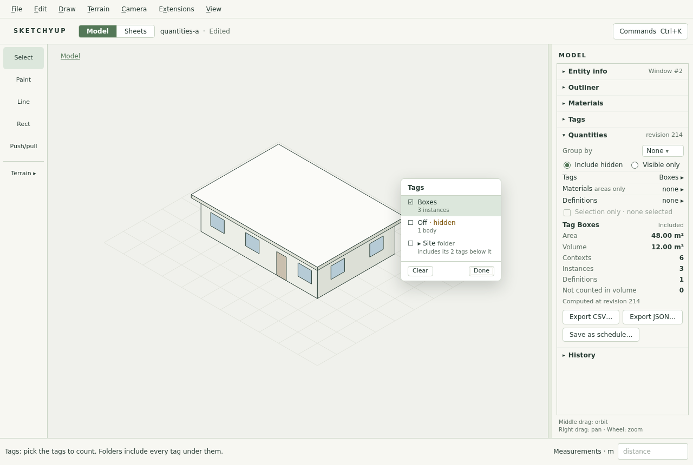 | The Tags popover with a folder and a hidden tag; the materials caveat; the disabled selection | 19.2 |
| 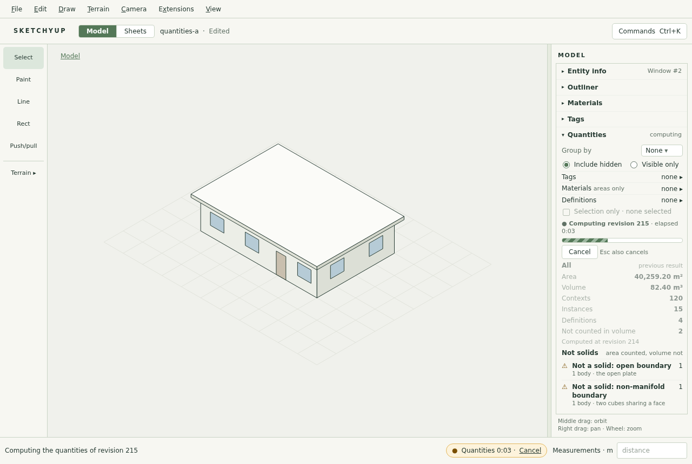 | A run past a second: the previous totals kept, the progress line, Cancel | 19.3 |
| 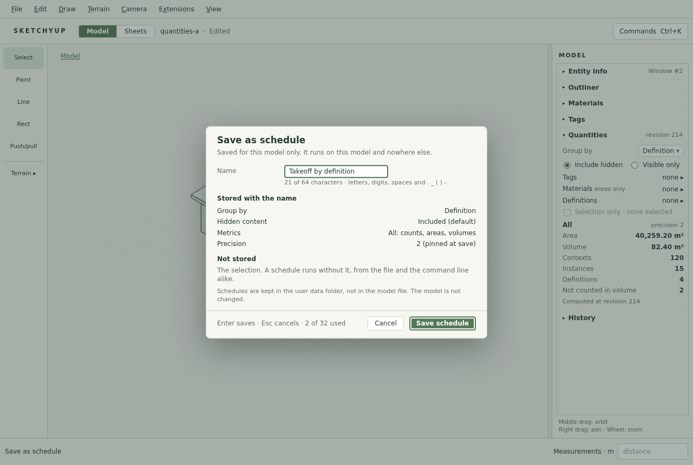 | Save as schedule: the name rules, what is stored and what is not | 19.6 |
| 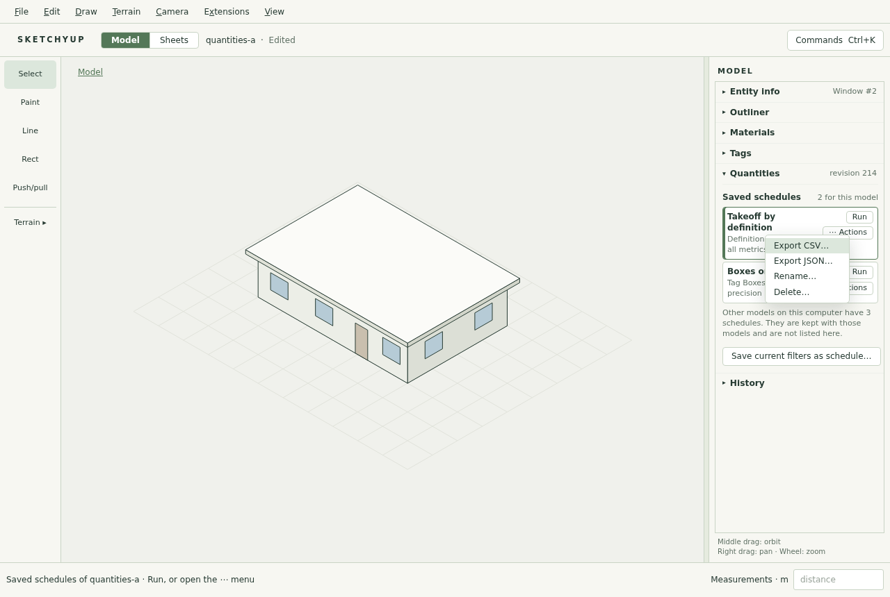 | The model's saved schedules and the ⋯ Actions menu | 19.6, 19.7 |
| 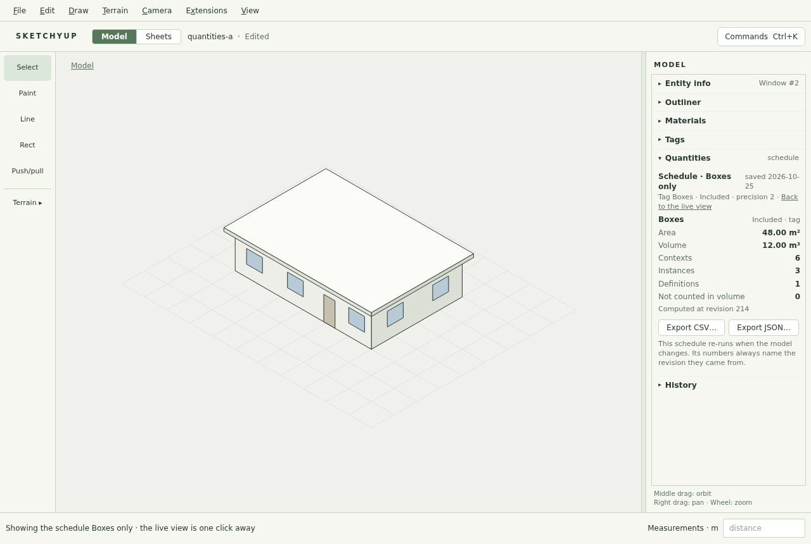 | A schedule as the active view, with its revision and Back to the live view | 19.6 |
| 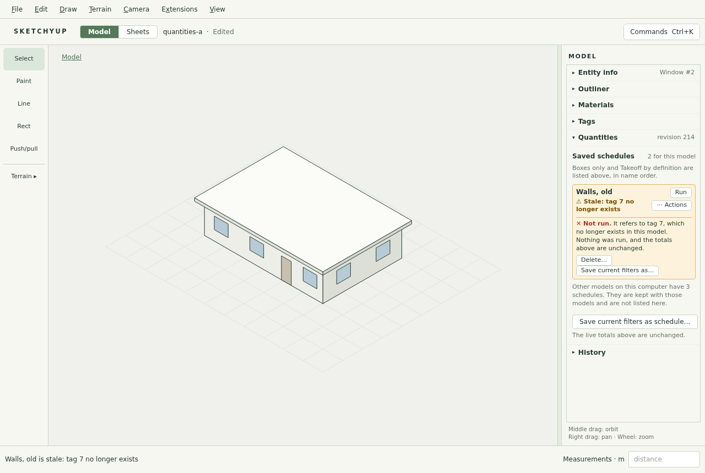 | A stale schedule: the amber state, the red refusal and the two ways out | 19.7, 19.9 |
| 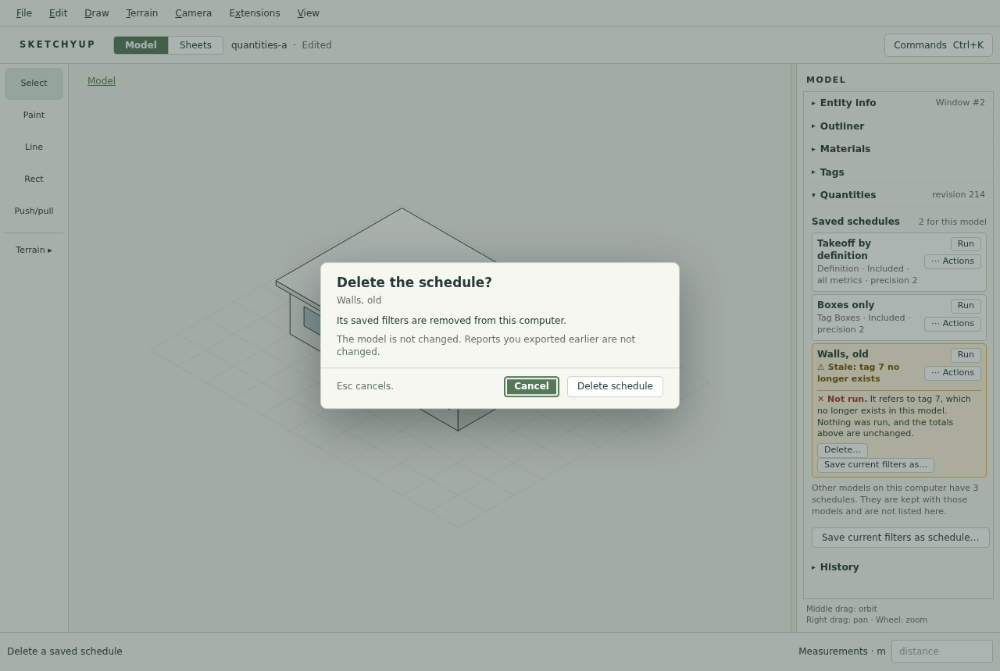 | Delete a schedule: Cancel is the default | 19.6 |
| 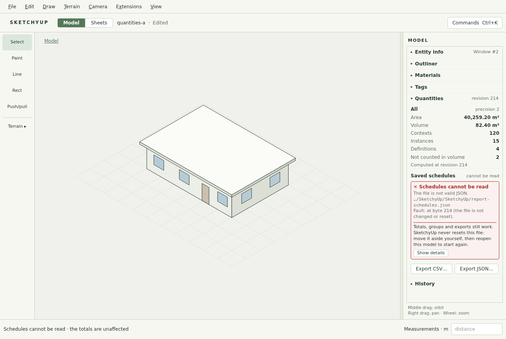 | The schedule file cannot be read; the rest still works | 19.7 |
|  | The export report: what was written, Not solids, notices | 19.8 |
|  | Refused: the file already exists, and nothing was written | 19.8, 19.9 |

Each screen also renders at 200 % text as `mockups/quantities/<name>-200.png`, which is the check for wrapping and overlap.

## 20. Terrain from a downloaded elevation file (desktop)

**Status: approved by the owner on 2026-10-30**, with every 20.8 choice as recommended. Not implemented. This section designs the desktop side of R107.b: importing an elevation file that the person downloaded from USGS 3DEP or Copernicus GLO-30 as a terrain. The engine and the command line already do the import (R107.b1, R107.b1.1 and R107.b1.2; [ADR 0181](decisions/0181-maps-geolocation-feasibility.md) §7.2 and §7.3). The product never downloads a file.

The import extends the terrain import dialog of section 15 and adds no second dialog. A GeoTIFF is a third source format in that dialog, with its settings column, live preview, report and footer. Section 15.1 places the menu entry, and the dialog's layout is described in its header comment (`src/app/terrain_import_dialog.hpp`). The import adds no rail slot, tool, shortcut or tray panel.

Parts: 20.1 the entry; 20.2 the window; 20.3 the labels; 20.4 the report; 20.5 the refusals; 20.6 keyboard, accessibility and text size; 20.7 the engine and command gaps the design found; 20.8 the open questions for the owner. The wireframes are text, as in section 18.5. No image mockups are added.

### 20.1 Entry

- **File → Import terrain…** (section 15.1), in the same place. The chooser's terrain filter gains **GeoTIFF elevation (\*.tif, \*.tiff)** beside the DXF and point-file choices.
- **Format from the extension.** A `.tif` or `.tiff` file opens the dialog with **GeoTIFF elevation** selected, as the command line picks it by extension. Other files open as they do now.
- **Which source.** Two radio buttons, **USGS 3DEP** and **Copernicus GLO-30**. The file does not say which it is, so the dialog reads its post size. A file whose posts fit one product selects that product, and the caption says why ("1/3 arc-second posts are 3DEP only"). A file at 1 arc-second in both directions fits both products, so neither is selected until the person chooses. A file that fits neither is refused (20.5).
- **Where to get a file.** The GeoTIFF settings show one line, "Get the file: the user guide explains how to download a 3DEP or GLO-30 tile. SketchyUp does not download it.", with **Open the user guide**. The button opens the guide page in the system browser when the person presses it. The product sends no request of its own. R107.e writes that page, so the link ships with it, not before.
- **Non-affiliation.** The source caption reads "Provider names identify the sources only. SketchyUp is not affiliated with USGS or Copernicus." (ADR 0181 V8.)
- **Subline.** "Adds a terrain to this model. The file is read and never changed."
- **No size refusal.** The reader works in windows, so the file's size is not a reason to refuse it. The 1/3 arc-second 3DEP tile, 434 MiB, is accepted once 20.7 item 1 is done.

### 20.2 The window

```text
Window
  (●) Around the site origin     Width [ 1,000 ] m    Height [ 1,000 ] m
  ( ) Centre and size            Centre  E [         ]  N [         ]
  ( ) Corners                    SW      E [         ]  N [         ]
                                 NE      E [         ]  N [         ]
  Zone [ 11N ▾ ]                 [ Fit to the file ]

Grid    33 × 33 = 1,089 posts · spacing 31 m (nominal 31 m) · not decimated
        2,048 triangles · room left in this model: 61,952 of 250,000
        Voids: none (a window with a void is refused)
```

- **Default.** When the site has a geographic record, the window is **Around the site origin**, 1,000 m square, centred on the origin, in the record's zone. Without a record, the default is **Centre and size** with an empty centre, and Import waits for it. Open question 2 sets the default size.
- **Three ways to set it.** *Around the site origin* takes the origin's position from the record. The record sits within 1 m of the origin's UTM position (ADR 0181 §2.1), so the window is exact. *Centre and size* takes a UTM centre and a width and height in metres. *Corners* takes the south-west and north-east corners in UTM. Beside each corner, its latitude and longitude show read-only, converted with R107.a's series. Open question 1 asks whether they can be typed as well.
- **One zone.** The window and the grid share one zone, 1 to 60 with N or S. A file that crosses a zone edge can be imported in one zone only. The preview then draws the file's extent clipped to that zone's 6° band, and says so.
- **Fit to the file.** Sets the window to the file's extent within the zone. A whole 1° tile at 1 arc-second decimates to posts of about 285 m (computed from the limits at 35° N), and the grid line shows that.
- **Over the file.** The preview draws the file's extent as a dashed outline, the window as a solid outline labelled with its size, the site origin as a cross, and the grid's posts as a light fill. Each has a label, so dash, fill and text carry the meaning, not colour alone. A window that leaves the file is drawn in the failure colour, with ✕ and "1,204 of 1,681 posts lie outside the file. Move the window inside the dashed outline." This is a refusal at the pointer, as in 15.3.
- **The grid's real extent.** Posts sit at whole multiples of the spacing from the window's west and south edges. The last post can therefore fall short of the east or north edge by less than one spacing. The preview draws the grid itself, and the grid line states the grid's extent when it differs from the window by more than one post.
- **Before Import.** The grid line gives the post count (columns and rows), the spacing with its nominal size, whether the grid was decimated, the triangles, and the room left in this model. The dry run supplies these figures. It runs after each change, debounced by 250 ms, on the worker. Cancel stops it, as in section 15.
- **Spacing.** A field in whole metres, defaulting to the nominal post size: 31 m at 1 arc-second, about 10 m at 1/3 arc-second, rounded to whole metres. A value below the nominal size is refused in the field before any run: "Finer than the file's posts (31 m) would only interpolate. Use 31 m or more." A coarser value is accepted. If the grid would pass the limits, the engine decimates, and an amber notice says so: "Too many triangles at 31 m, so the spacing is 34 m."
- **Origin outside the window.** If the site origin lies outside the window, a caption says how far away it is. The terrain is still placed relative to the origin, as for other sources.

### 20.3 The labels

```text
Source
  Product     (●) USGS 3DEP    ( ) Copernicus GLO-30
  File        USGS_1_n35w119.tif · 52.3 MiB · 1 arc-second · LZW
  Horizontal  NAD83, labelled approximation                 ⚠ Approximation
  Vertical    none in the file   [ Choose…            ▾ ]
              3DEP heights are NAVD88 over the conterminous US. The sources
              read do not cover other areas, so check the reference there.
  Site        Zone 11N · vertical NAVD88 · WGS84          [ Site settings… ]

⚠ The vertical references differ                     (shown only on a mismatch)
  The heights are NAVD88. The site's elevation is EGM2008.
  Offset to add to the heights  [ 0.00 ] m   (must not be zero)
  Why                           [                              ]  (required)
  Mixing them needs an offset and a note. SketchyUp adds no geoid model, so
  enter the difference at this place from a source you trust. To change the
  site's reference instead, use Site settings.
```

- **Horizontal datum.** GLO-30 is WGS84 and shows no warning. 3DEP is NAD83, shown as "NAD83, labelled approximation" with ⚠ and the word "Approximation". The caption reads: "NAD83 is taken as WGS84. Sources disagree on the size of the difference, from about a metre upward, so positions are approximate. The terrain keeps the NAD83 label." The report repeats it as a notice (20.4).
- **Vertical reference, chosen when the file has none.** Neither product's files carry a vertical key (ADR 0181, R107.b1 table), so for 3DEP and GLO-30 the person chooses. The menu starts at **Choose…**, as the DXF dialog's **Choose units…** does, and then lists NAVD88, EGM2008 and EGM96. Import stays off until one is chosen, and its description says why. Captions: for 3DEP, "3DEP heights are NAVD88 over the conterminous US"; for GLO-30, "GLO-30 heights are EGM2008, and a surface: buildings and trees are included." Nothing is pre-selected, because the sources read do not cover other areas. If a file ever names a reference, the menu shows it read-only, as "from the file", and a different choice is refused (20.5).
- **Mismatch with the site.** The site's reference is the vertical label of its geographic record ("Vertical reference of the origin's elevation" in Site settings). When both are known and differ, the amber block above opens under the Vertical row. Import stays off until the offset is not zero and the note is filled in. This is stricter than the engine today (20.7 item 5), and it follows ADR 0181 V5, which says "an offset and a note". When the dry run refuses the mismatch, the refusal names both references (20.5).
- **The site has no location.** With no geographic record there is nothing to compare, so the zone and the vertical reference are not checked. The Site row says so: "This site has no geographic location, so the zone and vertical reference are not checked. Set one in Site settings." (ADR 0181 §2.1 and §2.7.)
- **The site's reference is unknown.** A site whose elevation is labelled "unknown" accepts the import, with a notice: "The site's elevation names no vertical reference. The terrain is labelled NAVD88, and the label is recorded, not checked."
- **No origin yet.** The import establishes one, as it does for other sources: the centre of the grid, rounded to 100 m, editable with **Use proposed origin**. The import writes no geographic record, which 20.7 item 6 and 20.8 question 5 deal with.

### 20.4 The report

The report is the terrain dialog's own report: **Copy report** and **Save report…** as now, in the same footer, with the same text and JSON forms. For a GeoTIFF it reads like this, with the figures from the R107.b1.2 measurement of a 1 km window at 1 arc-second, labelled as an example:

```text
Terrain import report: USGS_1_n35w119.tif
Outcome: ready, with notices
Source: USGS 3DEP, 1 arc-second, LZW · 52.3 MiB (54,875,665 bytes)
Licence: free of charge, without use restrictions; USGS-produced data are U.S. Public Domain
SHA-256: 7e378d44621ce06260c81b3d6330f4e03d5f3caed9559323a959eb035130cba8
Window: zone 11N · E 361,789.4 to 362,789.4 · N 3,818,118.4 to 3,819,118.4 · 1,000 m square
Spacing: 31 m (nominal 31 m) · not decimated
Grid: 33 × 33 = 1,089 posts · read 1,089 · voids 0 · outside 0
Datum: NAD83, taken as WGS84 (labelled approximation)
Heights: NAVD88, chosen (the file names none) · offset 0.00 m
Triangles: 2,048 · the model had none before this import
Credit: U.S. Geological Survey

⚠ Notices
  The file is NAD83. It is taken as WGS84, with the label kept.
  The file names no vertical reference. The NAVD88 label is recorded.
```

- **GLO-30.** The licence line reads "Licence for the use of the Copernicus WorldDEM-30 (COP-DEM-GLO-30-F)". The credit is two lines: "produced using Copernicus WorldDEM-30 © DLR e.V. 2010-2014 and © Airbus Defence and Space GmbH 2014-2018 provided under COPERNICUS by the European Union and ESA; all rights reserved", and the no-liability sentence, "The organisations in charge of the Copernicus programme by law or by delegation do not incur any liability for any use of the Copernicus WorldDEM-30." Both texts come from the source record, unchanged.
- **Names and digests.** The report holds the file's name, never its path, as the engine does. The whole SHA-256 is in Copy report and Save report. The dialog shows its first 12 characters and "…", with the full value in a tooltip, as the Source row of Entity info does now.
- **Voids and outside.** Both read 0 for any window that imports, because a window with either is refused. The rows say so ("voids 0 · a window with a void is refused"), so the zero is not mistaken for a report that did not count.
- **Notices.** Each appears once, in the warning style, with the wording of the example. The set is: the datum approximation, the decimation, the GLO-30 surface, a vertical reference from the file or chosen, a vertical offset (with its note), and a site whose reference is unknown.
- **Save and not store.** Save report… keeps the report in a `.txt` or `.json` file, as the dialog does now. The report is not stored in the model.
- **After Import.** The status line reads "Imported a terrain from USGS_1_n35w119.tif (USGS 3DEP): 2,048 triangles · site origin set · Undo removes it". The Source row of the Terrain section shows the file's name, the start of its digest and the units, as it does now. The record holds no path, so the file is not needed after the import.
- **Credit in the app.** The credit appears only in this report for now. Open question 4 proposes a place in the Terrain section.

### 20.5 The refusals

Every refusal follows section 16.6 and section 18.6. It says first that nothing was imported and the model is unchanged, then gives the reason with its number, then numbered next steps. A file-level refusal, found while the window is chosen, appears as a red banner inside the dialog. The settings grey out, Import stays off, and focus moves to **Choose another file…**. A refusal from the read appears in the same banner and in the report's refusal group. No separate sheet opens. The reader's own texts cite ADR sections and command-line options. The dialog replaces them with the words below (20.7 item 9). No refusal involves the network.

```text
✕ Refused. Nothing was imported. Your model is unchanged.
  The window leaves the file: 1,204 of 1,681 posts lie outside it.
  1. Move the window inside the file's outline.
  2. Or choose Fit to the file.
```

| Where it appears | Refusal (named by the reader) | What the person is told | Next step |
| --- | --- | --- | --- |
| File, before the window | Not a TIFF file; the header cannot be read | "This is not a GeoTIFF file." | Choose another file |
| File | BigTIFF | "This is a BigTIFF file, which this version does not read." | Save the tile as a classic GeoTIFF with a GeoTIFF tool |
| File | Compression other than none, LZW or Deflate (JPEG, PackBits, ZSTD, WebP, LERC) | "This file is compressed with JPEG. SketchyUp reads uncompressed, LZW and Deflate files." | Download the product's standard GeoTIFF (3DEP is LZW, GLO-30 Deflate), or convert the file |
| File | A second full-resolution image; a transparency mask; a first image that is an overview or a mask; an image loop or a link outside the file; more than 16 further images | "The file holds a second full-resolution image (image 2). Overview images are skipped. A second full image is not read." | Keep one full-resolution image, with a GeoTIFF tool |
| File | Several bands; 64-bit or unsigned samples | "The file has 3 bands. An elevation file has one." / "The samples are 64-bit. This version reads 16-bit integer and 32-bit float heights." | Choose the product's elevation tile |
| File | Projected coordinates; a rotated or sheared raster; no geographic coordinate system; a user-defined one | "The file's coordinates are projected (EPSG:32611). This version reads geographic files only." | Download the geographic tile (WGS84 or NAD83) |
| File | OSGB36 (EPSG:4277) or ETRS89 (EPSG:4258) | "OSGB36 needs a national grid transformation, which this version does not have." | None in this version |
| File | Heights in units other than metres; a vertical code the reader does not know | "The heights are in units this version does not read. It reads metres only." | Choose a file whose heights are in metres |
| File | Posts outside the product's sizes (3DEP at 1/3 or 1 arc-second; GLO-30 at 1 arc-second north–south and 1 or 1.5 arc-seconds east–west) | "The posts are 3 arc-seconds. 3DEP is read at 1/3 or 1 arc-second, and GLO-30 at 1 arc-second." | Choose the matching product, or a supported resolution |
| File | Not georeferenced (no geographic keys, no tie point, no scale) | "The file has no map position, so its posts cannot be placed." | Choose a georeferenced tile |
| File | Damaged or cut short: a truncated file, a block that cannot be read, a malformed directory or LZW stream | "The file is damaged: {one line of the reader's detail}." | Download the file again, and compare its size with the source's listing |
| Vertical choice | No reference in the file and none chosen | Import is off: "Choose the vertical reference to import." | Choose NAVD88, EGM2008 or EGM96 |
| Vertical choice | The choice differs from the file's own reference | "The file names NAVD88 and you chose EGM2008." | Choose the file's reference |
| Window | Zone not 1 to 60; latitude outside 80° S to 84° N; the Norway or Svalbard zone exception | "This window cannot be placed in zone 31N: it is in the Norway zone exception, which this version does not place." | Choose a window in one zone without an exception |
| Window | Corners not ordered (east not greater than west, or north not greater than south); fewer than two posts across | "The east edge must be east of the west edge." / "The window is smaller than two posts across." | Correct the corners, or enlarge the window |
| Window | Posts outside the file (a count) | "1,204 of 1,681 posts lie outside the file." | Move the window inside the file, or choose Fit to the file |
| Window | Void (no-data) posts (a count) | "37 posts depend on no-data posts of the file. SketchyUp does not fill them." | Move the window clear of the no-data area (20.8 question 3, 20.7 item 11) |
| Spacing | Finer than the file's post | Refused in the field before a run: "Finer than the file's posts (31 m) would only interpolate. Use 31 m or more." | Enter 31 m or more |
| Site | Zone differs from the site's record | "The window is in zone 10N, and the site is in zone 11N. A terrain cannot cross zones." | Choose a window in 11N |
| Site | Vertical reference differs, and the offset is zero or the note is empty | "The heights are NAVD88, and the site's elevation is EGM2008. Enter an offset and a note, or change the site's reference in Site settings." | The amber block of 20.3 |
| Site | An offset with no note; a note over 256 bytes | "An offset needs a note that says why." | Enter the note, or shorten it |
| Model | The import would take the model's terrain past 250,000 triangles | "This model's terrain would have 262,144 triangles. The limit is 250,000." | Choose a smaller window, or a coarser spacing (20.7 item 4) |
| Cancel | Cancel during the read | Footer: "Cancelled. Nothing was imported." No sheet. | None |

Other formats are not offered in the chooser, and they are not imported in this version: DTED, BIL, ASCII grid, LAZ and COPC, LandXML, GeoJSON and LAS are later rows (ADR 0181 §7.3). The wording in the table is the dialog's, to be checked in the input tests. It is not the reader's text.

### 20.6 Keyboard, accessibility and text size

| Area | Rule |
| --- | --- |
| Entry | No new shortcut. File → Import terrain… from the menu, or Ctrl+K and "Import terrain"; then the chooser, then the dialog. |
| Tab order | The product radios; the user-guide button; the window radios; the window fields; Zone; Fit to the file; Spacing; Vertical reference; Offset; Why; Site settings…; Show report; Cancel; Import. |
| Radio groups | Arrow keys move inside a group, as in 16.9. |
| Accessible names | "Source product: USGS 3DEP or Copernicus GLO-30"; "Window: around the site origin, centre and size, or corners"; "Width, metres"; "Height, metres"; "Post spacing, metres, at least 31"; "Vertical reference of the heights, choose one"; "Offset to add to the heights, metres"; "Why the heights are offset, required". When Import is off, its description gives the reason. |
| The preview | One Tab stop. Its accessible description gives the window, the file and the grid in words: "Window 1,000 by 1,000 metres in zone 11N. File 1 by 1 degree. Grid 33 by 33 posts, 31 metres apart." |
| Enter and Esc | Enter is Import while Import is on, as the default button (15.7). Esc cancels a running read, and otherwise closes the dialog. |
| Refusals | The banner is announced as an alert, and its first words are "Refused. Nothing was imported." |
| Colour | The file's extent is dashed, the window solid, the grid filled, and every outline has a label. States are a glyph and a word: ⚠ Approximation, ✕ Refused, ● Reading. |
| Progress | One determinate bar, named "Reading the elevation file, 40 per cent". Its stages are the dialog's footer stages. |
| Text size (200 %) | The settings stack above the preview. The footer stays in view. The report's two columns stack (16.9). |
| Scale | 1×, 2× and fractional scales. Outlines are one logical pixel wide and labels scale with the display. |
| Checks | Proposed `terrain_dem_input_tests`, on X11 and Wayland at 1×, 2× and a fractional scale, and at 200 % text. The checks include the keyboard-reachability and accessible-name tests of 15.7 and 16.9, and every case in 20.3 and 20.5 (the mismatch, the missing location, the decimation, and each refusal). |

### 20.7 Engine and command gaps the design found

These are gaps to close before the dialog can import a GeoTIFF. Each is a note for R107.b or the owner, not a change made here.

1. **The desktop reads the whole file, and refuses files over 64 MiB.** The dialog takes the file as bytes (`TerrainImportDialog::Setup::bytes`), and `Window::importTerrainPath` throws for any file over 64 MiB (`src/app/window_terrain.cpp:71`). The 1/3 arc-second 3DEP tile is 454,839,551 bytes (R107.b1.1). The desktop needs a path-based dry run and import, as the command line has (`readGeoTiffTerrain` reads windows through `FileBytes`). The 64 MiB rule must not apply to GeoTIFF. (closed in R107.b3, PR #PENDING)
2. **GeoTIFF import is not a command.** `terrain.import` accepts only `dxf` and `points` (`src/automation/terrain_commands.cpp`, the `format` choice). The command line is the only caller of `importGeoTiffTerrain` (`src/automation/main.cpp`). The dialog needs the path-based calls. MCP and the headless session get no GeoTIFF import until the command accepts one, and ADR 0181 does not decide that. (closed in R107.b3, PR #PENDING)
3. **No file facts before the window.** The window cannot be chosen well until the file's facts are known: the product's post size, the datum and vertical keys, the compression, the latitude and longitude extent, and the zone. `readGeoTiffHeader` is public (`src/io/geotiff.hpp`), but the file-backed byte source is private to `src/io/geotiff_terrain.cpp`, and no call returns the facts. A small facts call is needed. (closed in R107.b3, PR #PENDING)
4. **Decimation ignores the room left in the model.** `readGeoTiffTerrain` decimates each grid to the limit alone. The model's total is checked afterwards (`src/io/terrain_import.cpp`, the `triangle-budget` refusal), so a window can be refused when a coarser spacing would have fitted. The spacing rule should take the room left. The dialog already passes that figure to the dry run (`src/app/terrain_import_dialog.cpp`, `otherTerrainTriangles`). (closed in R107.b3, PR #PENDING)
5. **The mismatch escape accepts a zero offset.** The check passes when the note is non-empty, whatever the offset (`src/io/terrain_import.cpp`, the vertical-reference block). The reader requires a note only when an offset is given (`src/io/geotiff_terrain.cpp`). Neither rejects a zero offset with a note, so the references can mix without a correction. The design requires a non-zero offset (20.3), which matches ADR 0181 V5. (closed in R107.b3, PR #PENDING)
6. **A DEM import writes no geographic record.** Nothing in `src/io/terrain_import.cpp` or `src/io/geotiff_terrain.cpp` sets the site's geographic record. A site that a DEM establishes therefore has no zone or vertical label, and the zone and mismatch checks never run for it. ADR 0181 §2.1 allows the record with provenance "imported" and the file's SHA-256. The import also sets the site's CRS label to EPSG:326nn or EPSG:327nn (`src/automation/terrain_commands.cpp`, `importGeoTiffTerrain`), with no position behind it. (closed in R107.b3, PR #PENDING)
7. **The SHA-256 is taken in a second pass.** `readGeoTiffTerrain` hashes the file after it has read the posts. If the file changes in between, the posts and the record's digest describe different files. The digest should be computed over the bytes as they are read. Until then, the dialog can check the file's size and modification time before Import. (closed in R107.b3, PR #PENDING)
8. **The desktop report text is DXF-shaped.** `TerrainImportDialog::reportText()` writes the "Format, Units, Conversion, Source extents" lines, and has no GeoTIFF branch. The `dem` block of the report already holds the fields it needs.
9. **Reader texts reach the person.** The reader's refusals cite ADR sections and command-line options, for example "Give --dem-vertical NAVD88" and "(ADR 0181 §2.8)". The dialog must replace them (20.5). The same change should keep the reader's texts for the command line. (closed in R107.b3, PR #PENDING)
10. **The credit is not shown in the app.** The source record holds the credit, the disclaimer and the licence (`provenance.dem`). The Source row of the Terrain section shows only the file's name, the digest and the units (`src/app/terrain_section.cpp`). The credit appears only in the report. Open question 4.
11. **Void posts are counted, not located.** Any void refuses the window, so the report's voids are always 0 for an import, and the refusal gives a count only. The preview cannot show where the voids are. A bounded list of void-post positions in the refusal would let it, and open question 3 depends on it. (closed in R107.b3, PR #PENDING)
12. **The preview overlays are new UI.** The file's extent, the window and the grid's outline are not drawn anywhere today. This is dialog work, not an engine gap.
13. **Other rows.** The user-guide page that the download link opens is R107.e's. Credits in exports are R107.c's. Neither belongs to this dialog, and the link must not ship before its page.

Items 1 to 4 and item 6 are needed before a GeoTIFF can be imported from the dialog. Items 5, 7 and 11 change the existing path, and items 8 to 10 and 12 are dialog work.

### 20.8 Open questions for the owner

**Decided 2026-10-30: the owner approved all six as recommended.**

1. **Typing the window in latitude and longitude.** The engine takes UTM only, with a zone (`--dem-window`, `--dem-zone`), and no latitude and longitude window is built (R107.b1). The site location already takes typed latitude and longitude, to six decimal places, with WGS84 or NAD83 and a 1 m match to the origin. *Recommended: yes, in the dialog only. The Centre and Corners fields take latitude and longitude as well as UTM, converted with R107.a's series into one zone, and the engine and the command line stay in UTM. Reason: file names and map tools use degrees, and the conversion is already in the application, so the engine needs no change.*
2. **The default window size.** *Recommended: 1,000 m square, centred on the site origin. Reason: at 1 arc-second it is 33 by 33 posts and 2,048 triangles, and the measured 1 km window reads in 0.16 s with the file's hash included (R107.b1.1). One terrain's limit allows a square of about 8.8 to 10.9 km at 1 arc-second and 2.9 to 3.6 km at 1/3 arc-second (ADR 0181 §2.9), so the default leaves room to enlarge.*
3. **Voids as holes instead of a refusal.** The triangulation cannot cut interior holes (ADR 0181 §2.8), and a fill would invent heights (ADR 0168, owner decision 6). *Recommended: keep the refusal for 1.x. The refusal locates the void posts (20.7 item 11), so the preview can show them and the person can move the window. Revisit holes in a later row, drawn dashed, with a report row such as "Holes: 2 areas, 37 posts, no height". Reason: a hole drawn as ground, or a fill, misleads. A refusal that shows where the voids are is safe, and it keeps the report exact.*
4. **Where the source credit shows in the app.** The credit and disclaimer appear now only in the import report (20.7 item 10). ADR 0181 §3.4 says a credit appears where the source-derived content appears. *Recommended: also show it in the Terrain section of Entity info, as a "Credit" line under Source, with the full text and the file's name. Exports carry it under R107.c. Reason: the terrain is the source-derived content, and the Source row already sits there.*
5. **Whether a DEM import that sets the site origin also writes the site's geographic record.** *Recommended: yes, when the import sets the origin. The record sits at the origin, with the file's name and SHA-256 as provenance "imported", the grid's zone and hemisphere, the chosen vertical reference, and the file's datum. Reason: without it the zone and vertical checks never run for that site, and its CRS label has no position behind it. ADR 0181 §2.1 allows the record with this provenance.*
6. **Wording of refusals in the same dialog.** The DXF and point-file banners say "Nothing was changed.", and 20.5 says "Nothing was imported." *Recommended: "Nothing was imported." for every refusal in this dialog, the DXF ones included, in the same change as this section. Reason: one dialog should not describe one outcome in two ways, and sections 16.6 and 18.6 already use this form.*

Build order for the owner's approval: 20.7 items 1 to 4 and 6 first, then the dialog. Items 5 and 7 can ship with them.
