# SketchyUp UX design

Status: proposed design, not an implemented interface. Updated: 2026-10-20.

This document designs the user experience for the native editor described in
the [build plan](BUILD_PLAN.md). It covers the window, tools, numeric entry,
inference feedback, organization panels, the AI assistant, Blender rendering,
document safety and accessibility. Scope IDs refer to the
[scope matrix](SCOPE.md); AI behavior follows the
[AI modeling contract](AI_MODELING.md). Shortcut letters, panel names and visual
tokens here are defaults to validate in the M0/M1 spikes, not frozen decisions.
The [PR roadmap](PR_ROADMAP.md) sequences implementation and records clarifications
C1–C6 for recovery, commit reconciliation, component scope, numeric re-entry,
responsive layouts and command discovery. The supplied screenshots remain
original design references, not evidence of implemented behavior; their simplified
status copy must follow the verified states specified below.

## 1. Design principles

1. **The viewport is the product.** Chrome stays thin and docked. Nothing floats
   over the model except feedback about the operation in progress.
2. **Draw first, type to be exact.** Every tool works by click–move–click, and
   every tool accepts typed values at any moment without clicking a field.
3. **One model, two hands.** A human and the assistant edit the same document
   through the same commands. An AI edit looks, undoes and saves like any other
   edit; it is never a separate mode with separate rules.
4. **Nothing happens silently.** Rejected geometry, lossy imports, stale AI
   plans, failed saves and failed renders all say what happened and what was
   preserved. Preview geometry never looks like committed geometry.
5. **Optional things fail alone.** With no provider, no network and no Blender,
   the interface has no dead ends, nag screens or broken panels.
6. **Keyboard-complete, tiling-friendly.** The primary desktop is Hyprland:
   the window can be any size or shape, has no title bar, and its user expects
   to reach everything from the keyboard.

## 2. Platform constraints that shape the design

| Constraint (Omarchy / Hyprland / Wayland) | Design consequence |
| --- | --- |
| Tiled windows of arbitrary size, often half a screen | Single window with docked, collapsible regions and defined breakpoints (section 3.3); no floating palettes or satellite windows |
| No server-side title bar | Document name, save state and edit context are shown inside the window |
| `Super` belongs to the compositor | No default shortcut uses `Super`; app shortcuts use plain keys, `Ctrl`, `Shift`, `Alt` |
| No global menu | In-window menu bar; collapses to one menu button when narrow |
| Trackpads without a middle button | Orbit/pan available as tools (`O`, `H`) and as modifier drags, not only middle-drag |
| Fractional and mixed-DPI scaling (N04) | Vector icons, overlay markers sized in logical pixels, hit targets independent of zoom |
| File access through portals | Native Open/Save dialogs only; no custom file browser |
| User-controlled theme | Follow the system light/dark preference; never edit Omarchy or compositor configuration |

## 3. Window anatomy

### 3.1 Regions

```text
┌────────────────────────────────────────────────────────────────────────────┐
│ File Edit View Camera Draw Tools Window Help      room ● Edited   ⌕ Ctrl+K │ 1
├────┬───────────────────────────────────────────────────┬───────────────────┤
│ ▸  │ Model › House › Window #2          3D Top Front ⛶ │ Tray │ Assistant  │
│ ╱  │                                                   ├───────────────────┤
│ ▭  │                                                   │ ▾ Entity info     │
│ ◯  │                                                   │   Window #2       │
│ ⌒  │                                                   │   Component (2)   │
│ ── │                    VIEWPORT                       │ ▾ Outliner        │
│ ⇕  │                                                   │   ▸ House         │
│ ✥  │                                                   │     ▸ Walls       │
│ ⟳  │                                                   │ ▸ Materials       │
│ ⤢  │                                                   │ ▸ Tags            │
│ ── │                                                   │ ▸ History         │
│ ✎  │ ┌ Scene 1 ┬ Scene 2 ┬ + ┐                         │                   │
├────┴───────────────────────────────────────────────────┴───────────────────┤
│ Line │ Click next point · Shift locks · Esc cancels  │ ⟳ Render 42% │ Length [ 3.5 m ] │ 5
└────────────────────────────────────────────────────────────────────────────┘
  2                         3                                    4
```

1. **Top bar.** Menu bar, document name with save state, command palette entry.
   Every command lives in the menus with its shortcut shown; the menu bar is
   the discoverable, screen-reader-friendly index of the application.
2. **Tool rail.** One column of tools grouped Select / Draw / Modify / Measure /
   Camera. Tooltips show name, shortcut and a one-line description. Related
   tools (arc variants, rectangle variants) share a slot with a flyout.
3. **Viewport.** Overlays are limited to: edit-context breadcrumb (top left),
   view controls (top right), scene tabs (bottom left, from M7), and transient
   operation feedback. A removable scale figure stands at the origin in new
   documents so the first shape has a sense of size.
4. **Side panel.** Two tabs. **Tray** stacks collapsible sections: Entity info,
   Outliner, Materials, Tags, History, and later Styles, Scenes, Shadows,
   Components and Diagnostics. **Assistant** holds the AI conversation
   (section 8). On wide windows the Assistant can split into its own column
   so Entity info stays visible during AI edits.
5. **Status bar.** Active tool, a context-sensitive instruction with the
   modifier keys that currently apply, background job chips, and the
   Measurements box. The Measurements box is the last thing ever hidden.

### 3.2 Command palette

`Ctrl+K` opens a palette over the viewport that searches user-facing actions in
the shared command registry (A01), recent documents, scenes and named entities.
The registry marks user-facing actions with labels, enabled contexts and input
forms, so modeling operations share handlers across UI, CLI and assistant.
Internal queries and transaction plumbing need not appear as raw menu entries.
Each action result shows its shortcut, so the palette also teaches the keyboard.

### 3.3 Responsive behavior

| Window width (logical pixels) | Layout |
| --- | --- |
| ≥ 1500 px | Tool rail, viewport, Tray and Assistant as separate columns |
| 1100 ≤ width < 1500 px | Tray and Assistant share one tabbed side panel |
| 800 ≤ width < 1100 px | Side panel collapses to an icon strip and opens as an overlay sheet; menu bar becomes one menu button |
| < 800 px | As 800–1100 px (icon strip, overlay sheet, Menu button); status instruction truncates; Measurements box and job chips remain. The Model tool rail shows one group of tools behind a group button (see Tool rail groups) |

**Resizable sidebar (R094.a).** The side panel and, in the ≥ 1500 px layout,
the Assistant column sit in one splitter with the workspace. Drag the handle on
the sidebar's left edge to resize it; in the column layout a second handle
between Tray and Assistant trades width between them. Double-click a handle, or
use View → Reset sidebar width, to return to the defaults (248 px panel,
340 px tabbed panel with the Assistant, 340 px Assistant column, as before;
capped at 320 / 420 px at large text). View → Widen sidebar (`Ctrl+Alt+]`) and
Narrow sidebar (`Ctrl+Alt+[`) step the edge column by 40 px; both are rebindable.
The handles are named "Resize sidebar" and "Resize between Tray and Assistant"
and reach AT-SPI as vertical split panes. Each handle is 6 px wide (scaled by
text size), filled with the theme's panel hover tone, a step darker than the
Tray, with a centred grip of two 1 px dotted lines about 28 px tall in the muted
text colour (at least 3:1 against the fill in both themes). Hovering or dragging
tints the fill with the accent (25 % over the surface); keyboard focus in the
sidebar does not change it. The pointer is the horizontal split cursor.

- **Bounds:** each column is at least 240 px and at most 720 px, both scaled by
  interface text size. The workspace (viewport or sheet canvas) always keeps
  400 px, unscaled because it is drawing area; that leaves the panel about
  240 px at 800 px with 200 % text. When the window shrinks, the rightmost
  column narrows first, then the panel, and only when the window cannot hold
  the minimum do the columns go below it. The sidebar never overlaps the workspace.
- **Persistence:** widths are per layout (panel alone, tabbed panel with the
  Assistant, Assistant column) in QSettings keys `sidebarTrayWidth`,
  `sidebarTabbedWidth` and `sidebarAssistantWidth`, saved when the user drags or
  steps a width and removed on reset. A missing, corrupt or out-of-range value
  (outside 240–720) uses the default. Window-size clamping never rewrites them, so
  a wider window restores the chosen width. Model and Sheets share the widths.
- **Text size:** widths are stored in logical pixels at 100 % text and scaled by
  the current interface text size, so a text-size change keeps the user's width
  in proportion (then clamps to the bounds).

**Narrow layout (below 1100 px).** The side panel collapses to an icon strip at
the window's right edge and opens as an overlay sheet; the menu bar becomes one
Menu button. Below 800 px the same strip, sheet and button apply.

- **Icon strip:** 46 px wide (the Sheets rail's width) with 36 px square buttons,
  top to bottom Info, Outliner, Materials, Tags, History, Assistant and More panels
  (three dots), as in the narrow mockup. The first five open the Model panel on
  that tab; Assistant opens the Assistant; More panels opens the whole Model panel
  (in Sheets, the Sheets panel) with all its tabs. The icons are original 1.5 px
  line glyphs drawn like the Sheets rail's (an 18 px glyph in a 24 px box, scaled
  with text size): an information circle, an indented three-row list, a 2×2 grid,
  a tag with its hole, a clock at three, a four-point sparkle and three dots. They
  use the muted text colour; the button of the panel open in the sheet is checked,
  with the selected fill and an accent glyph. Hover, checked and focus follow the
  Sheets rail. Each button's accessible name is its tab's name and its tooltip is
  the name plus the bound shortcut when one exists (Ctrl+J for Assistant,
  Ctrl+Shift+T for More panels, and any binding the user gives View → Outliner and
  the other panel commands). No new default shortcuts. The strip is one Tab stop
  with arrow keys (the rail pattern) and an F6 region.
- **Overlay sheet:** a strip button, or its View command or shortcut, opens the
  panel in a sheet over the workspace, anchored to its right edge beside the strip,
  and moves keyboard focus into it. The sheet's width is the remembered tabbed
  side-panel width (`sidebarTabbedWidth`, 340 px by default), clamped to the
  window; its left edge is the R094.a resize handle, and dragging it (or
  Ctrl+Alt+] / Ctrl+Alt+[) updates that setting. Esc, the open panel's button
  again (Ctrl+J and Ctrl+Shift+T toggle the same way), or a click in the workspace
  closes it and returns focus to where it was; the dismissing click does not select
  or draw. The side panel's own tab bar hides in the sheet; the strip chooses the
  page. A sheet opened for one of the six strip panels has that panel's name as its
  heading (in the Tray heading's style, in place of "MODEL") and no Tray tab row;
  only More panels shows the tab row (Ctrl+Tab and Ctrl+Shift+Tab switch tabs), headed
  "Panels". The sheet's edge is named "Resize sidebar" only while the sheet shows,
  so assistive technology finds exactly one such handle at any width. While the sheet is closed it takes no keys, so Measurements typing is
  unaffected. The Assistant opens in this sheet below 1100 px (there is no
  separate Assistant dialog). In Sheets, the Model view tool does not open the
  sheet; More panels shows its New model view panel.
- **Menu button:** one Menu button at the left of the header lists the menu bar's
  menus in order (Page, Insert and Arrange in Sheets). The hidden menu bar's
  mnemonics (Alt+F and so on) open the same menus from the button; every action
  shortcut is unchanged.
- **Breakpoints:** crossing 1100 px moves the side panel between the splitter and
  the sheet without changing its open tab, the selection or the dirty state.
  Widening docks it at the remembered widths; narrowing with focus in the panel
  keeps it open, as the More panels sheet, with focus where it was.

**Tool rail groups (below 800 px, Model workspace).** The rail's actions belong to
five groups: Select (Select, Paint), Draw (Line, Rectangle, Circle), Modify (Push/pull
with its "Create new face when pushing/pulling" toggle, Offset, Follow Me, Intersect,
Solids, Orient, Move, Rotate, Scale), Measure (Tape measure) and Camera (Orbit, Pan);
the group of each is set in one table where the rail is built. Below 800 px the rail's
first item is a group button (the shown group's name, then a 1.5 px down-chevron; a
single control as wide as the rail's buttons) and only the shown group's tools show, in
rail order, with no separators. The button opens a menu of the five groups with a check
mark on the shown one; choosing a group shows its tools and does not change the active
tool. When the active tool changes to a tool on the rail in another group (shortcut,
menu or command search), the rail switches to that group; tools off the rail (Zoom, Look
around, Walk) leave it. The shown group starts as the active tool's group, also each
time the window narrows below 800 px. Add driver, inside a component definition, stays
below the shown group with its separator. The button is the rail's first item in its one
Tab stop and arrow navigation; Enter, Space or Down opens the menu, Esc closes it and
returns focus to the button. Its accessible name is "Tool group", its description the
shown group, and its tooltip "Tool group: Draw"; the menu items are named for the groups.
It uses the rail's text, hover, checked and focus tokens in both themes. From 800 px the
rail is as before (all tools, one separator before Camera, no group button). Crossing
800 px either way keeps the active tool and keyboard focus (focus on a tool that hides
moves to the group button; focus on the group button moves to the active tool).

Validate at 640, 900, 1200 and 1600 logical pixels, including fractional scale.
On the smallest tile collapse job detail before reducing Measurements access.
The supplied narrow illustration is 900 px; add 640 px and split-column wide
references during M0.

`F6` cycles focus between regions. `Ctrl+\` hides all chrome for a
viewport-only view; the Measurements box stays.

### 3.4 Mockup screens

Static illustrations of this design, using the M5 demonstration room. They
are HTML drawings, not application code; regenerate them by opening
`mockups/index.html?screen=<name>` (`draw`, `context`, `assistant`, `render`,
`narrow`).

| Screen | Shows | Sections |
| --- | --- | --- |
| 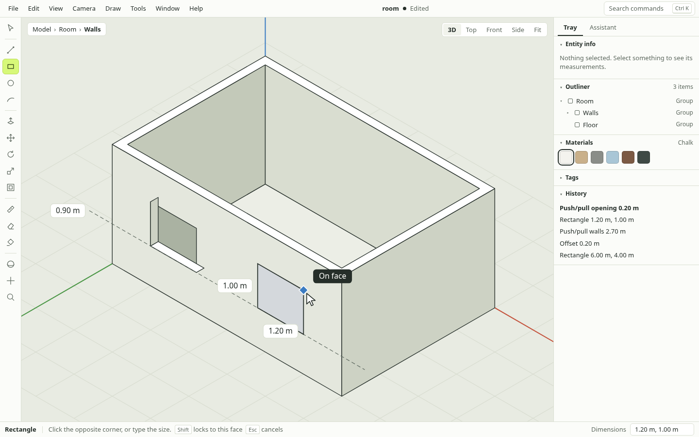 | Rectangle tool drawing the second window opening: on-face inference, a tape guide at sill height, live dimensions and the Measurements box | 3.1, 4.1–4.4 |
| 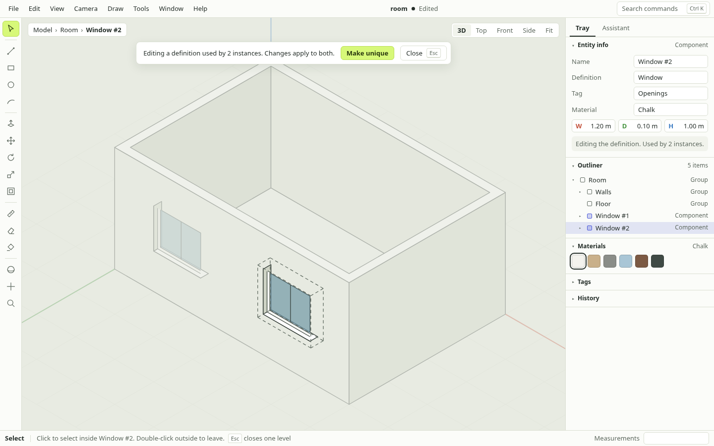 | Editing a shared component: breadcrumb, dimmed surroundings and the definition banner with Make unique | 4.6, 5 |
| 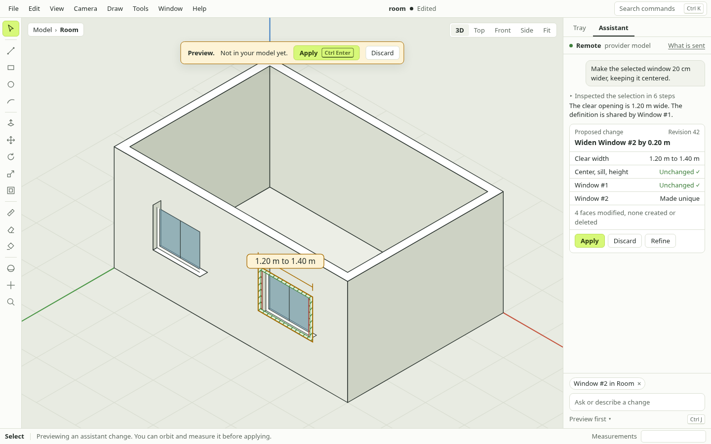 | A staged assistant change: hatched preview in the viewport, the change card, context chip and provider line | 8.1–8.4 |
| 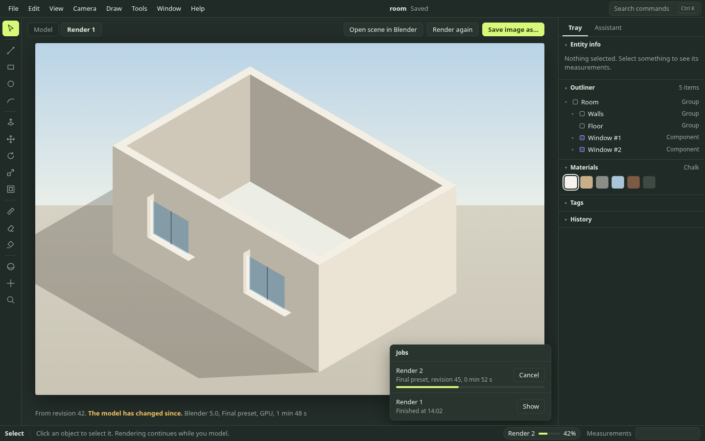 | Dark theme. Render result tab with its provenance line, plus the Jobs list with a second render running | 7, 9 |
| 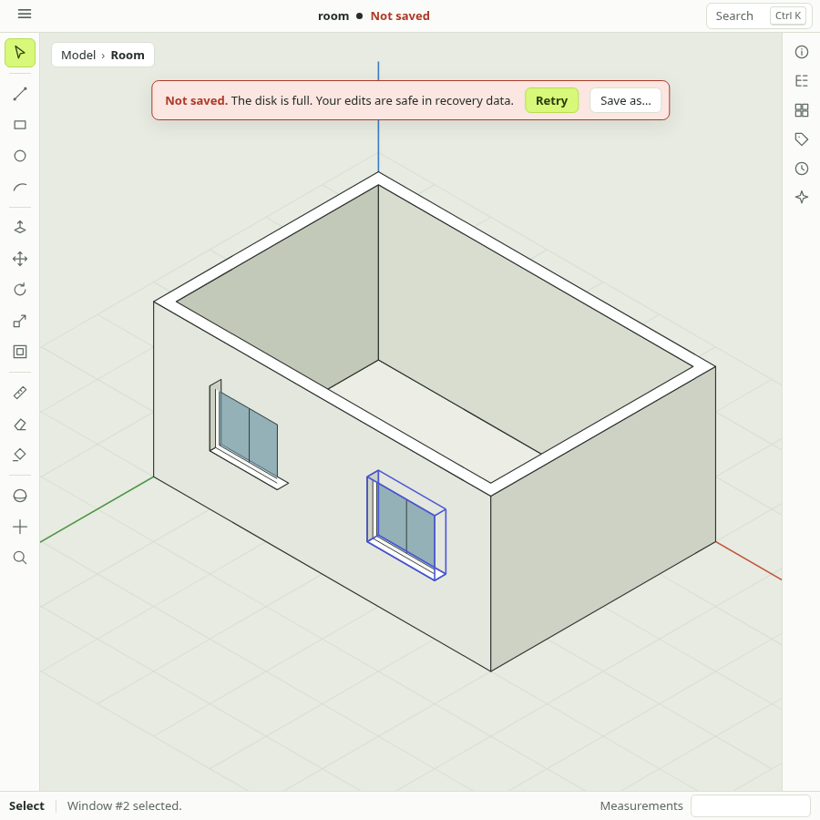 | A 900 px tile: single menu button, side panel collapsed to an icon strip, and the persistent save-failure banner | 3.3, 6.1 |

## 4. Tools and direct manipulation

### 4.1 One interaction grammar for every tool

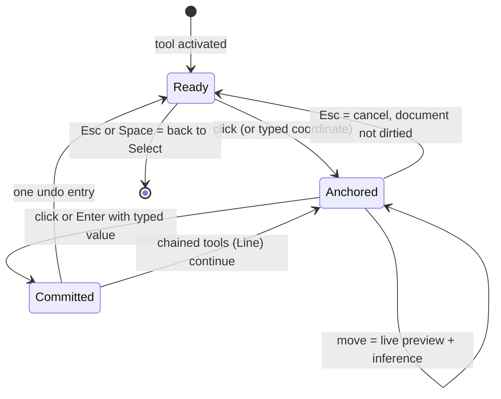

- Click–move–click and press–drag–release are equivalent everywhere.
- `Esc` backs out one step: cancel the operation, then leave the tool, then
  leave the edit context. A canceled operation never dirties the document or
  adds an undo entry (D03).
- The tool stays active after a commit so shapes can be drawn repeatedly.
- Middle-drag orbits and `Shift`+middle-drag pans **without leaving the active
  tool**; an operation in progress survives camera movement (M3 exit
  criterion: no camera/tool input conflict).
- A rejected operation leaves the previous document intact and explains why at
  the cursor and in the status bar, for example "No face created: the outline
  is not planar" (G02).

### 4.2 Default shortcuts

Defaults follow the muscle memory of the reference workflow; all are
configurable (N05). The prototype's `V` remains an alias for Select. Its `F`
(fit) moves to `Shift+Z` so `F` can be Offset.

| Key | Tool | Key | Tool |
| --- | --- | --- | --- |
| `Space` | Select | `M` | Move |
| `L` | Line | `Q` | Rotate |
| `R` | Rectangle | `S` | Scale |
| `C` | Circle | `F` | Offset |
| `A` | Arc | `T` | Tape measure / guides |
| `P` | Push/pull | `E` | Eraser |
| `B` | Paint | `G` | Make component |
| `O` / `H` / `Z` | Orbit / pan / zoom | `Shift+Z` | Zoom to fit |
| `Shift+D` | Add driver (in a component definition, section 14) | | |

| Modifier during an operation | Effect |
| --- | --- |
| `Shift` | Lock the current inference (axis, plane, direction) |
| `→` `←` `↑` | Lock to the red, green, blue axis; press again to release |
| `↓` | Lock parallel/perpendicular to the hovered edge |
| `Ctrl` | Toggle copy in Move/Rotate; toggle "create new face" in Push/pull |
| `Tab` | Cycle between overlapping pick or inference candidates |

The status bar always lists the modifiers that apply to the current step, so
none of this has to be memorized.

Shortcuts have a workspace scope ([ADR 0164](decisions/0164-sheet-layout-interface.md)
§4): **model** keys work only in the Model workspace, **sheets** keys only in
the Sheets workspace (section 13), and **global** keys in both. The same key can
mean one tool in Model and another in Sheets; a global key conflicts with every
scope. The shortcut editor shows each action's workspace.

| Key | Sheets tool or command (scope: sheets) | Key | Sheets tool or command (scope: sheets) |
| --- | --- | --- | --- |
| `Space` | Select | `M` | Move |
| `W` | Model view | `H` | Pan |
| `L` | Line | `Z` | Zoom |
| `R` | Rectangle | `Shift+Z` | Fit page |
| `X` | Text | `U` | Accept view |
| `K` | Label | `Ctrl+Shift+N` | Add page |
| `D` | Dimension | `Ctrl+PgUp` / `Ctrl+PgDn` | Previous / next page |
| `Ctrl+]` | Bring forward | `Ctrl+[` | Send backward |
| `Delete` / `Backspace` | Delete the selected view or item | `Ctrl+Alt+S` | Switch Model and Sheets (global) |

**Keyboard ownership rule:** the viewport owns the keyboard by default. Plain
keys are tool shortcuts and digits go to the Measurements box. Text fields
(entity name, assistant composer) take keys only while focused, and `Esc`
returns focus to the viewport.

### 4.3 Measurements box (G10)

Typing never requires clicking the box. Its label follows the active step:
Length, Dimensions, Radius, Distance, Angle, Sides, Copies.

| Input | Meaning |
| --- | --- |
| `3.5` | Value in document units |
| `350cm`, `12'6"`, `3/4"` | Explicit unit overrides document units for this entry |
| `6,4` | Two dimensions (rectangle); `;` is the separator in comma-decimal locales |
| `[1,2,0]` / `<1,2,0>` | Absolute / relative coordinate for the next point |
| `x5`, `/5` | After a copy: five copies / divide the span into five |
| `24s` | Segment count for the circle or arc being drawn |

- `Enter` applies. Until the next operation starts, typing a new value
  **revises the operation just completed** rather than starting another, only
  while its amend token matches the current content revision and context. Keep
  one undo entry but increment the revision for each successful replacement.
  An intervening human or AI content edit invalidates re-entry; never roll it
  back to revise an earlier operation. A replacement also makes existing AI
  previews stale. Pure camera movement does not change content revision.
- Before `Enter`, the box shows the live measured value of the preview.
- An entry that cannot be parsed or applied keeps the operation active, marks
  the box and states the reason ("Height must be greater than 0").
- Typed coordinates make every drawing tool usable with no pointer at all,
  which is also the keyboard-accessible modeling path (N05).

### 4.4 Inference feedback (G06, G07)

Inference is the feel of the product. Each inference has a marker shape, a
color and a text label near the cursor; shape and label carry the meaning so
color is never the only signal.

| Inference | Marker | Label |
| --- | --- | --- |
| Endpoint | Filled circle | Endpoint |
| Midpoint | Filled triangle | Midpoint |
| Center | Ring with dot | Center |
| On edge | Square on the edge | On edge |
| On face | Diamond on the face | On face |
| Intersection | Cross | Intersection |
| Along axis | Rubber band takes the axis color, drawn thicker | On red / green / blue axis |
| Parallel / perpendicular | Band in the reference color; reference edge highlights | Parallel / Perpendicular to edge |
| From point | Dotted line back to the reference point | From point |
| Locked | Band drawn bold with a lock glyph | Locked: blue axis |

Snapping distance is a fixed number of logical pixels at every zoom and scale
factor. It selects a constraint; it is never used as geometric tolerance.
Hovering a point for a moment "arms" it as a reference for from-point
inference, shown by a small persistent marker.

### 4.5 Selection (G08)

- Hover pre-highlights exactly what a click would select.
- Click selects one entity; double-click a face adds its bounding edges;
  triple-click selects all connected geometry. `Ctrl` adds, `Shift` toggles.
- Drag left-to-right draws a solid box and selects what is fully inside; drag
  right-to-left draws a dashed box and selects anything touched.
- Selected faces get a dot pattern plus outline; selected edges a heavier
  stroke; selected groups and components a bounding box.
- Entity info always summarizes the selection ("3 faces, 5 edges"), and the
  Outliner mirrors it in both directions.

### 4.6 Editing contexts (O01, O02)

Groups and components are the main defense against sticky geometry and the
main source of confusion, so the current context is always visible.

- Double-click or `Enter` opens a group or component; `Esc` or a click outside
  closes one level. The breadcrumb `Model › House › Window #2` is clickable.
- Everything outside the active context dims and cannot be picked or merged.
- Editing a shared component shows a persistent banner in the viewport:
  "Editing a definition used by 2 instances" with a **Make unique** action.
  The same instance-versus-definition question is put explicitly by the
  assistant (section 8.4), in the same words.

## 5. Tray panels

| Panel | Purpose | Notes | Gate |
| --- | --- | --- | --- |
| Entity info | Name, type, tag, material, dimensions, position, area/volume | Editable fields accept the same unit syntax as the Measurements box; volume appears only for valid solids, otherwise "Not a solid" with a link to Diagnostics (O06) | M4 |
| Outliner | Nested hierarchy with search | Rename, hide, lock, drag to re-parent; fully keyboard navigable; this is the accessible view of the model (N05) | M4 |
| Tags | Visibility and folders | Toggling visibility never edits geometry (O04) | M4 |
| Materials | In-model and library swatches | Paint tool samples with `Alt`-click; front/back shown separately (P01) | M4 |
| History | Labeled undo stack | AI entries are marked and carry the request text; click to step back; redo branch disappears on a new edit | M4 |
| Diagnostics | Open edges, non-manifold regions, reversed faces | Each finding selects and frames its entities; repairs are explicit, previewed and undoable (E09) | M6 |
| Styles, Scenes, Shadows | Display modes, saved views, sun | Scenes also appear as tabs in the viewport (P02, P03, P06) | M7 |
| Components | Local library with thumbnails; the bundled configurable assemblies (section 14) | Missing assets shown as such, never silently substituted (O05) | M8 |
| Terrain edits | A selected terrain's ordered changes (section 15.6) | Remove, Edit pad…, Restamp and Reset edits… replay with progress; skipped changes stay listed with their reason | R096 |

## 6. Document lifecycle

### 6.1 Save state is always visible

| State | Top bar shows | Behavior |
| --- | --- | --- |
| Saved | `room` | — |
| Edited | `room ● Edited` | Recovery journal is kept current in the background |
| Saving | `room · Saving…` | Editing continues; save is atomic |
| Failed | `room ⚠ Not saved` (persistent) | Banner with the reason and **Retry** / **Save as…**; never just a toast |

A save failure may also prevent recovery writes. Show the last verified recovery
revision/time separately from in-memory edits; do not promise the newest edits
are safe on disk unless the journal write succeeded. The narrow mockup's recovery
assurance is illustrative and must be replaced with the verified state.

Autosave is recovery data and never overwrites the user's file (D04). Closing
a window with unsaved edits, including a compositor close request, asks
**Save / Discard / Cancel**.

### 6.2 Recovery

After an unclean exit the next launch shows one dialog listing each affected
document: its name, when it was last explicitly saved, and how many edits were
recovered. Choices per document: **Open recovered version** (opens as Edited;
the saved file is untouched), **Open last saved**, **Discard recovery data**.
Missing textures or assets are listed rather than hidden.

### 6.3 First run and new documents

No account, sign-in or tour. First run asks one question — default units
(meters, millimeters, feet and inches) — and opens an empty document. A
start view lists recent documents and recovered work. Templates (D05) replace
the units question at M8. Assistant and Blender setup are offered only when
those features are first opened.

### 6.4 Import, export and reports

One **report sheet** component is reused wherever an operation has an outcome
worth reading: imports and exports (per-feature loss report, X02–X04), Formline
migration (X01), recovery, diagnostics and AI changes. It lists what was
converted, approximated and skipped, with counts and clickable entities.

## 7. Visual system

- **Themes.** Light, Dark, and Follow system. The viewport background belongs
  to the model style, not the theme.
- **Identity.** Carry the prototype's calm warm-gray surfaces and single lime
  accent forward as the starting token set, with a dark counterpart. The
  accent marks the primary action and active tool only.
- **Reserved colors.** Red, green and blue mean the X, Y and Z axes everywhere:
  viewport, inference, coordinate fields. Selection has its own blue-violet.
  Amber means warning or stale; red text means failure.
- **Not-yet-real geometry is hatched.** Tool previews are drawn as thin
  outlines; staged AI changes use a diagonal hatch (section 8.3). Hatch, not
  hue, is what says "this is not in your document".
- **Type and density.** System UI font, tabular numerals for all measurements,
  28 px controls on a 4 px grid, original line icons at 1.5 px stroke.
- **Motion.** Camera transitions between standard views and scenes animate
  briefly; everything else is immediate. Respect reduced-motion preferences.

## 8. AI assistant

### 8.1 Panel anatomy

```text
┌ Assistant ──────────────────────────────────┐
│ ◉ Remote · <provider/model>   What is sent ▾│  provider chip
├─────────────────────────────────────────────┤
│ You: Make the selected window 20 cm wider,  │
│      keeping it centered.                   │
│                                             │
│ ▸ Inspected selection · 6 steps             │  collapsible activity
│   Clear opening is 1.20 m wide.             │
│                                             │
│ ┌ Proposed change ────────── rev 42 ──────┐ │
│ │ Widen Window #2 by 0.20 m               │ │
│ │ Clear width      1.20 m → 1.40 m        │ │
│ │ Center, sill, height        unchanged ✓ │ │
│ │ Window #1 (other instance)  unchanged ✓ │ │
│ │ Made unique: Window #2                  │ │
│ │ Modified 4 faces · created 0 · deleted 0│ │
│ │ [ Apply  Ctrl+Enter ] [ Discard ] Refine│ │
│ └─────────────────────────────────────────┘ │
├─────────────────────────────────────────────┤
│ ⌖ Window #2 · in Model › House         ✕    │  context chips
│ [ Ask or describe a change…            ] ➤  │
│ Preview first ▾                    ■ Stop   │
└─────────────────────────────────────────────┘
```

`Ctrl+J` toggles the panel and focuses the composer. The current selection and
edit context are attached automatically as chips the user can remove; "this",
"the selected window" and "here" resolve to them.

### 8.2 Request lifecycle

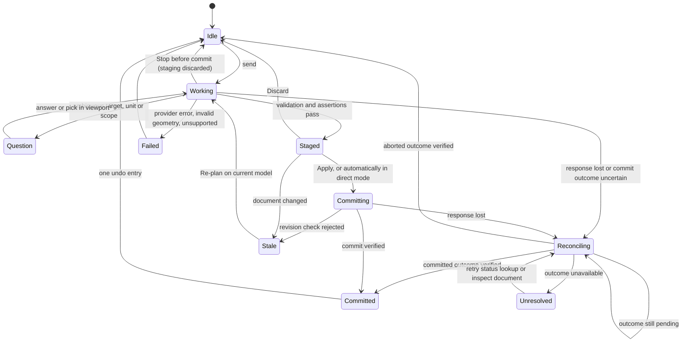

| State | What the user sees |
| --- | --- |
| Working | A plain-language activity list ("Measured clear width: 1.20 m"), not raw tool calls; raw calls are one disclosure away. **Stop** is always available. The model stays fully editable. |
| Question | A card with concrete choices, for example "Width of the clear opening or of the frame?", and **Pick in viewport** when the target is unclear. Never a silent guess on anything that changes the result. |
| Staged | Hatched preview in the viewport plus the change card: before → after measurements, what was verified unchanged, entity counts, warnings. |
| Committed | The card collapses to a summary with **Undo** and the new revision. The History panel gains one labeled entry (A03). |
| Stale | "The model changed while this was prepared. Nothing was applied." with **Re-plan on current model**. Human edits always win; there is no silent rebase. |
| Committing | Applying the validated transaction; the card does not report success until the outcome is verified. |
| Reconciling / unresolved | "Checking whether the change was applied" or "Outcome unknown"; query the request/transaction identity before retrying. Do not claim the document is unchanged. |
| Failed | What failed, the verified transaction outcome, and a supported alternative if one exists. Say this request made no changes only after confirming it did not commit. "Unsupported" is said plainly, never disguised as success. |

### 8.3 Preview in the viewport

Staged changes render in place: added geometry hatched green, removed geometry
hatched red, modified faces outlined amber with before/after dimension labels.
A banner at the top of the viewport reads "Preview — not in your model yet"
with Apply and Discard. The user can orbit, measure and inspect the preview.
Editing the real model during a preview is allowed and turns the card Stale.

### 8.4 Modes and confirmations

The composer has a mode switch: **Preview first** (default) or **Apply
directly**. In direct mode routine requests commit after validation and report
with an Undo button. Regardless of mode the assistant stops to ask before:

- changing a shared definition when the intended scope is ambiguous — "Used 2
  times. Change only this one (make unique) or all 2?". When the user explicitly
  requests only one instance, make it unique and report that without asking again;
- deleting or replacing content beyond what was requested;
- a paid render beyond configured limits, or sending anything outside the
  machine other than the configured provider request.

### 8.5 Trust, privacy and absence

- The provider chip always shows remote versus local and the model in use.
  **What is sent** lists the context of the current request: selection
  summary, hierarchy excerpt, screenshots. The first remote request per
  provider asks once for consent with this list.
- Text inside imported models, names and metadata is displayed as data. If it
  resembles instructions the assistant does not follow it, and says so.
- Keys are entered in Preferences, stored through the OS credential facility
  and never shown in documents, logs or the conversation.
- With no provider configured the panel shows a single setup card and the rest
  of the application is unaffected. A dropped connection triggers transaction
  outcome reconciliation. Say "Nothing was applied" only for a verified
  non-commit; otherwise report the committed result or unresolved outcome.
  Committed work is never rolled back by a timeout.
- A render image is never presented as evidence that a modeling request was
  correct; correctness is reported from measurements.

## 9. Rendering with Blender

- **Start.** `Camera › Render…` or the palette opens a small sheet: camera
  (current view or a scene), preset (Final / Preview from M7), resolution,
  device (Automatic, GPU, CPU). One primary button: **Render**.
- **While running.** The job appears as a chip in the status bar with
  progress. Modeling continues. Clicking the chip opens the Jobs list with
  progress, elapsed time, **Cancel** and logs. Canceling a render never
  touches the document and is not an undo.
- **Result.** Opens in a Render tab beside the model view, with **Save image
  as…**, **Render again** and, from M7, **Open scene in Blender**. Each result
  carries a provenance line: "From revision 42 · model has changed since",
  plus Blender version, preset and device from the manifest (P08).
- **Failure.** The job shows the actual reason and its log. A success state is
  shown only when an image exists.
- **Blender absent.** The Render sheet becomes a setup card: what Blender is
  used for, the detected status, a path chooser and the install hint for the
  platform. No other part of the interface mentions Blender.
- **Handoff (P09).** "Open scene in Blender" states up front that it is one
  way: changes made in Blender do not return to the model.

## 10. Accessibility and preferences (N05)

- Every command is reachable from the menus and the palette; every control
  has a label, a visible focus ring and a tooltip with its shortcut.
  A control filled with the accent colour (a primary button, the checked
  segment of a switch) shows focus as a 2 px inset ring in the surface colour,
  which contrasts with the fill in both themes.
- The viewport cannot be fully screen-reader accessible. The documented
  alternative is the Outliner (structure), Entity info (measurements) and
  typed coordinates (creation), all keyboard operable. The assistant is a
  further non-pointer path to the same commands.
- Color is never the only carrier: inference uses shape and label, previews
  use hatch, states use icon and text. Text contrast meets 4.5:1 in both
  themes; UI text scales independently of display scaling.
- Preferences: units and precision, theme and accent, shortcut editor with
  conflict detection, navigation style (mouse or trackpad), assistant mode and
  provider, Blender path, autosave interval. Preferences persist across
  upgrades.

## 11. Delivery by milestone

The interface grows with the engine; no gate ships controls for capabilities
that do not exist yet.

| Gate | UX delivered |
| --- | --- |
| M0 | Spike validates: overlay markers and hatch rendering in the chosen viewport path, keyboard ownership rule, tiled-window breakpoints, fractional-scale picking |
| M1 | Window shell, menus, command palette from the registry, camera navigation, status bar, save states, themes, native dialogs |
| M2 | Push/pull on real faces with live dimension, rejection messages for invalid geometry |
| M3 | Full tool rail for drawing, inference markers and locks, Measurements box syntax, selection model, standard views, guides |
| M4 | Tray (Entity info, Outliner, Tags, Materials, History), edit-context breadcrumb and definition banner, recovery dialog, Formline import report |
| M5 | Assistant panel with preview/apply and direct modes, provider setup and "What is sent", basic Render sheet, job chip and result tab |
| M6 | Offset, follow-me, intersect and solid tools; Diagnostics panel; placement feedback for hosted components |
| M7 | Styles, Scenes tabs, sections, dimensions and text, shadows, full Jobs list, Blender handoff |
| M8 | Component library, templates, import/export report sheets, extension management |
| M9 | Shortcut editor, accessibility audit against section 10, scaling and multi-display verification, preference migration |
| M10 (R091) | Sheets workspace (section 13): Model \| Sheets switch, page canvas, sheet tool rail, Sheets Tray (Entity info, References, Pages, History), model views with Changed and Broken states, edit-view, lines, rectangles, text, labels, referenced dimensions with Reattach, title blocks, workspace-scoped shortcuts |

## 12. Decisions to confirm

| Decision | Proposed default | Why it matters |
| --- | --- | --- |
| Shortcut scheme | Reference-workflow letters (section 4.2); prototype `F` fit moves to `Shift+Z` | Familiarity is the product objective; the prototype's keys conflict with Offset |
| Assistant default mode | Preview first | Builds trust before speed; one click to switch |
| Assistant placement | Tab beside Tray, own column when wide | Keeps Entity info visible during AI edits without a second window |
| Render result location | In-window tab, not a separate window | Predictable under a tiling compositor |
| Visual identity | Evolve the prototype palette, add dark theme | Continuity; needs an accent check against the reserved axis green |
| Native menu bar versus single menu button | Menu bar when width allows | Discoverability and accessibility versus vertical space |

Validate sections 4 and 8 with the M5 demonstration in the build plan: a
person should be able to complete every step using only what this document
describes, and each failure case in step 8 should land in a state named here.

## 13. Sheets

The Sheets workspace lays out drawing pages from the model's scenes
([ADR 0163](decisions/0163-documentation-sheets.md) records,
[ADR 0164](decisions/0164-sheet-layout-interface.md) interface; R091). Page
editing never changes model geometry: every page operation is one labelled,
undoable sheet-only entry in the model's single history.

### 13.1 Switching workspace

- The header holds a **Model | Sheets** switch: two buttons, also under View
  (Model workspace, Sheets workspace). `Ctrl+Alt+S` switches between them and
  is configurable like any shortcut.
- Switching swaps the tool rail, the central area and the Tray. The model
  viewport is never closed, so returning to Model is instant and keeps the
  camera and selection.
- In Sheets the header's document name reads "house.sketchyup · Sheets •
  Edited", and the Page, Insert and Arrange menus appear.
- F6 regions in Sheets: command search, sheet tool rail, canvas, page tabs,
  Tray (Sheets), Assistant, Measurements.

### 13.2 Layout

```text
┌────────────────────────────────────────────────────────────────────────────┐
│ File Edit View … Page Insert Arrange  [Model|Sheets]  house.sketchyup · Sheets │
├────┬───────────────────────────────────────────────────┬───────────────────┤
│ ▸  │ Sheets › A-101 Ground floor   A3 420×297 · Grid ⛶ │ ▾ Entity info     │
│ ▢  │ ┌─────────────────────────────────────────────┐   │ ▾ References      │
│ ── │ │  ┌ plan ─────────┐  ┌ elevation ── ⟳ Changed│   │   2 views changed │
│ ╱  │ │  │               │  │                 │     │   │   [Accept all]    │
│ ▭  │ │  └───────────────┘  └─────────────────┘     │   │ ▾ Pages           │
│ T  │ │                          ┌ title block ───┐ │   │   A-101 ⟳2        │
│ ↘  │ │                          └────────────────┘ │   │   A-201 ⊗1        │
│ ↔  │ └─────────────────────────────────────────────┘   │ ▸ History         │
│ ── │ ┌ A-101 ┬ A-201 ┬ + Page ┐                         │                   │
├────┴───────────────────────────────────────────────────┴───────────────────┤
│ Dimension │ Click the second point · Esc cancels │ Paper units: mm │ Offset [ 10 ] │
└────────────────────────────────────────────────────────────────────────────┘
```

- **Canvas.** White paper on a pasteboard, the margin frame, an optional
  5 mm grid, and the page's views and items. Wheel and the Zoom and Pan tools
  move the page; `Shift+Z` fits it. Targets and snapping keep their size in
  logical pixels at every zoom and scale factor.
- **Breadcrumb and paper line** above the canvas name the page and its paper,
  with the grid toggle and Fit page.
- **Page tabs** below the canvas switch pages; **+ Page** adds one and copies
  the current page's title block in the same entry.
- **Status bar.** An active-tool label, the instruction, "Paper units: mm" and
  the Measurements box labelled with the current step.

### 13.3 Tools

| Tool | Use |
| --- | --- |
| Select | Click or Tab to select a view or item; drag to move; handles crop a view; arrows nudge 1 mm (`Shift` 10 mm), and consecutive nudges are one "Nudge" entry; Enter opens edit-view on a view or edits text in place |
| Model view (`W`) | The Tray shows **New model view**: this model, its scenes with their projections, the scale (the page's scale by default) and the style. Drag a frame, click–move–click, or type `w,h`; Enter or **Place** uses the natural frame at the pointer. A perspective scene places as "Not to scale" with rendered content |
| Line, Rectangle | Drag or click–move–click; `Shift` gives 45° steps or a square; snaps to the grid, margins and view edges |
| Text | Click (the box fits the words) or drag (the drag sets the wrap width), then type in place; a new item is made only when editing ends with text |
| Label | First click picks the leader's point: a model vertex or edge in a view drawn to scale binds it to that view, anything else is a paper point. Second click places the text |
| Dimension | Pick two model points in one view (vertex preferred within 8 px), then the offset. Values follow the page's dimension format |
| Move, Pan, Zoom | Move picks up and drops; Pan and Zoom move the page view |

Insert › Title block places a title block in the bottom-right corner of the
margin. Its project, drawing title, date and revision are stored; the sheet
number, page "n of N" and scale ("1:50 @ A3", "As indicated", "Not to scale")
fill in automatically. Arrange › Bring forward and Send backward change the
stacking order.

**Snapping.** 8 logical pixels at any zoom, to the paper edges, the margins,
and other views' edges and centres, which draw as alignment guides; the 5 mm
grid applies when shown and nothing nearer does. A hint names the target. `Alt`
held during a drag ignores snapping.

### 13.4 Measurements in Sheets

Bare numbers are paper millimetres; `cm` and `in` suffixes are accepted.
Dimension *values* use the page's dimension format, never the model's units.
Typing right after an operation revises it (amend), as in Model.

| Tool or step | Label | Accepts |
| --- | --- | --- |
| Model view | Size | `w,h` frame size |
| Select, one view | Scale | `1:50` or `50` sets the scale; `w,h` crops |
| Select, items | Move | `<dx,dy>`, `[x,y]` (top-left) or `12pt` (text size) |
| Select, a dimension | Offset | offset in mm |
| Line | Length | a length along the preview, `<dx,dy>` or `[x,y]` |
| Rectangle | Size | `w,h` |
| Move | Distance | `dx,dy` |
| Text, Label | Position | `[x,y]`, or `12pt` for new text |
| Dimension, after two points | Offset | offset in mm |
| Zoom | Zoom | `150%` or a factor |

### 13.5 View states

| State | On the page (screen only, never printed) | Repair |
| --- | --- | --- |
| Current | Nothing | — |
| Changed | Amber "⟳ Changed" chip in the frame corner | **Accept view** (`U`) or **Accept all** (References, Page menu) |
| Broken | Red border, cross-hatch and a card naming the cause, for example "Scene “South elevation” was deleted", with **Choose scene…** | Choose scene… relinks the view, keeping frame and scale |
| Failed | As Broken, with "Could not draw this view" and the detail | — |

"Not to scale" (a perspective scene) is a caption, not a state. Until a view's
evaluation arrives, the page keeps its last drawing and Entity info reads
"Updating…".

**Edit-view.** Enter on a selected orthographic view, or **Edit view** in
Entity info, edits what the frame shows without moving the frame: the wheel
zooms the crop about the pointer, arrows pan 1 mm (`Shift` 10 mm), `+` and `-`
zoom, and a banner offers **Save as new scene…** and **Done**. Each gesture is
one entry; Esc, Done or a click outside leaves. **Show scene in model** applies
the scene's camera in Model without an edit.

### 13.6 Referenced dimensions and Reattach

A dimension measures model geometry through its view: moving geometry, or
changing the view's scale, crop or scene camera, updates the value at once.
Anchors are resolved by entity identity. When an anchored vertex or edge no
longer exists (erasing it, splitting an anchored edge, making a component), the
dimension turns red at its last position, reads "[Missing reference]", and
Entity info offers **Reattach**. Reattach proposes the nearest model vertex or
edge point in the view; Enter accepts it, or a click picks another, and nothing
is committed until then. Labels bound to a view behave the same way.

### 13.7 The Tray in Sheets

| Section | Contents |
| --- | --- |
| Entity info | The selection's editable fields: Model view (title, source, scale, style, crop, status, Edit view, Show scene in model, Choose scene…), each item kind's fields, and Page (dimension unit, decimals, show unit) when nothing is selected |
| References | This model, the count of changed views, and **Accept all** |
| Pages | Pages expanding to their views and items in paint order, with a state glyph (amber ⟳ changed, red ⊗ broken; page rows show counts) |
| History | The shared labelled history |

While Model view is the active tool, the **New model view** panel replaces
these sections.

### 13.8 Accessibility

The canvas is one accessible object named for the page. Its description
announces the selected view or item ("View 1 · Ground floor plan · 1:50 ·
Changed since accepted"), and each view and item is an accessible child. The
**Pages** tree is the full keyboard and screen-reader alternative, as the
Outliner is for the model: arrows choose a row and select it on the canvas, F2
renames a page or view, Alt+Up and Alt+Down move a page or an item's stacking
order, Delete erases, and Enter edits an item's text. State glyphs carry their
words as tooltip and accessible description. Entity info exposes every value as
a labelled field. With typed Measurements, a page can be laid out without a
pointer. Every Sheets control draws the visible focus ring of section 10.

### 13.9 Export and print

**File › Export sheets…** (Sheets, and Model while the model has pages) and
**File › Print…** (Sheets) open one preflight dialog, from the approved R091
design ([ADR 0164](decisions/0164-sheet-layout-interface.md) "R092 export").

```text
┌ Export sheets as PDF ───────────────────────────────────────────────┐
│ house · 4 pages · printed at actual size                             │
├──────────────────────────────────────────────────────────────────────┤
│ Pages   (•) All 4  ( ) Current page  ( ) Range [A-101–A-301]          │
│ File    ~/Projects/house-sheets.pdf                       [Choose…]  │
├──────────────────────────────────────────────────────────────────────┤
│ Checked before publishing                                            │
│ ┏ ⊗ 1 broken view blocks export. A-301, view 3 “Section B-B”: …     ┓ │
│ ┃   [Go to view]  [ ] Export it as an empty, labelled frame         ┃ │
│ ┌ ⟳ 2 views changed since accepted. A-101 view 2 …                  ┐ │
│ │   [Review and accept]  [ ] Export them as they are now (…)        │ │
│ ┌ ⚠ 1 font is not installed. “ISOCPEUR” … Choose another font       ┐ │
│   ✓ 7 views at measured scale: 6 at 1:50 and 1 at 1:20. …            │
│   ▦ 1 view will be raster: “Garden view” (perspective) at 300 dpi.   │
├──────────────────────────────────────────────────────────────────────┤
│ Fix the broken view, or choose to export it empty. [Cancel][Export PDF]│
└──────────────────────────────────────────────────────────────────────┘
```

- **Pages** is one Tab stop; the arrows choose All, Current page or Range, and
  typing a range chooses Range. A range names sheet numbers or page positions
  (`A-101–A-301`, `1, 3–4`); an unknown page marks the field and the footer
  says why.
- **File** shows the new PDF's path; **Choose…** opens the platform's save
  dialog (through the portal). An existing file is never replaced: the footer
  asks for a new name. In Print the row is **Printer**: the printer and paper,
  and **Choose…** opens the system print dialog, whose page range comes back to
  Pages.
- **Checked before publishing** groups the preflight's findings by code, with
  a bold count headline and the engine's sentence. A blocking group has the red
  failure border; changed views and warnings are amber; scales and raster views
  are plain rows. The list checks again whenever an option or the document
  changes, keeps the focused control, and scrolls when the screen is small.
  - **Go to view** and **Review and accept** close the dialog and select the
    first broken or changed view on its page; nothing is accepted for the user
    (**U** accepts).
  - The opt-in check boxes turn the blocking finding into a warning: broken
    views export as empty, labelled frames; changed views export as they are now
    and the export report names them.
  - **Choose another font** selects the first text that uses the missing font
    and focuses its Font field.
  - In Print, a page larger than the paper adds an amber "pages are larger than
    the paper" row: it prints at 100% and is cut off; nothing scales to fit.
- **Footer.** The hint names what to fix; **Export PDF** (or **Print**) is the
  default, accent-filled with the R091.h focus ring, and disabled while
  anything blocks or the check is running. Cancel and Esc close without writing.
- **Export** runs off the UI thread behind the file-operation progress surface
  ("Exporting sheets…"), then shows the **report sheet** (§6.4): the file, the
  page count, the views exported as they are now or as empty frames, raster
  views and font substitutions, and **Show the reconciliation report (JSON)**.
  A failure says what happened; no file is written.
- **Print** paints each page at actual size from the paper's top-left corner,
  one printer page per sheet.
- Focus returns to the page canvas (or, from Model, the viewport) when the
  dialog, the report or a failure message closes.

## 14. Configurable components

Component definitions can carry typed parameters and drivers, and each
placement can keep its own values ([ADR 0165](decisions/0165-constrained-component-parameters.md)
records; [ADR 0166](decisions/0166-configurable-component-interface.md)
interface and its implementation notes; R093, R094). This section describes
what was built. Every change is one labelled, undoable History entry, and
every refusal leaves the model unchanged.

### 14.1 The Info tab's sections

Entity info is a stack of collapsible sections in one scroll area with no
horizontal scroll bar: **Entity info**, then **Parameters · this placement**
when a configurable placement is selected, then **Parameters · definition**
and **Drivers** while a component definition is open. A header shows a muted
count when it has one ("2 overridden") and elides its title in a narrow Tray.

- **Parameters · this placement.** One row per parameter in the definition's
  order: the label and a caption ("Override · default 900 mm", "Default",
  "Derived · *formula*", "From *parent*", and the bounds), then the control: a
  line edit for quantities, a spin box for counts, a check box ("Shown" or
  "Hidden") for booleans, a list for choices. A row is laid out beside its
  label while the label fits next to 16 characters of value, else under it.
  Values accept the Measurements box's syntax in the document's units
  (`1200`, `1.2 m`, `3'11"`). The value is checked as you type; Enter or
  leaving the field commits, Esc restores. An override row has a reset button,
  and Ctrl+Backspace on an unchanged field resets it (while editing it deletes
  a word). **Reset all** and **Edit definition…** close the section. Entries
  read "Change *Label*", "Reset *Label*" and "Reset all parameters".
- **Measurements box.** With the Select tool and one configurable placement
  selected, the box is labelled with the parameter last focused in the section
  (else the first quantity) and shows its value; Enter sets it, and typing
  again amends the same entry. Digits typed in the canvas stay view
  shortcuts: reach the box with F6, Tab or a click.
- **Parameters · definition.** A tree (Name, Type with its bounds, Default or
  "= *formula*") with an inline editor below it and **+ Parameter** in the
  header. The editor has no button: Enter commits and Esc cancels. F2 edits,
  Alt+Up and Alt+Down reorder and Delete removes; a parameter still in use is
  refused with the names of its users. Entries read "Add parameter *Label*",
  "Edit parameter *Label*", "Rename parameter *name*".
- **Drivers.** A tree (Kind, Target, Formula, State) with **+ Driver**. A
  driver whose part was edited by hand reads "⚠ Changed" in the warning
  colour with an in-row Rebind; **Rebind** and **Rebind all** act on Changed
  drivers ("Rebind driver", "Rebind *n* drivers").
- **Formula fields** are checked as you type. An error is a sentence under
  the field, with a caret under the character it names, and a missing unit
  offers a one-click fix ("Use 120 mm").

### 14.2 Definition authoring

- Opening a parametric placement shows the breadcrumb "*Definition*
  (definition)" and the banner in the information colour with **Close
  definition**. A **Preview** strip under the banner holds one field per
  input; changing one draws a dashed, hatched ghost of the regenerated shape
  from a dry run, without changing the model. Esc in the strip is **Back to
  defaults**.
- **Add driver** (`Shift+D`, the Component menu, the palette, **+ Driver**
  and a rail button in a definition) opens the driver form on the selected
  part with focus on Kind. Only the kinds the part accepts are offered. With
  nothing suitable selected, the status bar says what to select.
- **Stretch plane.** A Stretch driver shows its plane as a dashed quad with
  arrows on the points that move. Drag it (it snaps within 8 px to the part's
  vertex coordinates and the midpoints between them; Alt turns snapping off),
  or type its position in the form's Plane at field or the Measurements box.
- Regeneration keeps the open context, the selection and the parts'
  materials.

### 14.3 A placement with its own values

Opening a placement that has values of its own (Enter, double-click, Edit
definition… or Enter in the Outliner) asks first. The dialog "*Placement* has
its own values" names the differing values and offers **Cancel**, **Make
unique and edit** and **Edit definition at defaults** (the focused,
accent-filled default).

- **Edit definition at defaults** suspends the placement's values ("Edit
  *Definition* at defaults") and the banner says they return on close.
  Closing by any route restores them ("Restore *placement* values"); values
  the definition no longer accepts are left out and the status bar names
  them. When nothing was edited, the suspension is undone and no entry
  remains.
- **Make unique and edit** gives the placement its own definition whose
  defaults are its values ("Make *placement* unique"). A nested placement,
  whose values come from its parent, offers only this choice.
- **Refusals** are shown at the control that caused them, in words, with the
  §5 table of ADR 0166 and its actions (**Use 120 mm**, **Show the driver**,
  **Select *placement*** for a locked one). A hand edit that changes a part a
  driver acts on shows an amber strip under the banner naming the drivers,
  with **Rebind** and **Undo**.

### 14.4 The Components tab and assemblies

The Tray's **Components** tab (View → Components) lists the six bundled
assemblies (interior door, casement window, dining table, bookshelf, base
cabinet, straight stair) as cards in two columns. **Show** chooses
Configurable assemblies or All components (adding the user library). The
cards are one Tab stop; arrows move between them and Enter or a click starts
placing. A card reads "Interior door, cuts opening, 4 parameters", and adds
"In this model" once the model has that assembly.

- A **values form** lists the assembly's inputs with their bounds in the
  model's units, checks each value, and stores only values that differ from
  the defaults. **Use defaults** resets it; Esc or **Cancel** ends placement.
- **Placing** is a mode over the Select tool. The status bar says what to
  click ("Placing Interior door · Click a wall face to place · the opening is
  cut in the same step · Esc cancels"). The ghost follows the pointer; a door
  or window snaps upright to the hovered wall face, moving in whole
  millimetres, and draws its opening outline and width. A click places it, or
  Enter on a selected face places it at the face's centre; the Measurements
  box takes `[x,y,z]`, a wall anchor or an inset, and typing again amends the
  placement. Placing is one entry, "Place *Name*", which also cuts the
  opening; a later width change re-cuts it in one entry. An assembly already
  in the model is reused, so all its placements share one definition. After
  placing, the Tray shows Entity info.
- SketchUp Dynamic Components are not imported or converted, and the tab
  says so.

### 14.5 Accessibility

Every section header, field, reset button, tree, form, strip, dialog button
and card is a Tab stop with an accessible name; a field's description carries
its caption and, first, "Invalid: …" or "Warning: …" while it has a message.
Override, information and warning states have text as well as colour, and the
default button and focused controls draw the focus ring of section 10. The
interface is checked on X11 and Wayland at 1× and 2× and at 200 % text.

## 15. Terrain editing

This section designs the desktop tools for editing a terrain: sculpt, smooth,
contour edit, pad stamp and drape ([ADR 0169](decisions/0169-terrain-editing-drape-stamp.md)
§8 lists the questions it answers; R096.f builds it). Status: approved by the
owner on 2026-10-20. Every change is one labelled, undoable History
entry with a preview first, and every refusal leaves the model unchanged.
The mockups are `mockups/terrain.html` (all screens, with notes) or
`mockups/terrain.html?screen=<name>` (`menu`, `sculpt`, `contours`, `stamp`,
`drape`, `edits`), drawn in the light theme of `src/app/theme.hpp`.

### 15.1 Where the tools live

- **Terrain menu.** A new top-level menu between Draw and Camera. *Tools:*
  Sculpt, Smooth, Edit contours, Stamp pad, Drape. Then, for the selected
  terrain (its name as the heading): Terrain settings…, Regenerate, Reset
  edits…, Explode terrain…. Last, Create terrain from selection. File →
  Import terrain… and Site settings… stay where they are. All of them are in
  command search (Ctrl+K).
- **Rail.** One **Terrain** slot after Tape, in its own group. It shows the
  last terrain tool used ("Sculpt ▸" at first) and starts it. The rail stays
  one slot longer instead of five, and it follows the rail's existing
  responsive rule.
- **Tool options strip.** While a terrain tool is active, a strip across the
  top of the viewport holds a five-way switcher (Sculpt · Smooth · Contours ·
  Pad · Drape) and that tool's options. It is one row where it fits and wraps
  to a second row where it does not. Its fields take the Measurements box's
  syntax and units, and F6 moves focus between the strip and the box.
- **Context menu.** Right-clicking a terrain offers the five tools, Terrain
  settings… and Explode terrain…. With edges or faces selected it also offers
  **Drape onto terrain**.
- **Shortcuts.** Only Sculpt has a default, Shift+S, which is unused in the
  model scope today. The others start with no shortcut and can be assigned in
  the shortcut editor. Inside a terrain tool, `[` and `]` change the brush
  radius by 10 %. These keys have no other model-scope meaning.
- **Outside a terrain.** Each tool follows R095.e1's hover pattern: over
  anything but a terrain the cursor is not-allowed and the status bar names
  what to point at. With no terrain in the model, it says "No terrain in this
  model. Import one with File → Import terrain…".

### 15.2 Sculpt and Smooth

- **Brush.** A ring is drawn on the surface at the pointer: a solid outer ring
  at the radius and a dashed inner ring at half strength. Every vertex that
  will move gets a dot whose size and opacity follow its weight, and a label
  gives the amount, the radius, the vertex count and the tiles touched. A
  brush that catches no vertex draws its ring amber and dashed, with "No
  vertices under the brush · ] enlarges it" (ADR 0169 §4.1, sparse meshes).
- **Stroke.** Press and drag paints a stroke at the strip's Amount. The stroke
  is swept, so each vertex moves once, by its distance to the whole path.
  Release commits it as "Sculpt terrain".
- **One spot (Smoove).** A click without a drag anchors the brush. Moving the
  pointer up or down then sets the amount, and a click or a typed value
  commits it. This is the only terrain gesture where press–drag and
  click–move–click differ, because a drag paints. The status bar says so.
- **Modifiers.** Ctrl lowers. Shift smooths while held, so one Sculpt session
  can raise and then soften. The status bar lists both.
- **Options.** *Scope* Brush or Region; *Radius*; *Falloff* Smooth, Linear or
  Constant; *Amount* (Sculpt) or *Strength* 0.05–1 and *Passes* 1–8 (Smooth).
  The Measurements box is labelled Radius before a stroke and Amount (or
  Strength) after one. After a commit, typing a new amount amends the same
  entry, under §4.3's rules.
- **Region scope.** If a face or a closed edge loop is selected when the tool
  starts, that region is used. Otherwise, click points on the surface as with
  the Line tool and close the polygon on its first point. The falloff band is
  a dashed outline offset by *Falloff width*, typed in the strip or the box.
- **Pads** are protected. Their vertices show no dots, and a stroke over a pad
  skips them.

### 15.3 Edit contours

- **What is shown.** While the tool is active, source contours are drawn solid
  at 1.5 px and display contours fade. Breaklines are dash-dot and spot points
  are small crosses. Hovering a source highlights it and names it ("Contour
  105.00 m · source 17").
- **Selecting and handles.** A click selects a source. It turns
  selection-coloured, with square handles on its vertices and round handles
  at segment midpoints; dragging a round handle inserts a vertex. Tab cycles
  overlapping candidates (§4.2).
- **Editing.** A dragged handle previews the re-triangulated cavity on a
  worker, latest wins (ADR 0169 §4.2), with the changed region outlined. A
  typed number sets the selected source's elevation (the box is labelled
  Elevation). Delete removes the selected vertex and Shift+Delete removes the
  source. *Role* in the strip switches Contour and Breakline.
- **Adding.** **Add contour**, **Add breakline** and **Add spot** draw on the
  surface as the Line tool does. Enter finishes a line. A new contour takes
  its first point's elevation unless one is typed. **Promote** turns the
  display contour under the pointer into a source at its level; this is how
  terrains made from points become editable.
- **Refusals at the pointer.** A drag that would cross another source, leave
  the outline or enter a pad draws the moved run red and dashed, with a red ×
  at the first conflict and a failure label ("Crosses contour 106.00 m ·
  Release to cancel, or move back"). The preview is withdrawn and releasing
  changes nothing. The status bar repeats the reason with the location in site
  coordinates.
- **Contours a drape crossed** (R096.e). An imprinted drape shares its crossing
  points with the contours and breaklines it crossed, so typing a new elevation
  for such a contour is refused at the first crossing, naming the change
  ("This contour is crossed by Drape (change #4); remove that change to
  re-elevate it alone"). Moving or deleting the contour is allowed: the
  crossing points stay where the drape put them, at their surface heights, as
  vertices of the drape's lines.

### 15.4 Stamp pad

- **Footprint.** Start the tool with a face, group, component or closed loop
  selected, or hover one and click. A group or component uses its lowest
  horizontal face, which is highlighted before the click. The strip names the
  footprint.
- **Elevation.** The pad starts at the footprint's height less *Pad offset*
  (default 0 m; a slab build-up such as 0.15 m is typed once and remembered).
  Move the pointer up or down, or type the elevation; Enter or a click stamps
  it. After the stamp, typing a new elevation or slope amends the same entry.
- **Grading.** *Daylight* (the default) has *Cut* and *Fill* slopes as rise:run
  (default 1:2; `0.5` and `26.6°` are also accepted) and *Max distance*
  (100 m). *Fixed width* replaces them with *Width*.
- **Preview.** Cut is tinted brown with a diagonal hatch and fill teal with
  dots; the strip has a legend, so colour is never the only signal. The pad
  is drawn flat and light, the slope rays as thin lines, and the daylight line
  is dashed and labelled. A refusal ("Ray at E …, N … leaves the terrain";
  "Overlaps Pad · Building B") marks the ray or overlap in red, and Enter is
  refused until it changes.
- **Restamp.** A pad row in Terrain edits (15.6) offers **Restamp**, which
  re-reads the footprint from its source body as one entry, "Edit terrain
  change". It is unavailable, with the reason as its tooltip, when the source
  body no longer exists.

### 15.5 Drape

- **Input.** Select edges, curves or faces in any context, above or below the
  terrain, then choose Drape (or **Drape onto terrain** from the context menu)
  and point at the terrain.
- **Preview.** The lines are drawn lying on the surface. With *Paint regions
  with their material* on, a face's region is also drawn in its material.
  Parts outside the terrain are red and dashed and are counted in the strip
  ("1 edge clipped"). A click on the terrain or Enter drapes.
- **Mode.** *Imprint* (the default) leaves the terrain's shape unchanged and
  adds the lines as breaklines. Afterwards the terrain is selected and the new
  row appears in Terrain edits. *Overlay* makes ordinary geometry in a new
  group in the active context, lifted by *Lift* (default 0.01 m, enabled only
  for Overlay), and afterwards the new group is selected.
- **Crossed contours.** An imprint's lines keep the points where they cross
  contours and breaklines. Removing a crossed contour leaves those points at
  their heights, and a crossed contour cannot be re-elevated alone while the
  drape exists (§15.3); removing the drape's change lifts both.

### 15.6 Terrain edits

A **Terrain edits** section follows the Terrain section on the Info tab
whenever a terrain is selected. The header shows the count ("5 changes").

- **Rows.** The list is in the order the changes are applied. A row shows a
  kind glyph, the title ("Pad · Building A"), its key values on a second line
  ("106.00 m · daylight, cut 1:2, fill 1:2") and its ID, muted. A caption
  gives the use ("5 of 4,096 changes").
- **Selection.** Selecting a row outlines its region in the viewport in the
  selection colour, with a label. Double-click or Enter frames it.
- **Actions.**
  - **Remove** (or Delete) removes the selected change and replays the ones
    after it.
  - **Edit pad…** opens a small form with the pad's elevation, grading,
    slopes and offset.
  - **Restamp** is described in 15.4.
  - **Reset edits…** asks first ("Reset 5 changes to Riverside site? The
    terrain is rebuilt from its sources."), and Cancel is the default.
  
  Each action is one undoable entry. A replay shows a job chip in the status
  bar ("Replaying 3 changes · 64 %") with **Cancel**; cancelling leaves the
  model as it was.
- **Skipped changes.** A change that no longer applies after a replay stays in
  the list. It is marked "⚠ Skipped" in the warning colour, with the reason on
  its second line, until it is removed or the replay is undone. It is not
  silently deleted.
- **Notices.** The notices of the last change or replay appear under the list
  in the warning style, each with **Show report**, which opens the R095.c2
  report tree. Examples: "Paint removed from 2 rebuilt tiles (use Drape with
  Paint regions to keep paint)", "3 source contours clipped", "1 change
  skipped".

### 15.7 Accessibility and keyboard

- **Keyboard-only path.** With a terrain tool active, typing a coordinate in
  the Measurements box places the brush, footprint or contour point there.
  Both `[x,y]` in model coordinates and `@E,N` in site coordinates (R095.e2)
  work. Then:
  - Sculpt: type the amount, and Enter commits a one-spot brush at that point.
  - Region scope: type successive points.
  - Contours: with a source selected, Tab moves between its handles, and a
    typed coordinate moves the focused handle.
- **Accessible names.** The strip's fields, the switcher, the Terrain edits
  rows and their buttons are Tab stops with accessible names. A row reads, for
  example, "Change 3 of 5, Pad, Building A, 106.00 metres, daylight, cut 1 to
  2, fill 1 to 2". A skipped row's description starts with "Warning: skipped".
- **Not colour alone.** Cut, fill and preview use hatch and labels as well as
  colour. Refusals use the × marker and text.
- **Checks.** The interface is checked on X11 and Wayland at 1×, 2× and a
  fractional scale, and at 200 % text, as in R096.f's input tests.

| Screen | Shows | Sections |
| --- | --- | --- |
| 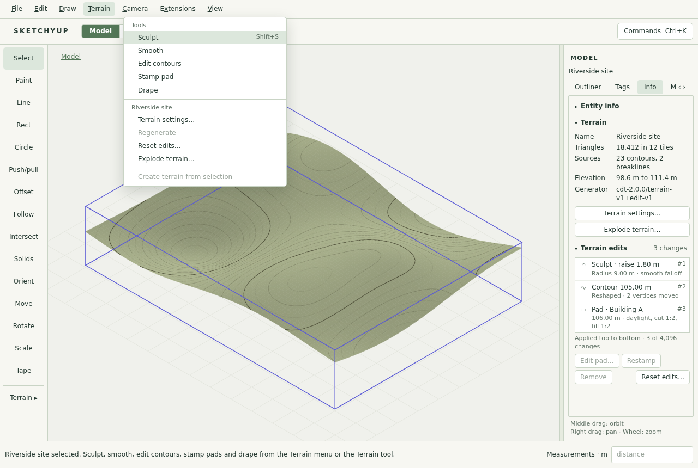 | The Terrain menu, the rail's Terrain slot, a selected terrain with its Terrain edits | 15.1, 15.6 |
| 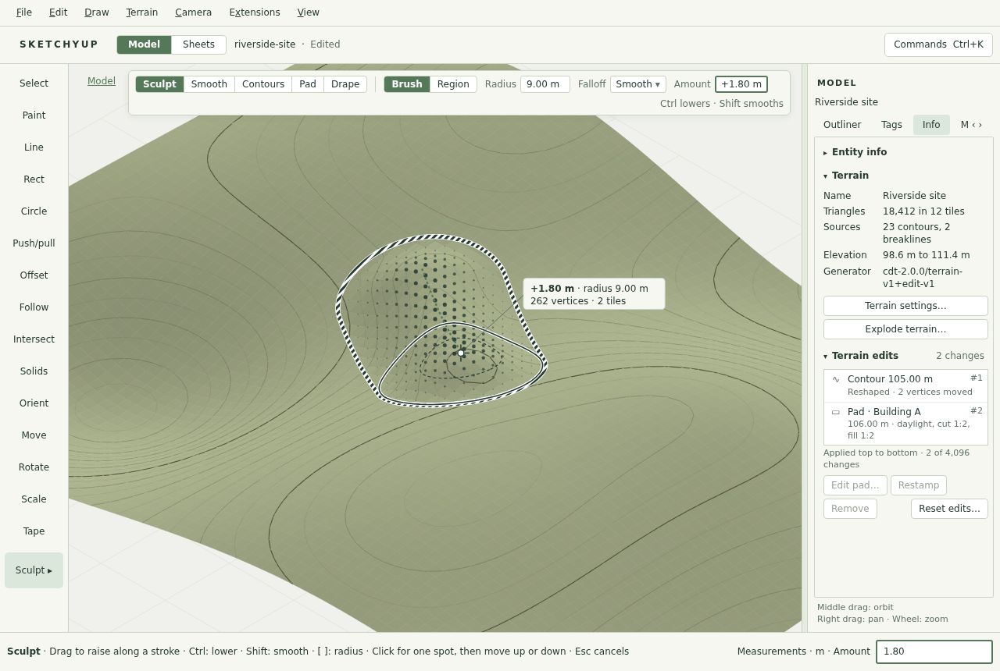 | A stroke in progress: brush rings, moving-vertex dots, hatched preview outline, strip and Amount | 15.2 |
| 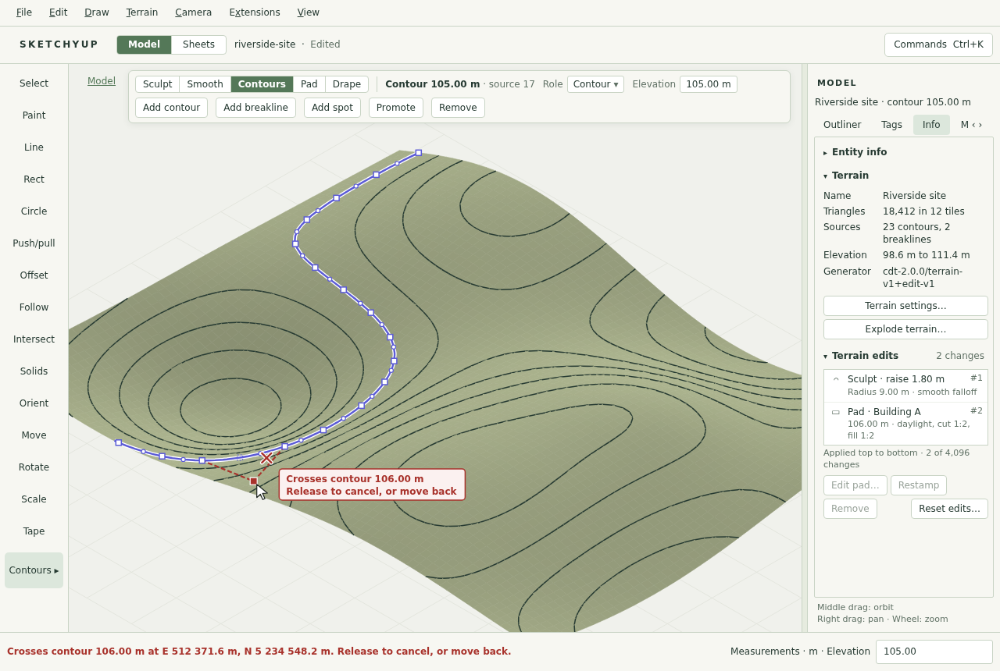 | Source contours, handles, and a drag refused at the pointer | 15.3 |
| 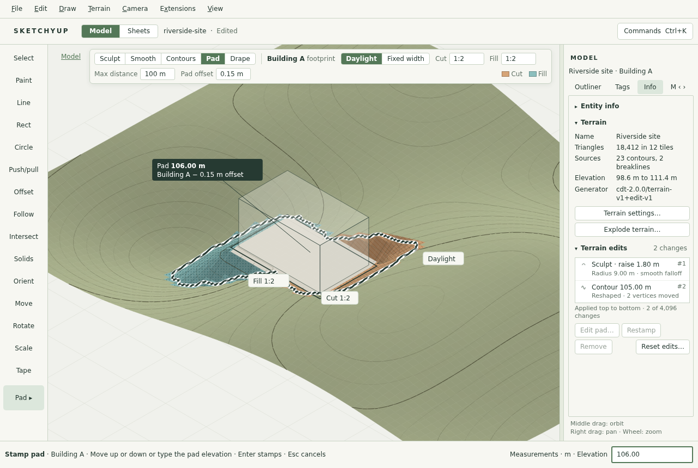 | Pad preview with cut and fill tint and hatch, rays and daylight line | 15.4 |
| 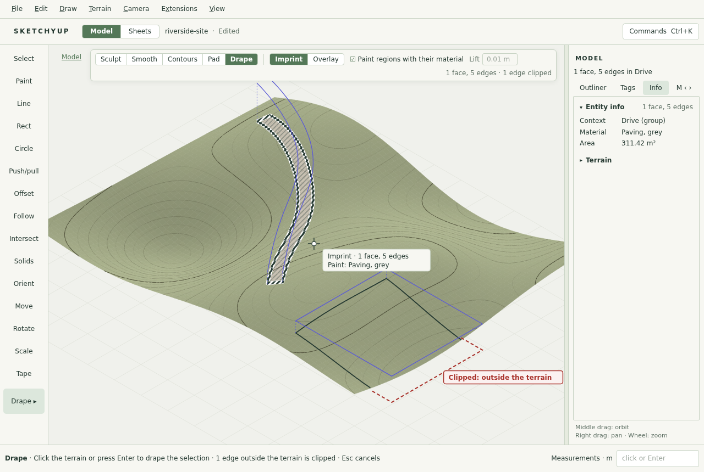 | An imprint preview with region paint and a clipped part | 15.5 |
| 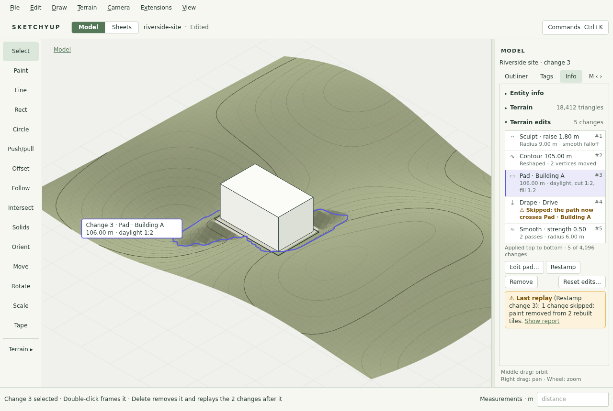 | A selected change highlighted, the row actions, a skipped change and the last replay's notices | 15.6 |
