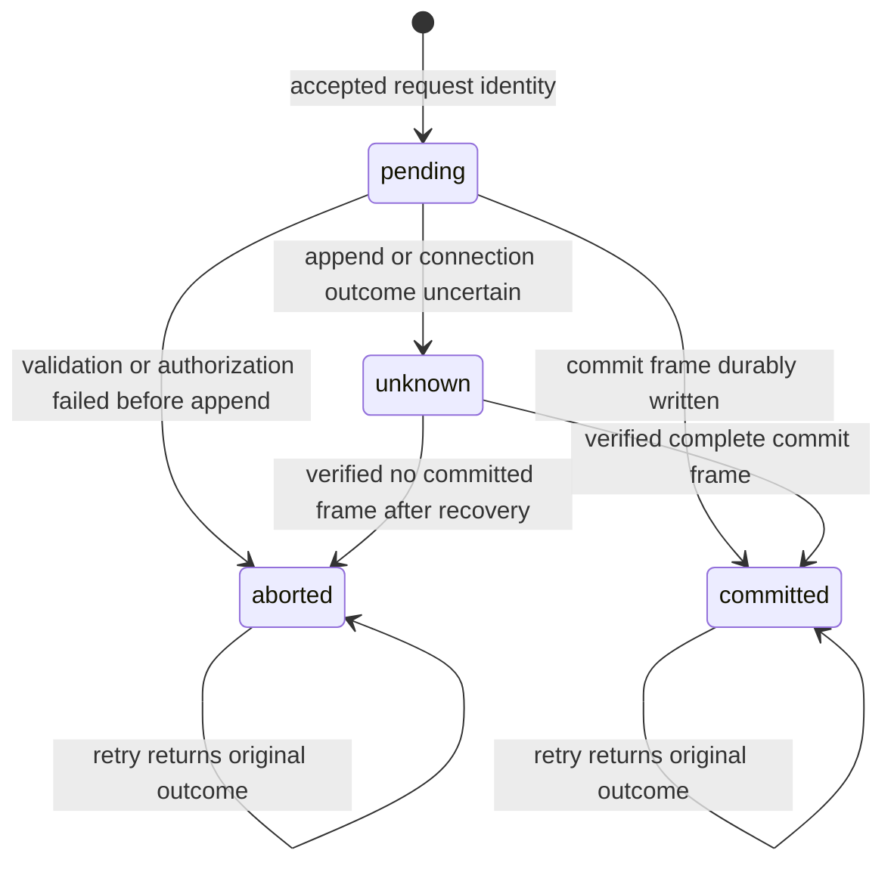

# ADR 0005: document, container and durable command contracts

Date: 2026-10-03. R004.b. Status: selected contract for implementation; the current
R012 implements the bounded single-document container and explicit durable save.
M4 interval recovery is specified in [decision 0015](0015-recovery-storage.md);
per-command durable remote outcomes remain future work.

## Identity and coordinates

A document has a random 128-bit identity. Content revisions are unsigned 64-bit
monotonic integers within a persisted document epoch, serialized as decimal
strings in JSON. Opening a saved checkpoint restores its epoch/revision; recovery
continues from that checkpoint. Fork/Save Copy creates a new document identity;
Save As renames the same document. New document always creates a new identity.
Exhausted counters fail before mutation, never wrap.

Entity references carry document ID, editing context ID, entity kind and stable
ID. Context owns vertex/edge/face IDs; definitions own reusable geometry;
instances reference definitions. Allocator high-water marks survive undo and
save. Undo can restore deleted records with the same identity, but a new unrelated
entity cannot reuse them. Views, selection and camera movement do not increment
content revision. Successful edits, undo, redo and amendments each increment it.

Canonical units are double-precision meters and radians, Z-up, right-handed.
Instance transforms are finite column-major 4×4 affine matrices acting on column
vectors, composed `world = parent × local`. Translation occupies column four.
Mirror transforms are permitted; determinant sign affects winding/normal handling.
Singular transforms are rejected for editable instances. Display units are
metadata and never rescale canonical geometry implicitly.

## Worked identity maps

The wall-ring fixture in R003.b starts with face 9. Its x=3 split produces faces
14 and 15: `face:9 -> [face:14, face:15]`. The edge namespace is distinct:

```json
{"1":[9,10],"2":[2],"3":[3],"4":[11,12],
 "5":[5],"6":[13,16],"7":[14,15],"8":[8]}
```

Four unaffected edges survive. Four divided edges retire and map to eight new
edges. The reverse merge maps those eight children into four fresh merged IDs;
it does not resurrect retired edges as unrelated entities. An undo, in contrast,
restores the exact prior records and IDs while retaining allocator high-water
marks. Selection resolution exposes one-to-many results instead of arbitrarily
choosing the first descendant.

## Encoding experiment and selected container

`persistence_benchmark` compares compact JSON, Qt CBOR conversion, and zlib level-6
compressed JSON on 1/100/1000 original wall-ring solids. Each variant is measured
five times, verified field-for-field, then decoded through the document validator.
Raw results: [R004-codecs.json](../verification/R004-codecs.json).

For 1000 bodies, JSON is 888793 bytes (encode/decode about 43/40 ms); CBOR is 677250
bytes (10/77 ms including Qt's JSON conversion); compressed JSON is 59696 bytes
(72/39 ms including compression/decompression). Full geometry validation adds
roughly 360–600 ms. Peak process RSS across the experiment is about 76 MiB. These
repetitive fixtures favor compression and are not representative texture assets.
The CBOR result measures this adapter, not every possible binary implementation.

Select **uncompressed JSON document chunks in a bounded binary envelope** for M1.
It keeps inspectable records and fast decoding; compression is optional later
only with declared and enforced decoded-size limits. Geometry chunks can move to
a binary encoding after M1 benchmarks justify it, without changing the envelope.
Embedded images/assets use raw content-addressed chunks; no base64 expansion or
filesystem extraction is needed. Renderer buffers never enter the format.

Envelope v2 contract (little endian): 8-byte magic `SKUPDOC\0`; uint32 version 2;
uint32 manifest byte count; UTF-8 JSON manifest; then concatenated chunk payloads.
Chunk offsets are relative to the payload region. Manifest contains document ID,
epoch, revision, writer version, units/up, required feature set, allocator floors,
and chunk descriptors `{kind, encoding, offset, bytes, sha256}`. Integers that
could exceed JSON's exact range are decimal strings. Exactly one `document`
chunk is required. Its initial encoding is `json-v2`; asset chunks use `raw`.
An optional thumbnail is non-authoritative. Chunk SHA-256 covers the exact bytes.

Readers reject overflow, overlapping ranges, duplicate required chunks, bad
hashes, unknown required features, unsupported future envelope/schema versions,
invalid identities and geometry before replacing the current document. Optional
unknown chunks may be preserved verbatim if their size/hash validate. No chunk
name is a filesystem path. Initial limits: 1 MiB manifest, 32 MiB document chunk,
256 MiB total file, 4096 chunks, 64 MiB per asset, 128 MiB aggregate assets. Limits
are checked before allocating or decoding. R033 revisits these with real assets.

The experimental raw JSON v1 and raw schema v2 are recognized explicitly and migrated in memory to
the envelope model. Migrations run on a copy, preserve IDs and original source,
and require an explicit successful save before replacing any file. Forward
migration chains are versioned fixture-tested functions. No downgrade or silent
unknown-required-field dropping. A file requiring persistent edges cannot claim
it is readable by the original spike reader.

R012 supports exactly one document chunk, manifest ≤1 MiB and document ≤32 MiB
(total ≤16 + 1 MiB + 32 MiB). It rejects additional chunks and unknown manifest,
chunk or document fields rather than discarding data. The larger asset budgets
above are reserved for R033. Epoch is fixed at `"1"` until the recovery protocol
introduces epoch rotation. No remote at-most-once or cross-session replay guarantee
is implied by this initial envelope. Schema v2 contains transform/property records;
raw v1 migrates those to identity transforms/empty properties. The allocator floor
manifest repeats body/live-surface high-water marks and must agree with the payload.

R015 advances the document chunk to `json-v3` and requires `topology-v1` alongside
`scene-v2`. Each body persists `nextEdgeId` and edge records `[id, a, b, wire]`.
The manifest adds per-context edge allocator floors. Readers still accept the
original raw v1/v2 and envelope/scene-v2 files; deterministic boundary indexing
adds initial edge IDs on migration. New readers reject inconsistent edge coverage,
duplicate/retired allocators and feature/encoding mismatches. Original readers reject
the new required feature. Context is currently a body ID; component definitions
extend this ownership model in M4. Epoch and durability boundaries remain unchanged.

R024.a advances the chunk to `json-v4` with `curves-v1`. Each body stores curve
kind, center, affine parameter axes, radius, start/sweep angles (radians), segment
count and ordered `[edgeId, reversed]` associations. Curve IDs share the monotonic
vertex/face allocator; all three entity kinds must have disjoint IDs. Existing
surface floors therefore cover curve retirement and undo without a new allocator.
Readers retain v1/v2/v3 migrations and never infer analytic metadata for old
polygons. Required-feature sets are order independent but reject duplicates,
unknown features and mismatched encodings. Curve parameters and edge associations
must agree on load; malformed metadata cannot silently disappear.

## Save and recovery ordering

Explicit Save serializes a validated immutable snapshot, writes a sibling temp
file, flushes and fsyncs it, preserves a verified last-known-good backup, atomically
renames the new target, then fsyncs the parent directory. Only then acknowledge
the snapshot's saved revision; edits made while it was being written remain dirty.
Failure before replacement preserves the prior target. Failure after rename but
before directory sync reports uncertain durability, not a fictional rollback.
Never delete the last-known-good copy before a replacement is durable. Permission,
full-disk, partial-write, disconnect and process-kill fixtures belong to R012.

The M4 implementation specializes the following protocol with journal references
to immutable full native checkpoints; see [decision 0015](0015-recovery-storage.md).

Recovery uses an application data directory keyed by document ID and epoch,
including unnamed documents. It never overwrites the explicit save. A checkpoint
contains authoritative records and allocator floors. Append-only journal frames
contain a sequence, previous-frame hash, document/epoch, base/result revisions,
validated changes, optional request outcome and checksum. Length precedes payload;
maximum frame size is 32 MiB. No replay of arbitrary executable commands.

Recover only a complete, checksummed, contiguous prefix consistent with the
checkpoint. Ignore an incomplete tail while reporting the exact last recovered
revision. Interior corruption stops recovery and preserves the original files
for diagnosis. Compact by writing/fsyncing a new checkpoint and durable pointer
before retiring older frames. Never claim recovery protection beyond the last
verified fsync and revision. A full disk can prevent both Save and recovery.

## Commit reconciliation and idempotency

A document actor serializes commits. Request identity is `(document, epoch,
requestId)` plus a hash of normalized command payload. Same identity/different
payload is an explicit conflict. Validate/stage at expected revision before any
mutation. A commit frame co-records changes and terminal outcome in the same
journal record; fsync before publishing committed state or acknowledging success.
A staged preview is immutable and invalidated by every intervening content edit.



Transport timeout does not change engine outcome. After losing a response, query
by request ID; retry only with the same identity. While durability is unknown,
freeze dependent mutations until journal reconciliation completes. Never say
“Nothing was applied” merely because a provider/client timed out. Recovery replays
the committed frame at most once and restores its result revision and created-ID
map; user undo is a separate new revision, not erasure of the original outcome.

Retain terminal outcomes for at least 30 days. Initial ledger cap: 10000 outcomes
or 64 MiB; prune only expired outcomes after checkpointing. If retained outcomes
fill the cap, reject new remote mutations with a storage-limit error before
execution, rather than silently weakening the guarantee. Expired/unknown request
identities return an explicit reconciliation-required error and are never
silently replayed. Authentication and authorization are checked on every retry.
R041 implements and fault-injects this contract. [R041.b](0023-durable-outcomes.md)
specializes the initial storage as an atomically replaced co-recorded checkpoint,
with the same durability/outcome ordering and explicit size limits. Transaction
dispatch is not enabled in today's CLI.

## Budgets and verification

Initial live-model limits were 10000 bodies and 100000 each of vertices, faces
and wires; R110 (1.7.0) raised the unique values to 300000 (see
[Raised unique geometry limits](#raised-unique-geometry-limits-r110-170)). Retained
undo history is 192 MiB since R110 (owner decision, 2026-11-01; 64 MiB before). Terrain
edits have a separate 512 MiB budget (ADR 0168, D-043). Stage plus validation scratch has a
separate 128 MiB target. One over-budget operation fails before publication.
Estimate shared allocations once, then compare RSS and allocator telemetry on
empty, room, 1000-body, large single-mesh and import fixtures. Track checkpoint,
undo, redo and branch invalidation. Current changed-body copying is an interim
implementation; large topology edits need granular deltas.

Repeat `persistence_benchmark` on each format change, recording build mode,
platform, fixture hash, bytes, encode/decode/validate time and peak RSS. Add random
geometry and texture-heavy fixtures before choosing compression defaults. M1/M4
must test truncated headers/chunks, every journal tail boundary, failed fsync,
rename interruption, post-commit response loss and duplicate retry. Any revised
limit or durability guarantee requires an ADR update and measured rationale.

## Shared admission limits

`core/document_limits.hpp` owns aggregate materialized-record bounds;
`io/native_limits.hpp` owns native file/model/manifest bounds. Readers, writers,
recovery, library loading and capability output share these values. Aggregate
edge admission is independent of per-body topology limits. Legacy raw JSON keeps
an explicit separate model-byte bound. The initial consolidation changes no
numbers, schema or accepted files; [normal/sanitized validation](../verification/R082l-resource-limits.md)
records the unchanged profile. Private sizing experiments do not redefine it.

## Unique geometry and placement limits (R082.gg)

Component placements no longer count against the unique-geometry limits.
`DocumentLimits` now has two classes:

- **Unique geometry** keeps the earlier values: 10,000 bodies, 100,000 each of
  vertices, faces and wires, 300,000 edges, and 10,000 each of curves and guides.
  R110 (1.7.0) superseded these unique values; see
  [Raised unique geometry limits](#raised-unique-geometry-limits-r110-170).
  It counts records outside every placement plus each definition's members once.
  Placement roots and projected members do not count.
- **Placement limits** bound 20,000 materialized component instances (nested ones
  included) and the materialized totals after expanding every placement: 40,000
  bodies, 600,000 each of vertices, faces and wires, 900,000 edges, and 40,000 each
  of curves and guides.

The materialized values come from measured per-placement and per-vertex costs, so
that the worst document they admit models at 2.67 GiB peak RSS even when every
placement draws its own mesh ([R082.w v2](../verification/R082w-memory-budget-v2.md)).
Placement, apply, load/decode and restore enforce both classes. Placement and
apply preflight the materialized totals; apply and restore then check the placement
count before validating bindings and unique geometry after it. Rejections follow
D06: they name the operation, the limit class, the first exceeded quantity, its
attempted and maximum values, and the offending definition, placement or body,
with names truncated to 64 UTF-8-safe bytes and the message capped at 256 bytes.
The native manifest bound rises from 1 MiB to 4 MiB because the manifest records
allocator floors for every materialized body; the container stays below the
128 MiB file bound and no schema changes. Capability output keeps `bodies`,
`vertices` and `guides` as the unique values and adds `placements` and the
materialized totals. [Evidence](../verification/R082gg-placement-limits.md).

## Implementation notes (D-075)

D-075 refines the counting rule above in two places. Where this section and the rule
differ, these notes govern.

- **The component edit draft (part 1).** `editComponentDefinition` runs its nested commands on a
  scratch `Document` whose plain bodies are the edited definition's members. The draft is
  marked as a component draft (`Document::componentDraft`, set by `restore`, copied by
  snapshots). Its unique-geometry check counts its plain bodies and the placements it shows,
  less the records those placements own, and it does not add the stored definition records.
  The stored record of the edited definition is the copy the edit replaces, so counting both
  counted the definition twice. The edited definition's own members still must fit the limits
  alone, so the draft refuses an edit that makes the edited definition exceed the limit by itself.
- **The real document is authoritative.** When the edit publishes, `apply` checks the real
  document: stored records with the new record in place of the old one, and placements
  subtracted. `publish` also sums the stored definitions (`validateComponentDefinitions`) before
  it applies, so an edit whose stored sum alone exceeds the limit is refused there, and its
  message names the definition at which the sum crosses the limit. That can be a definition
  other than the edited one. The check that counts loose geometry is the document-wide one.
- **Orphaned definitions (part 2).** `group.explode` of a placement, and `component.make_unique`,
  remove each definition that the edit leaves with no placement, unless something still refers
  to it: a nested reference in a definition that remains, or a library assembly identity
  (ADR 0165). Removal is in the same edit, so one undo restores the definition with its
  placement. The removal repeats while a removed definition releases another. A component draft
  removes nothing. Definitions left unplaced in any other way are unchanged. Removing them is
  the R111 command set in [Removing unused definitions (R111)](#removing-unused-definitions-r111).
  `component.replace` is unchanged.
- **Reporting.** A batch response lists the definitions its edit removed in `removedDefinitions`,
  beside `createdDefinitions`.
- **Measured.** A 60,000-vertex single-instance definition moves one member: the draft counted
  120,000 before the fix and 60,000 after. The owner's scenario at small scale (two
  single-instance definitions of 50,000 vertices each, 100,000 in all) ran `component.edit`,
  `component.make_unique` and `group.explode` through `sketchyup-cli --script --preview` and then
  committed each one. Before the fix the first refused at 150,000 vertices. Each command reports
  its removal (`removedDefinitions`, the replaced or exploded definition).
- **Contradictions.** None with the counting rule. The bug was that a definition with no
  placement kept counting its members as stored geometry, so the rule's "each definition once"
  counted geometry that no placement uses.

## Raised unique geometry limits (R110, 1.7.0)

The owner approved these limits on 2026-11-01. They supersede the unique values of
[R082.gg](#unique-geometry-and-placement-limits-r082gg), which stay above as history.
The materialized values, the placement limit and every per-body kernel limit are unchanged.

- **Unique geometry:** 10,000 bodies; 300,000 each of vertices, faces and wires; 900,000
  edges; 10,000 each of curves and guides. Before 1.7.0 the vertices, faces and wires were
  100,000 each and the edges 300,000. Each unique value is at or below its materialized value,
  as the `static_assert`s in `core/document_limits.hpp` check.
- **Placement and materialized limits (unchanged):** 20,000 placements; 40,000 bodies; 600,000
  each of vertices, faces and wires; 900,000 edges; 40,000 each of curves and guides.
- **Native bounds:** `NativeLimits::fileBytes` 256 MiB (was 128 MiB); `modelBytes`, the document
  chunk, 96 MiB (was 32 MiB). `containerBytes` follows its formula: 193,126,492 bytes, about
  184 MiB (was 126,017,628). `legacyModelBytes` (32 MiB), `manifestBytes` (4 MiB), the asset
  bounds and the terrain-mesh bound are unchanged. `outcomeStoreBytes` follows as 2 × containerBytes
  + 16 MiB, which is 403,030,200 bytes (was 268,812,472, D-089). Every integer that the capability
  output derives from these values fits in 32 bits.
- **Raw JSON (legacy and import, ADR 0108):** a raw JSON file, one with no container magic, is
  bounded by `NativeLimits::rawJsonBytes`, 128 MiB as before R110, and refused as "Raw document
  exceeds 128 MiB" before it is parsed. The in-process inline form (`encodeDocument` with inline
  asset data) keeps `fileBytes`, 256 MiB, because presentation capture (`presentation_batch.cpp`), the
  text worker and the native round-trip checks in `createNativeFile` and `migrateNativeFile` hold a
  whole document inline. By the bounds (not measured), a valid at-limit document with its assets
  inline is about 208 MiB: a 96 MiB model, 64 MiB of assets as base64 (about 85 MiB) and a terrain
  mesh as base64 (about 27 MiB). A 128 MiB inline bound would refuse those round trips.
- **Compatibility (decision 5):** no schema or document version changes (document version 35,
  container version 2). The encoder did not change, only the bounds it checks, so a model within the
  1.6.1 bounds (a document chunk of at most 32 MiB and a file of at most 128 MiB) is written with
  the bytes 1.6.1 writes, and 1.6.1 reads it. A larger file is refused by 1.6.1 with that version's
  own message. `document_limits_io_tests` checks that the 40,000-body model is within those bounds
  and saves, reloads and re-saves it unchanged.
- **Budgets that do not change (decision 6):** staging 128 MiB, transactions 128 MiB and the
  inspection snapshot 32 MiB. Since D-082 staging and the snapshot charge only the records not shared
  with the base. A staged proposal also holds its edit's whole history charge, so a whole-document
  proposal can exceed 128 MiB (see the implementation notes below). The at-limit acceptance test
  (`unique_limits_acceptance`) checks a snapshot and scripted transactions on a 300,000-vertex model.
- **Undo history (owner decision, 2026-11-01):** `Document::historyLimit` is 192 MiB, three times
  the 1.6.1 value of 64 MiB. The refusal message states that number. The history budget charges
  every record an edit touches, in full, before and after, so it limits the size of one edit, not
  only the retained total. The measurements are in the implementation notes below.
- **Memory evidence:** [R082w v3](../verification/R082w-memory-budget-v3.md) measures the raised
  limits in software. Its modeled worst case, with the retained-history row at the 192 MiB undo
  budget, is 3.03 GiB, which is over the 3 GiB ceiling by 27.4 MiB. With the per-unique-vertex
  excess that the loose unique family shows, it is 3.58 GiB. R110 stops there under its brief, so
  the unique limits are **not accepted** for 1.7.0 until the owner decides how to resolve the ceiling.

## Implementation notes (R110)

- **Acceptance (`unique_limits_acceptance`, local build: Debug with `-g0` and shared libraries,
  not the Release harness):** 150 prisms of 1,000 sides, so 300,000 unique vertices, 450,000 edges
  and 150,300 faces in 150 bodies. Its document chunk is 35.0 MiB, over the old 32 MiB bound, and
  it saves, reopens and re-saves byte for byte. A snapshot is taken, then a transaction (begin,
  apply, preview, commit) moves one body and saves, and undo restores the body. The R110 checks
  below follow. Peak RSS was 1,529 MiB, and the whole test took 223 s (77 s before R110; the R110
  checks take 168 s of it). It sits in the `slow-core` group of `.github/ci-path-map.json`.
- **History budget (owner decision, 2026-11-01: 192 MiB).** The refusal reads "Edit exceeds the
  192 MiB history budget". The charge of an edit is its records before and after, in full, for
  every record it touches. Measured in the test:
  - one edit that moves all 150 loose bodies (300,000 vertices): charged 174.5 MiB, accepted, and
    undone exactly;
  - one member of a component of two closed 100,000-face spheres (200,000 faces, 100,004 vertices):
    charged 183.1 MiB, accepted, and undo and redo are exact;
  - the same edit with three spheres (300,000 faces, 150,006 vertices, the unique limit): refused
    with the message above. Each sphere is the same size, so the charge is linear, and three would
    charge about 275 MiB (1.5 times the two-sphere figure; not measured, since the edit is refused).
  **So a component definition at the 300,000-face limit cannot be edited in one undoable step at
  192 MiB.** This is open: the owner decides whether the budget rises (about 275 MiB or more for
  that edit) or component definitions are limited below the unique limit.
- **Whole-document transactions (finding; staging not changed).** A transaction accepts at most 100
  cumulative commands, so the transaction check moves 100 bodies of 1,500 sides (the same 300,000
  vertices). The 128 MiB staging budget refuses that proposal: it stages 261.4 MiB, which is the
  edit's history charge (174.5 MiB) plus the records it adds (86.9 MiB). A proposal of 20 bodies
  stages 52.3 MiB, is charged 34.9 MiB of history, and commits and undoes. A whole-document
  transaction at the limit therefore needs a larger staging budget, or it is refused. Staging was
  not changed, as the brief directs.
- **Measured memory (R082w v3, software, Release, one CPU and 4 GiB; the full record is in
  [R082w v3](../verification/R082w-memory-budget-v3.md)):** the loose unique family at 300,000
  vertices peaks at 1.92 GB; an 89 MiB container loads in 1.5 s from a fresh process and peaks at
  1.39 GB; the densest shape (three closed 100,000-face spheres) peaks at 974 MiB; and a
  whole-document edit of 5,700 bodies, 191.0 MiB charged, stays in history at 297 MiB resident.
  Moving all 5,769 bodies in one edit is refused by the budget. The worst case is over 3 GiB, as the
  memory-evidence bullet says.
- **Terrain explode:** the budget that Explode terrain checks is the unique face limit, so a terrain
  can now explode into a document of up to 300,000 faces (it was 100,000). The boundary is exact: a
  249,218-triangle terrain with 50,782 loose modelling faces explodes, and one more face is refused
  with the numbers. The per-call overlay cap of 100,000 faces stays. It is the per-body limit, since
  an overlay is one body.
- **Copy array:** the aggregate check now uses the unique limits. Its edge count was the per-body
  edge limit (300,000) and is now the unique edge limit (900,000). Its other counts had the same
  values before and after.
- **Unchanged per-body kernel limits:** `Surface::validate` (100,000 vertices or faces per body,
  `loop` at most 10,000 vertices), `Topology::edgeLimit` (300,000 edges per body) and the terrain
  and glTF, OBJ, STL, DXF and STEP import bounds keep their values. They are not document limits.

## Removing unused definitions (R111)

A scripted model that places a part several times leaves a definition with no placement after
each replaced attempt. D-075 removes only the definitions that an explode or a make-unique
leaves unplaced. R111 adds two scripting commands that remove the rest. Neither is in the
desktop interface, and the desktop assistant does not run them.

- **`component.delete_definition` `{definition}`** removes exactly the named definition when
  nothing uses it. Nothing uses it when no placement names it (top-level or nested), no other
  definition's nested reference names it, and it has no library assembly identity. That is the
  rule `unreferencedDefinitions` applies. Otherwise the command refuses, changes nothing, and
  names the blocker: `DEFINITION_PLACED` (the placement count and up to five placement IDs),
  `DEFINITION_NESTED` (up to five definitions that nest it) or `DEFINITION_ASSEMBLY` (the
  identity). It does not cascade. Its result lists as `nowUnused` the definitions that the
  removal released and that nothing else refers to; they are kept. One undo restores the
  definition with its ID and content.
- **`document.purge_unused` `{definitions?, materials?, assets?, dryRun?}`** removes, in one
  edit, every unused definition, then every material that nothing names, then every asset that
  nothing names. Each category defaults to on, and `dryRun` defaults to off. The definition
  step applies the rule above to every definition. The material step uses the reference set of
  `validateMaterialAssignments`, which `material.delete` enforces on commit: a body's two sides,
  its face overrides and its terrain paint (`addMaterialReferences`). The asset step keeps an
  asset that a remaining material names, and also one that a reference image or an edge stroke
  texture names, since validation refuses to drop those. Each step reads what the earlier one
  left, so removing a definition can free a material, and removing a material can free an asset.
  With `dryRun` the result is the same and the document does not change. With nothing to remove
  the command succeeds with empty lists and records no history item.
- **Results.** Each removed record is reported by ID and name. Names are model data, so they are
  bounded like limit messages (64 bytes, control characters replaced). The purge reports
  `uniqueVerticesFreed`, the unique vertices that the removed definitions' members stored.
- **Rule kept.** Ordinary edits still do not drop definitions. Only D-075's explode and
  make-unique removals, and these two commands, drop one. A component draft refuses both new
  commands, because they change the document, not one definition.
- **Contradictions.** None. The Clean files button in the Materials panel keeps its own rule (an
  asset no material uses). It is unchanged, and it does not keep an asset that a reference image
  or an edge stroke names.

## Implementation notes (D-083)

D-083 changes what erasing a context does to its descendants. Where this section and the rules above differ, these notes govern.

- **Cause.** `Document::erase` removed the one record it was given. A group's children kept naming it as their parent, and the edit's validation, which resolves every body's parent chain, failed with "Missing parent entity". The command failed and published nothing.
- **Rule.** Erasing a context erases its descendant bodies, and the placements they own, in one undoable edit. That is the set `eraseSelected` removes for a selected context. A nested group deletes only its own subtree; its ancestors and siblings stay. An ID that is not a body is still refused.
- **Contract.** `geometry.delete` keeps its documented contract, "Delete context". A group is a context, so the command now does what that contract says. The generated tool reference does not change, and `scripts/generate-tool-reference.py --check` passes.
- **Tests.** `command_tests`, `deleteGroupCommand`: the subtree is removed, a sibling stays, the result equals `geometry.erase_selection` on the same model, one undo restores the subtree and its parent links, and a nested group removes only its own subtree.
- **Contradictions.** None.
